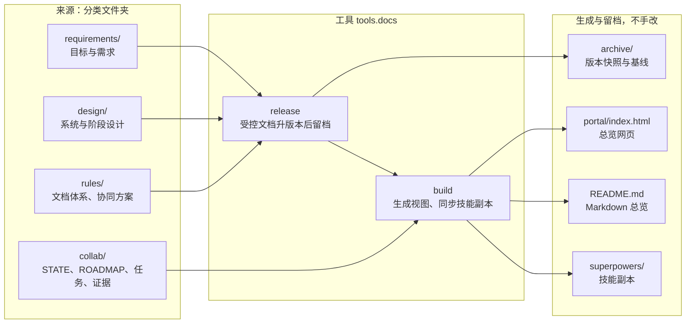
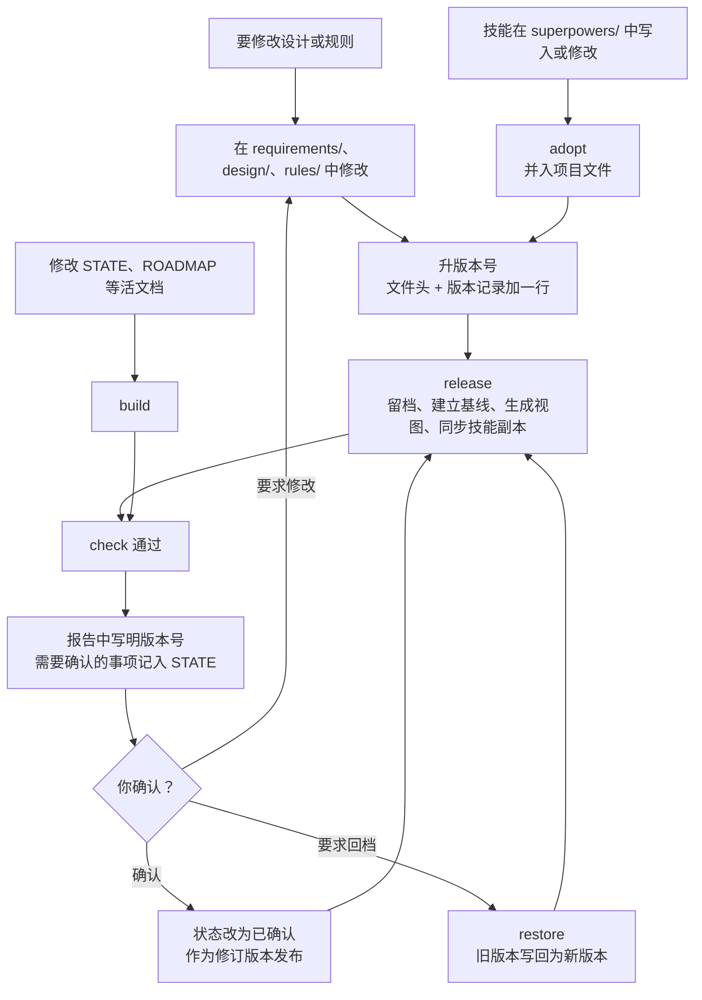

# 文档记录体系与版本规则

用户 2026-10-18 的要求：
- 用一个网页总览项目的系统设计、数据处理流程、开发进展与待确认事项；
- 每次修改设计都附版本号并留档，便于查看历史与回档；
- 网页与 Markdown 同步更新；
- 用文件夹分类管理文档；
- `docs/superpowers/` 属于 superpowers 技能，项目文档放在分类文件夹中。技能修改的内容要同步到项目文件夹，方便查阅。

本文件就是这套规则。它补充 `AGENTS.md` 与[协同开发方案](COLLABORATION_PLAN_CN.md)，不替代它们。

## 1. 原则

<!-- portal:block rules-summary -->
1. **按类别分文件夹**：需求、设计、规则、协同记录、使用说明、交接、归档各有一个文件夹，见 §2。
2. **单一来源**：
   - 每类信息只在一个文件里维护；
   - 网页与 Markdown 总览由工具从这些文件生成，不手改；
   - `docs/superpowers/` 中的技能副本由工具从项目文件同步。
3. **设计与进展分开**：
   - 受控文档只写“做什么、怎么做”，例如目标、设计、规则；
   - 进展只写在 ROADMAP 与 STATE 里，例如任务状态、关卡结果、轮到谁。
4. **每次修改都有版本**：受控文档的任何修改，包括错别字，都要升版本号、写一行版本记录，并用工具留档。
5. **归档只增不改**：每个版本存一份原样快照，并登记哈希，之后不修改也不删除。
6. **历史只向前**：回档也生成一个新版本，内容取自旧版本，不删除、不改写历史，与 Git 安全规则一致。
7. **交接前检查**：工具检查网页是否同步、版本是否留档、归档是否完好、技能副本是否一致。检查不通过就不交接。
8. **隐私**：文档与网页只含汇总数字，不放图像、人名与企业名。网页发布到任何外部服务前，都要逐次征得用户同意。
<!-- /portal:block -->

## 2. 文件夹与架构

<!-- portal:table folders -->
| 文件夹 | 放什么 | 类别 | 版本方式 | 维护者 |
| --- | --- | --- | --- | --- |
| 仓库根目录 | `AGENTS.md`、`CLAUDE.md`：两个 agent 的仓库规则；`README.md`、`README_CN.md`：项目说明 | 规则、用户文档 | Git 记录 | Claude 起草，用户确认 |
| `docs/` | `README.md`：项目总览的 Markdown 版，在 GitHub 上打开 docs 文件夹时自动显示；其余文档都在下面的分类文件夹中 | 视图 | 工具生成，不手改 | 工具 |
| `docs/portal/` | `index.html`：项目总览网页 | 视图 | 工具生成，不手改；建立基线时留档 | 工具 |
| `docs/requirements/` | 项目目标与需求基线 | 基线 | 受控：版本号、版本记录、归档 | Claude 起草，用户确认 |
| `docs/design/` | 系统总体设计、阶段 3 设计、验证集设计、D1/D2 设计 | 基线 | 受控 | Claude 起草，用户确认 |
| `docs/design/history/` | 旧设计与实施计划：2026-07、2026-08 的设计，以及被取代的 2026-10-15 多摄像机设计 | 历史 | 不再修改 | — |
| `docs/rules/` | 文档记录体系、协同开发方案（受控）；跨 agent 协作流程 | 规则 | 前两份受控，其余由 Git 记录 | Claude 起草，用户确认 |
| `docs/collab/` | STATE、ROADMAP、HISTORY、QUICKSTART、PR 正文；`tasks/` 任务契约与报告；`evidence/` 证据；`analysis/` 分析 | 现状与记录 | 活文档：Git 记录，基线快照留档 | Claude 与 Codex 按字段 |
| `docs/usage/` | Gazelle 使用说明，英文与中文 | 用户文档 | Git 记录；与两份 README 共四份同步 | Codex 实施，Claude 审查 |
| `docs/handoff/` | 换机迁移与交接说明 | 交接 | Git 记录 | Claude |
| `docs/archive/` | 受控文档的历史版本、基线快照、归档索引 | 归档 | 只增不改，哈希登记 | 工具 |
| `docs/superpowers/` | superpowers 技能的工作区：`specs/`、`plans/` 中是项目文件的技能副本 | 技能工作区 | 由工具从项目文件同步；技能写入的内容要并入项目文件（§4） | 工具与技能 |

<!-- portal:mermaid docs-architecture -->


- **受控文档**：`requirements/`、`design/`、`rules/` 中登记在 §3 的文档。Claude 修改，用户确认，工具留档。
- **活文档**：`collab/` 中的 STATE、ROADMAP、HISTORY、任务文件与证据，记录进展，由 Git 记录。
- **视图**：`docs/README.md` 与 `docs/portal/index.html`，由工具从来源生成。
- **归档**：`docs/archive/`，只增不改。

## 3. 受控文档清单

<!-- portal:table registry -->
| ID | 名称 | 路径 | 类别 | 确认方式 |
| --- | --- | --- | --- | --- |
| GOALS | 项目目标与需求基线 | `docs/requirements/PROJECT_GOALS_CN.md` | 基线 | 用户确认 |
| SYSTEM | 系统总体设计 | `docs/design/SYSTEM_OVERVIEW_CN.md` | 基线 | 用户确认 |
| STAGE3 | 阶段 3 视线与注意力位置估计设计 | `docs/design/STAGE3_GAZE_ATTENTION_CN.md` | 基线 | 用户确认 |
| VALSET | 作业数据验证集设计 | `docs/design/VALIDATION_SET_DESIGN.md` | 基线 | 用户确认 |
| PERCEPTION | 人脸与姿态关联、新轨迹确认设计（D1、D2） | `docs/design/PERCEPTION_D1_D2_DESIGN.md` | 基线 | 方向由用户确认，细节可由协调者确认 |
| COLLAB | Claude × Codex 协同开发方案 | `docs/rules/COLLABORATION_PLAN_CN.md` | 规则 | 用户确认 |
| DOCS | 文档记录体系与版本规则 | `docs/rules/DOCS_SYSTEM_CN.md` | 规则 | 用户确认 |

- 新增受控文档时，放进对应的分类文件夹，在本表加一行，并升本文件的版本。
- `docs/design/history/` 中的历史设计不在本表中，作为历史资料保留，不再修改。

## 4. 技能副本（superpowers）

superpowers 技能（例如 brainstorming、writing-plans）按自己的约定把规格写到 `docs/superpowers/specs/`、把计划写到 `docs/superpowers/plans/`。这个文件夹属于技能，项目文档的权威版本在分类文件夹中。

- **对照表**：下表登记每个技能副本对应的项目文件。
- **同步方向**：
  - 项目文件是权威版本；
  - 技能副本是它的副本，相对链接按副本所在位置换算。
- **自动同步**：
  - `build` 与 `release` 会生成缺失的副本，并更新与已发布旧版本相同的副本；
  - 技能改过的副本不会被覆盖，`check` 会报告“需合并”。
- **技能改了副本**：
  1. 运行 `adopt` 把副本并入项目文件；
  2. 受控文档按 §5 升版本并 `release`。
  项目文件若有尚未发布的修改，`adopt` 会拒绝。这时先发布，或把技能的修改手工合并进项目文件，再用 `adopt --merged` 登记这份副本为已处理。
- **技能写了新文件**：
  1. 在对应的分类文件夹建立项目文件，例如设计放 `docs/design/`；
  2. 在下表登记；
  3. 需要版本管理的，同时登记到 §3。
  `check` 会报告技能目录中未登记的文件。
- **说明文件**：`docs/superpowers/README_CN.md` 说明这个文件夹的用途，不需要对照。

<!-- portal:table mirrors -->
| 项目文件 | 技能副本 | 说明 |
| --- | --- | --- |
| `docs/design/SYSTEM_OVERVIEW_CN.md` | `docs/superpowers/specs/2026-10-18-system-overview-design.md` | 受控文档 SYSTEM |
| `docs/design/STAGE3_GAZE_ATTENTION_CN.md` | `docs/superpowers/specs/2026-10-18-gaze-attention-system-design.md` | 受控文档 STAGE3 |
| `docs/design/VALIDATION_SET_DESIGN.md` | `docs/superpowers/specs/2026-10-15-workdata-validation-set-design.md` | 受控文档 VALSET |
| `docs/design/PERCEPTION_D1_D2_DESIGN.md` | `docs/superpowers/specs/2026-10-15-face-pose-association-and-track-confirmation-design.md` | 受控文档 PERCEPTION |
| `docs/design/history/2026-10-15-multicamera-attention-design.md` | `docs/superpowers/specs/2026-10-15-multicamera-attention-design.md` | 历史设计，已被阶段 3 设计取代 |
| `docs/design/history/2026-07-21-mediapipe-head-perception-design.md` | `docs/superpowers/specs/2026-07-21-mediapipe-head-perception-design.md` | 历史设计 |
| `docs/design/history/2026-07-23-project-usage-guide-design.md` | `docs/superpowers/specs/2026-07-23-project-usage-guide-design.md` | 历史设计 |
| `docs/design/history/2026-07-29-dual-head-pose-reference-rays-design.md` | `docs/superpowers/specs/2026-07-29-dual-head-pose-reference-rays-design.md` | 历史设计 |
| `docs/design/history/2026-07-30-video-codec-selection-design.md` | `docs/superpowers/specs/2026-07-30-video-codec-selection-design.md` | 历史设计 |
| `docs/design/history/2026-08-03-configurable-gazelle-diagnostics-design.md` | `docs/superpowers/specs/2026-08-03-configurable-gazelle-diagnostics-design.md` | 历史设计 |
| `docs/design/history/2026-07-21-mediapipe-head-perception-implementation-plan.md` | `docs/superpowers/plans/2026-07-21-mediapipe-head-perception-implementation-plan.md` | 历史实施计划 |
| `docs/design/history/2026-07-23-project-usage-guide-implementation-plan.md` | `docs/superpowers/plans/2026-07-23-project-usage-guide-implementation-plan.md` | 历史实施计划 |
| `docs/design/history/2026-07-29-dual-head-pose-reference-rays-implementation-plan.md` | `docs/superpowers/plans/2026-07-29-dual-head-pose-reference-rays-implementation-plan.md` | 历史实施计划 |
| `docs/design/history/2026-07-30-video-codec-selection-implementation-plan.md` | `docs/superpowers/plans/2026-07-30-video-codec-selection-implementation-plan.md` | 历史实施计划 |
| `docs/design/history/2026-08-03-configurable-gazelle-diagnostics-implementation-plan.md` | `docs/superpowers/plans/2026-08-03-configurable-gazelle-diagnostics-implementation-plan.md` | 历史实施计划 |

## 5. 版本号与状态

### 5.1 版本号：`主版本.次版本.修订号`

| 部分 | 何时增加 | 是否需要用户确认 | 例子 |
| --- | --- | --- | --- |
| 主版本 | 方向、架构、需求、评估协议发生变化，或使以前的确认失效 | 需要 | 阶段 3 由区域分类改为视线与热力图：1.x → 2.0.0 |
| 次版本 | 在已确认的方向内有实质增改：新章节、参数、任务划分、规则条款 | 改变“要做什么”或“怎样评估”时需要；纯说明性补充可由协调者确认，并告知用户 | 增加一个关卡：2.0.1 → 2.1.0 |
| 修订号 | 只改措辞、错别字、链接、格式、文件位置，或补入版本信息，含义不变 | 不需要，沿用上一版本的状态 | 文件移入分类文件夹、链接随之更新：2.0.1 → 2.0.2 |

- 一次交接中对同一文件的连续修改，合并成一个版本发布。
- 版本号只增不减；回档也用新的、更大的版本号（§8）。

### 5.2 版本状态

| 状态 | 含义 |
| --- | --- |
| 草案 | 还在起草，供讨论，不作为执行依据 |
| 待确认 | 已提交给用户，等待确认；Codex 不据此开发，规则类文档除外（见 `confirm_ref`） |
| 已确认 | 用户已确认；`confirm_ref` 写明依据，例如“用户 2026-10-15”或问题编号 |
| 已确认（协调者） | 在用户已确认的方向内，由 Claude 按分级自主确认的细化；用户可以随时推翻 |
| 已取代 | 被更新的版本或文件取代，只作历史 |

### 5.3 文件头

每份受控文档以如下文件头开始。GitHub 会把它显示为表格。

```yaml
---
doc_id: STAGE3
title: 阶段 3 视线与注意力位置估计设计
version: 2.0.2
status: 待确认
updated: 2026-10-18
owner: Claude
confirm_ref: Q-018
---
```

### 5.4 版本记录

每份受控文档末尾有“版本记录”一节，以 `<!-- portal:versions -->` 标记，最新版本在最上面：

| 版本 | 日期 | 状态 | 变更摘要 | 确认 | 归档 |
| --- | --- | --- | --- | --- | --- |
| 2.0.2 | 2026-10-18 | 待确认 | 文件移入 `docs/design/`，链接随之更新；内容不变 | Q-018 | 由工具填写 |

- 最上面一行必须与文件头的版本、日期、状态一致。
- 发布新版本时，较早各行的状态改为“已取代”。
- “归档”一栏由发布命令自动填写为指向快照的链接。
- 用户确认后，Claude 把状态改为“已确认”，作为一个修订版本发布。

## 6. 归档

- **文档快照**：`docs/archive/<ID>/<ID>_v<版本>.md`，与发布时的文件逐字相同。
  - 快照中的相对链接按发布时的位置书写；文件移动后，旧快照里的链接可能失效，但内容不受影响。
- **索引**：`docs/archive/ARCHIVE_INDEX.json` 登记每个快照的版本、日期、状态、来源与 SHA-256（按 LF 换行计算）。
  - 它也登记工具写入过的技能副本内容与 `adopt` 并入过的内容，用来区分工具自己的写入与技能的修改。
- **来源**：
  - 正常发布的来源是当时的工作区；
  - 体系建立前的旧版本取自 Git 提交，来源写成 `git:<提交>`；
  - 个别从现有文件去掉后续增补得到的版本，来源写成 `reconstructed`，并在摘要中说明。
- **不可变**：快照、索引中已有的条目、基线目录都不修改、不删除。若发现快照有误，只能发布新版本并在摘要中说明。
- **检查**：`check` 核对快照是否存在、哈希是否一致，并确认每份受控文档与其当前版本的快照逐字相同。不一致说明有修改未发布。

## 7. 基线

- **定义**：基线是某一时刻全部受控文档版本的组合，加上当时生成的网页与 Markdown 总览。编号为 B001、B002……
- **何时建立**：
  - 每次发布受控文档的新版本时，自动建立；
  - 每轮结束交接时，由交接方建立一个快照，留下当时的进展。
- **内容**：`docs/archive/baselines/B<编号>/` 下有：
  - `baseline.json`：各文档版本、来源文件哈希、说明；
  - `index.html`：当时的网页；
  - `README.md`：当时的 Markdown 总览。B001 中这个文件名为 `PROJECT_OVERVIEW_CN.md`。
- **查看**：直接打开基线目录中的 `index.html`，就能看到当时的完整总览。网页的“文档与版本”一节列出全部基线。

## 8. 回档（恢复旧版本）

- **单份文档**：
  1. 用 `restore` 把旧版本的正文写回当前文件，同时保留现有版本记录，并加一行新版本“回档到 vX”；
  2. 检查后用 `release` 发布。
- **整个基线**：对基线中版本与当前不同的每份文档，按上一条处理，然后一起发布，摘要写“回档到 B00k”。
- 活文档（STATE、ROADMAP）记录的是事实进展，不随回档恢复。回档本身记入 ROADMAP 的决策表。
- 用户只需说“回档到某文档的 vX”或“回档到 B00k”，由 Claude 执行。

## 9. 生成的视图

- **文件**：
  - `docs/portal/index.html`：项目总览网页，可直接用浏览器打开；
  - `docs/README.md`：内容相同的 Markdown 总览，在 GitHub 上打开 `docs/` 文件夹时自动显示。
- **来源**：
  - 受控文档的文件头与版本记录；
  - 文档中以 `<!-- portal:… -->` 标记的表格、图与段落；
  - STATE、ROADMAP 中标记的表格；
  - 归档索引；
  - 技能副本的同步状态。
  标记的名称由工具检查，缺失时 `check` 报错。
- **构建与检查**：
  - 修改任何来源后运行 `build`；
  - 交接前运行 `check`，必须通过。
- **外部依赖**：网页的流程图在打开时从 jsDelivr 加载 Mermaid，字体来自 Google Fonts。离线打开时显示流程图源码，其余内容不受影响。
- **外部发布**：生成的网页可以发布为 Claude 中的私有网页，前提是用户同意（协同开发方案 §7）。

## 10. 活文档的约定

- **STATE.md**：
  - 只保留控制块、当前暂停或说明、最近一轮的审查结论与交接记录、本轮与下一轮的任务、给各方的说明、待决问题与注意事项；
  - 结束的轮次与已完成事项移到 `HISTORY.md`，逐字移动。
- **ROADMAP.md**：
  - 阶段、任务、目标进展、关卡状态与决策都在这里；
  - 状态只在这里更新，受控文档不写进展。
- **状态词**：

  | 表 | 状态列可用的值 |
  | --- | --- |
  | 决策表（ROADMAP） | 已批准、待你决定、待决、暂停、已取代 |
  | 待决问题（STATE） | 待用户、待 Claude、待 Codex、已解决 |
  | 关卡（ROADMAP） | 未开始、进行中、通过、未通过 |
  | 任务（ROADMAP） | 沿用图例：ready、blocked、proposed、needs-decision、accepted、changes-requested、done，可以加括号说明 |

- **任务文件、证据、分析**：按现有规则维护，不加版本号。证据文件按日期新建，不改写旧证据。

## 11. 工作流程

<!-- portal:mermaid docs-workflow -->


**Claude 修改设计或规则时：**
1. 修改受控文档。
2. 按 §5.1 定版本号，更新文件头，并在版本记录最上面加一行。
3. 运行 `release`：留档，重建视图，同步技能副本，建立基线。
4. 运行 `check`。
5. 在给用户的报告中写明文档、新版本号与要点。
6. 需要确认的事项记入 STATE 的待决问题。

**Codex 每轮：**
1. 修改 STATE 或其他来源后，运行 `build`。
2. 交接前运行 `check`，并运行 `snapshot` 建立本轮结束的基线。
3. 提交 `docs/archive/**`、`docs/portal/index.html`、`docs/README.md`、`docs/superpowers/**` 与相关来源。

**用户：**
- 打开 `docs/portal/index.html` 查看总览；
- 在聊天中确认版本，或要求回档。

## 12. 命令

在仓库根目录、`Gazelle-next` 环境中运行：

```powershell
python -m tools.docs build                    # 同步技能副本，重建网页与 Markdown 总览
python -m tools.docs check                    # 检查同步、版本记录、归档与技能副本；不通过时退出码为 1
python -m tools.docs release --doc STAGE3 --note "说明"
python -m tools.docs restore --doc STAGE3 --from 2.0.0 --to 2.1.0 --status 待确认 --summary "回档到 2.0.0"
python -m tools.docs adopt --mirror docs/superpowers/specs/2026-10-18-gaze-attention-system-design.md
python -m tools.docs adopt --mirror docs/superpowers/specs/2026-10-18-gaze-attention-system-design.md --merged
python -m tools.docs snapshot --note "第 5 轮结束"
```

- `release` 可以一次给多个 `--doc`，只建立一个基线。
- 命令只读写 `docs/`，不联网、不调用模型。
- 依赖：`Gazelle-next` 中已有的 PyYAML 与 markdown-it-py。
- 输出含中文，Windows 控制台中可以先设 `PYTHONIOENCODING=utf-8`。

## 版本记录

<!-- portal:versions -->
| 版本 | 日期 | 状态 | 变更摘要 | 确认 | 归档 |
| --- | --- | --- | --- | --- | --- |
| 1.1.0 | 2026-10-18 | 待确认 | 按类别分文件夹（requirements、design、rules、collab、usage、handoff）；superpowers 改为技能工作区，技能副本自动同步，技能修改用 adopt 并入；文档管理架构图与流程图；Markdown 总览改为 `docs/README.md`；新增 adopt 命令 | Q-019（先行生效） | [v1.1.0](../archive/DOCS/DOCS_v1.1.0.md) |
| 1.0.0 | 2026-10-18 | 已取代 | 首版：原则、分层、受控文档清单、版本号与状态、归档、基线、回档、生成视图、活文档约定、工作流程、命令 | Q-019（先行生效） | [v1.0.0](../archive/DOCS/DOCS_v1.0.0.md) |
