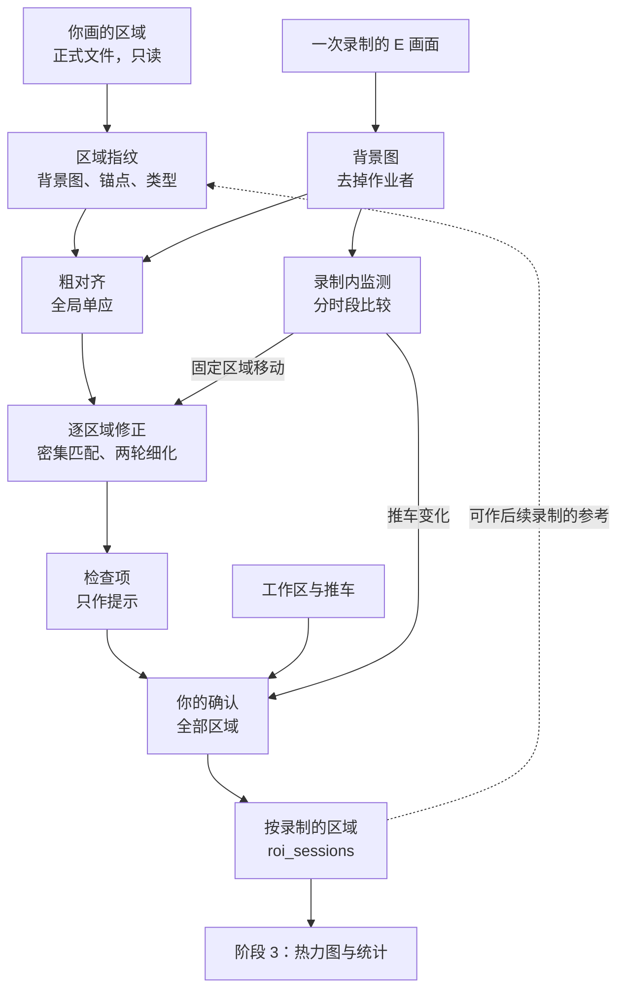

# 工作区域自动重配准设计

你 2026-10-30 的要求：摄像头虽然都固定在工作台上，但依旧存在震动、工作台移动等情况，“导致摄像头会存在逐渐偏移的情况”。希望“在制作工作区域标记的时候，通过记录我们标记后的工作区域的特征，就能够使用区域识别，边缘识别，特征匹配等处理，能够自动地重新对工作区域进行重新匹配和调整”，并请协调者仔细调查，必要时设计完善的子功能方案。

本文是这个方案，由协调者提出，你 2026-10-30 确认（Q-028）。实测在[偏移与重配准的实测](../collab/evidence/2026-10-30-region-drift-analysis.md)，下文的数字都来自那里。它细化 D27（区域按录制配准，由你复核），对应系统总体设计的 C25。

## 0. 结论

- **需要这个子功能。** 不配准时，`20261030` 的区域与配准后位置的交并比只有 0.42 至 0.60。
- **你的思路可行，有三处按实测调整：**

| 之前的假设 | 实测 | 调整 |
| --- | --- | --- |
| 偏移是逐渐发生的 | E 上的固定区域在录制内基本不动，单个顶点最大 0.84 像素；变化发生在录制之间，而且有增有减。只有 B 在录制内有两次明显运动 | 每次录制配准一次，再加分段监测，不逐帧跟踪 |
| 一个全局配准就够（D27 之后的原计划） | 不同位置移动不同，单一全局单应最多差 18.9 像素，换一种特征算法结果也会变 | 每个区域用自己的锚点单独修正 |
| 所有区域都靠记录的特征找回 | 料箱推车的外观、堆高与位置都在变，通常匹配不上 | 固定结构自动配准；推车由你确认 |

- **一致性**（不是精度，目前没有人工真值）：27 次配准的区域主体都对得上，边缘扫描峰值都在 ±1 像素以内；同一录制前后两半最多差 2.22 像素；跨录制闭环最差 7.11 像素。约 70% 的顶点靠外推得到，个别顶点可能差几像素到十几像素，要靠复核确认。
- **代价**：只用 CPU，不下载模型，每次录制约 1 至 2 分钟。
- **你的工作量**：所有区域都由你确认，估计每次录制约 5 分钟，10 次约 50 分钟，另有一次约 15 分钟的盲测（§10.3）。
- **确认**：你 2026-10-30 确认，七项全部按推荐执行（§15，Q-028）。

## 1. 依据

| 事实 | 数字 | 对设计的影响 |
| --- | --- | --- |
| E 的固定区域在录制内基本不动 | 150 次比较：中位数 0.07，单个顶点最大 0.84 像素 | 一次录制一组区域；监测只为发现例外 |
| 录制之间移动不小 | 固定区域由不到 3 像素，到 7–37 像素，`20261030` 为 94–166 像素 | 配准要能处理大位移和约 8° 的旋转 |
| 不符合单一平面变换 | 一个单应只解释 31%–53% 的位移向量；原因未定，部件移动、视差或两者都有 | 全局变换只作基础，每个区域再修正 |
| 区域模型的比较 | 只用相似时 `20261030` 闭环最差约 35 像素；只用仿射在现有录制上最一致，但表达不了强透视；它与混合模型的多边形最多差 3.93 像素 | 采用“粗对齐单应 + 区域仿射修正”，防备比现有录制更强的透视。这是协调者的判断，盲测时两种都比较 |
| 沿多边形边线比较边缘，结果不稳定 | 135 条可判断的边线中只有 55 条在 ±2 像素以内 | 不把多边形吸附到边缘 |
| 区域内部的边缘是可用的旁证 | 边缘扫描峰值都在 ±1 像素以内 | 作为检查项；它与锚点有重合，不算完全独立 |
| 外观相关受光照与遮挡影响 | 位移不到 0.2 像素时可降到 0.52 | 不用它判断位移 |
| 推车通常无法靠外观找回 | SIFT 整图搜索 5–7 个内点，结果无效 | 由你确认 |
| 没有人工真值 | 现有检验都是自洽性检验 | 检查项只作提示；安排盲测（§10.3） |

术语：**锚点**是参考图上用来匹配的角点小块（图像上两个方向都有纹理的小块）；**内点**是符合模型的匹配；**单应**是平面到平面的投影变换；**仿射**可以表示平移、旋转、缩放与切变，表示不了透视；**闭环**是比较 a→c 与 a→b→c 的差；**顶点**是多边形的顶点，首尾几乎重合的两点算一个，三个固定区域共 15 个；**边缘命中率**是参考图边缘映射后，落在录制边缘 1.5 像素以内的比例。

## 2. 目标与范围

**目标：**

1. 固定结构的区域自动到位。目标是固定点误差中位数不超过 3 像素，以盲测（§10.3）为准，并与点选重复性一起看。
2. 不确定时提示人，绝不悄悄用错的区域。
3. 减少你的工作量：你从配准好的结果上确认和修改，不用重画。
4. 只用 CPU，不下载，新录制接入后可以直接运行。
5. 原区域文件不改，每个结果都能追溯到来源。

**不做：**

- 不逐帧跟踪；
- 不把多边形吸附到边缘，也不修正多边形本身画得不准的地方；
- 不自动识别推车；
- 不用自动检查代替人工确认；
- 只处理 E 上的区域。A、B、W 没有区域，摄像机运动见 §11。

## 3. 三类区域

区域的类型记在 `roi_sessions\region_policy.json`，不写进只读的 `roi\`。类型由协调者按实测提出，你已确认（Q-028），以后可以改。

| 类型 | 区域 | 物理含义 | 行为 | 处理 |
| --- | --- | --- | --- | --- |
| 固定结构 | `work_area_1`、`item_area_2`、`finish_area` | 工作台与台面 | 录制内基本不动，录制之间移动 | 自动配准（§6），你确认 |
| 工作区 | `work_area` | 范围较大，边界不严格 | 同上，各处移动不同 | 每个顶点局部拟合（§8），你确认 |
| 可移动物体 | `item_box` | 推车上堆叠的料箱，料箱会被搬走 | 录制内也会变 | 从上一次确认的多边形开始，由你调整（§9） |

固定结构的区域**跟着工作台走，不跟台面上的物品走**：治具、托盘、纸张移动了，区域不动。这一点由协调者提出，D27 原来写的是“物体移位处按实际物体修正”，你已确认按本文执行（Q-028 第 2 项）。

## 4. 总体流程



## 5. 区域指纹（标记时记录的特征）

这是你说的“记录标记后的工作区域的特征”。画完或改完区域后生成一次，放在 `gazelle_data\workdata\roi_sessions\_fingerprints\<参考录制>\`，不提交，不上传。

| 内容 | 说明 |
| --- | --- |
| 背景图 | 参考录制的无人背景：均匀取 64 帧，每个像素取最密集的四分之一样本 |
| 屏蔽 | 烧录时钟、画面角上的标签等不随场景移动的内容，按该录制的时钟版式确定 |
| 锚点 | 每个区域多边形外扩 30 像素范围内的角点小块（48 像素）：位置、角点强度、所属区域 |
| 区域类型 | §3 |
| 出处 | 区域文件的 SHA-256、背景图的 SHA-256、参数版本 |

指纹由背景图与区域文件确定，可以随时重建。

## 6. 逐区域配准

对每次录制、每个固定结构的区域：

1. **背景图**：与指纹相同的方法。
2. **粗对齐**：全局 SIFT 加 MAGSAC 单应，吸收整体位移与透视。它在区域内不够准，所以只作基础。
3. **宽范围匹配**：参考图上的角点小块到录制中搜索，用归一化互相关，要求峰值明显、前后向一致。不假设运动模型。
4. **区域修正**：只用该区域的匹配，以粗对齐为基础拟合仿射修正。
5. **两轮细化**：用当前模型对齐录制画面，在更小的范围内重新匹配，再拟合。这一步让 `20261030` 的内点由几十个增加到 273–492 个。
6. **映射多边形**：结果写入新文件。每个区域的模型是“粗对齐单应 × 区域仿射”，不做模型选择。

下面是原型的参数，TASK-151 的契约固定它们，之后不看新录制再改。

| 参数 | 值 |
| --- | --- |
| 背景图 | 64 帧，取最密集的四分之一 |
| 小块 | 48 像素 |
| 角点强度下限 | 宽范围 60，细化 40 |
| 粗对齐 | SIFT 比值 0.8，MAGSAC 阈值 3.0 像素 |
| 宽范围匹配 | 步长 24，搜索半径 72，互相关 ≥ 0.70，峰值差 ≥ 0.05 |
| 第 1 轮细化 | 步长 16，半径 24，互相关 ≥ 0.65，峰值差 ≥ 0.04 |
| 第 2 轮细化 | 步长 12，半径 10，互相关 ≥ 0.60，峰值差 ≥ 0.04 |
| 前后向一致 | ≤ 1.5 像素；反向搜索半径 6（宽范围）、4（细化） |
| 稳健拟合阈值 | 宽范围 2.5 像素，细化 2.0 像素 |
| 区域外扩 | 30 像素 |
| 留块分块 | 140 像素 |

**失败时**：粗对齐失败或没有得到模型时，状态记为 `failed`，以上一次已确认的多边形为起点；还没有已确认的录制时，用原多边形。

## 7. 检查项（只作提示）

检查项告诉你哪里要重点看，不决定区域是否可用。原因是它们没有在真实失败上验证过：到现在为止，负样本都是模拟或人为的。全部正常记为 `proposed`，有一项不正常记为 `attention`，并写明是哪一项。

| 检查 | 含义 | 提示线 | 27 次真实配准中最差 |
| --- | --- | --- | --- |
| 证据格数 | 内点落在多少个互不重叠的 48 像素格内 | ≥ 20 | 33 |
| 解释率 | 宽范围匹配在多边形内找到的点，有多少落在最终模型预测的 3 像素以内。分母不依赖最终模型。它只能发现模型与多数匹配点不一致；错误部件占多数时不会提示 | ≥ 0.7 | 0.771 |
| 覆盖 | 内点凸包落在多边形内的面积 ÷ 多边形面积 | ≥ 0.35 | 0.475 |
| 留块预测 | 整块留出后拟合，预测留出候选点，2.5 像素以内的比例 | ≥ 0.6 | 0.650 |
| 边缘扫描 | 模型位置附近平移 ±10 像素时，边缘命中率峰值的位置 | 不超过 ±2 | ±1 |
| 前后两半 | 64 帧分成前后两半各自配准，顶点最大差 | ≤ 3 像素 | 2.22 |
| 可见面积 | 映射后多边形在画面内的比例 | ≥ 0.8 | 1.0 |

**顶点提示**：每个顶点另外报告离最近内点的距离、是否在内点凸包内、周围 120 像素的局部位移与区域模型的差。外推超过 100 像素或局部相差 ≥ 3 像素的顶点，在复核页面上标出。这批数据每次录制的 15 个顶点中有 3 至 10 个这样的点。它们不一定错，只是值得看。

提示线是看过这批数据后定的，只算暂定。模拟时，外来模型全部被提示；区域一半移动 8 像素时大多被提示；移动的部分较小或占多数时，常常不提示（实测 §5.3）。所以检查项不能代替你的确认。

## 8. 工作区

`work_area` 横跨画面大部分，`20260925` 起整体只有 11% 至 54% 的锚点符合一个模型。做法：每个顶点用周围 260 像素内的锚点局部拟合；点数不足时退回粗对齐，并在结果中注明。状态固定为 `attention`，由你确认。

## 9. 可移动物体

推车通常不能靠特征找回。实测的原因：

- 料箱的颜色、标签与朝向随录制变化，SIFT 整图搜索只有 5–7 个内点；
- 只有装载相同的录制之间，特征才匹配得上；审查时用完整流程在相邻录制之间配准，10 对都没有达到当时的门槛，所以不作为自动步骤；
- 录制中料箱被搬走，堆高下降，推车也会移动。约一半的录制中移动 5 像素以上，包括参考录制 `20260821`。

做法：

1. 起点：上一次录制中你确认的多边形。
2. 工具给出这次录制 6 个时段的背景缩略图，并标出与前一时段差别较大的时段。
3. 你画一个多边形，覆盖推车在这次录制中的主要位置。只有推车明显离开这个多边形时，才按时段再画一个（Q-028 第 3 项）。
4. 一个多边形只是近似，`item_box` 的统计在报告中单列。
5. 缩略图只在本机，不提交，不上传。

以后如果这一步太费时，可以考虑分割或开放词汇检测模型。阶段 3 设计已把它们列为可选，要先核实许可并请你授权下载，本方案不依赖它们。

## 10. 录制内监测、确认与参考

### 10.1 录制内监测

- **做法**：每次录制分成 6 个时段，每时段 20 帧建一张背景。用已确认或已配准的多边形，比较各时段与第一时段：步长 24，半径 20，互相关 ≥ 0.70，峰值差 ≥ 0.04，相似变换拟合（阈值 1.5 像素），取顶点位移的中位数。这比 §6 轻，只用来发现移动。
- **事件**：固定区域的顶点位移中位数 ≥ 1.0 像素。这批数据未注入时最大 0.51 像素；注入约 2 像素时，150 次全部超过 1.6 像素。
- **处理**：在事件附近加密取样定位；前后分成两段，各自配准，两段都要你确认。过渡时段标 `region_uncertain`：从事件前最后一个稳定时段结束，到事件后第一个稳定时段开始。
- **`region_uncertain` 的影响**：这些步不进入区域统计与区域指标，视线和融合不受影响。这与 `sync_uncertain` 不同，后者影响抽样与跨机融合。这项排除改变评估样本，你已确认（Q-028 第 6 项）。
- **不用外观判断位移**：外观变化只用来提示推车的变化。
- 10 次录制中固定区域还没有发生过这种事件，所以这条路径只用注入的位移测过。注入的是整幅平移，只移动区域一部分的情况没有测过。

### 10.2 你的确认（沿用 D27）

- 在 `roi_server` 的复核模式中，逐次录制查看：背景图上叠加各区域，颜色表示状态，列出不正常的检查项，标出值得看的顶点。
- 每个区域都要你确认或修改，可以拖动顶点。
- 保存到 `roi_sessions\<录制>\`，记录你改动了哪些顶点、改了多少。
- `20260821` 也生成一份，固定结构的多边形就是原区域，来源记为 `drawn`，由你确认；推车可以按 §9 调整。
- 估计每次约 5 分钟，10 次约 50 分钟，TASK-153 实测后更新。

### 10.3 盲测（第一份人工真值）

你看到配准结果后再修改，修改量会受它影响，没改的点也不代表它准。所以在确认这些录制之前，先做一次盲测：

- 协调者在本机图像上预先选约 10 个固定结构上清楚的点。至少一半选在内点范围之外、靠近多边形顶点的地方，因为那里靠外推，是真正的风险。
- 隐藏多边形。你在 `20260821` 上点两遍，得到点选本身的重复性；再在 3 次录制（含 `20261030`）上各点一遍。约 15 分钟。
- 比较你点的位置与配准预测的位置，报告固定点误差的中位数、最大值与全部数值，并与点选重复性一起看。约 30 个误差还不足以给出可靠的 P90。
- “粗对齐单应 + 区域仿射”与“只用仿射”两种模型都比较（§1）。
- 这是第一份不来自算法自身的精度数字。它只覆盖这些点，不等于每个顶点的误差。

### 10.4 新录制与参考

- 默认参考是你在 `20260821` 上画的区域。
- 没有得到模型或提示较多时，再用最近一次已确认的录制作参考重试，结果记录实际用的参考。
- 设备或布局大改时，你确认过的录制可以成为新的参考。
- 不串联配准：每次都从已确认的多边形出发，这样误差不会累积。
- 下一次新录制是真正的留出检验：参数不改，先跑配准，再由你确认，报告修改量。

## 11. 摄像机运动（交给 TASK-305）

你说的摄像头偏移，实测如下，这部分不改变区域的做法：

- E 与 W 在录制内没有明显运动，A 最大 1.6 像素。
- B 有两次：`20260903` 一次台阶（画面四角约 12.8 像素），`20260911` 一次缓慢漂移（约 4.2 像素）。

阶段 3 设计的 TASK-305 本来就有“检查同一录制内机位是否被碰动”。实测用的方法（每 120 秒一张背景，特征加相似变换）可以直接用在那里，脚本是 `gazelle_runs\claude-drift-r1\drift_measure.py`。发生台阶时外参怎样处理，在 TASK-305 的契约中决定，不在本方案之内。

## 12. 输出

放在 `gazelle_data\workdata\roi_sessions\`，不提交，不上传。

| 文件 | 内容 |
| --- | --- |
| `region_policy.json` | 各区域的类型（§3） |
| `_fingerprints\<参考录制>\` | 指纹（§5） |
| `<录制>\regions.json` | 各区域的多边形、时段、状态、来源 |
| `<录制>\registration.json` | 模型、内点、各检查项与顶点提示的数值、实际参考、未裁剪的多边形 |
| `<录制>\monitor.json` | 分时段比较结果与事件 |
| `<录制>\background.png` 与缩略图 | 只在本机，供复核 |

`regions.json` 保留 `roi_regions.json` 的字段（`version`、`camera`、`reference`、`regions`），每个区域保留 `key`、`name_zh`、`kind`、`color`，并增加下面的字段；多边形移到时段内：

```json
{
  "key": "work_area_1",
  "name_zh": "工作台1",
  "kind": "target",
  "color": "#16a085",
  "behavior": "fixed",
  "intervals": [
    {
      "start_s": 0.0,
      "end_s": null,
      "polygon": [[0.11, 0.42], [0.21, 0.61]],
      "status": "reviewed",
      "source": "registered+edited",
      "reference_session": "20260821",
      "uncertain": false
    }
  ]
}
```

- 坐标归一化，与正式区域相同，并裁到画面内；未裁剪的结果在 `registration.json`。上面的多边形只是格式示例。
- `start_s`、`end_s` 用以 B 为基准的同步时间轴（D18）；`monitor.json` 另记 E 的文件时间。
- `status`：`proposed`、`attention`、`failed`、`reviewed`。`source`：`drawn`、`registered`、`registered+edited`、`manual`。
- **正式结果只用 `reviewed` 的区域**。其余状态只用于开发时的试运行。
- 标注使用类别名，不依赖多边形，所以标注不用等这个功能。

## 13. 验收

**离线测试**（默认测试集，用合成图像，不读真实录像）：

- 已知位移、旋转与透视的恢复；
- 图像不同部分各自移动时，每个区域得到自己的结果；
- 光照、噪声、压缩、遮挡与移动的物品；
- 负样本：无关画面得不到模型；外来模型被提示；
- 注入小位移时，监测报事件，并分成两段；
- 输出格式与原子写入；原区域文件不被改动。

**真实运行**（只读，只用 CPU）。这些主要证明实现与原型一致，因为参数就是在这批录制上定的：

| 项目 | 通过标准 |
| --- | --- |
| 与原型一致 | 全部录制的顶点差中位数 ≤ 1 像素，参考结果是 `gazelle_runs\claude-drift-r1\v3_table.json`；`20261030` 在 TASK-152 之后补做 |
| 前后两半 | 最差 ≤ 3 像素 |
| 闭环 | 每个区域的最大差 P90 ≤ 6 像素 |
| 负样本 | 镜像与上下颠倒没有模型或被提示；外来模型（错层模拟）全部被提示 |
| 注入的位移 | 真实分时段背景上整幅注入 2 像素，全部被发现 |
| 正式文件 | `roi_regions.json` 的 SHA-256 不变 |

**人工证据**：

- 盲测（§10.3）：目标是固定点误差中位数 ≤ 3 像素，并与点选重复性一起看。超过时先查原因，不调参数掩盖。
- 确认记录：报告被修改的顶点比例与修改量。
- 下一次新录制（如果有）：参数不改，作为留出检验。
- 这些证据齐了之后，再讨论自动通过的区域能否少看，那是新的决定。

## 14. 任务与风险

### 14.1 任务

| 任务 | 内容 | 依赖 | 真实活动 | 规模 |
| --- | --- | --- | --- | --- |
| TASK-151 | 背景图、指纹、逐区域配准、检查项、录制内监测、报告 | TASK-150；`20261030` 另需 TASK-152 | CPU | L |
| TASK-153 | `roi_server` 的复核模式：初始多边形、状态与提示、分时段缩略图、盲测、另存与修改记录；你的确认 | TASK-151 | CPU，浏览器实测 | M |

- TASK-151 排在第 10 轮，TASK-153 排在第 11 轮，都在阶段 2 分支上。你 2026-10-30 确认的是第 9、10 轮（Q-028 第 7 项）；TASK-150 返工，TASK-151 需要的新录制代理还没有，所以你 2026-10-31 确认各移后一轮（Q-033）。
- 契约在第 9 轮审查时编写。
- 阶段 3 的 TASK-305 要等你确认完区域才能开始。

### 14.2 风险

| 风险 | 影响 | 处理 |
| --- | --- | --- |
| 自洽性检验看不出共同偏差 | 所有录制同向偏差时查不出 | 盲测；你的确认 |
| 外推的顶点不准 | 区域边界局部偏差，最多可能十几像素 | 顶点提示；你的确认 |
| 选错部件 | 区域跟着错误的部件走；错误部件占多数时检查项不提示 | 你的确认；盲测 |
| 参数在同一批录制上选定 | 对新录制可能偏乐观 | 实现前固定；下一次新录制作留出检验 |
| 工作台换件或布局大改 | 锚点失效 | 没有模型或提示增多时，你修改后作为新参考 |
| `20261030` 换了设备 | 二维映射不受影响；标定要单独处理 | 见 Q-026 第 2 项 |
| 推车的多边形不准 | `item_box` 的统计精度较低 | 报告中单列；工作量过大时再评估分割模型 |
| 同一录制中工作台被撞动 | 区域在录制中段失效 | 录制内监测；真实数据上尚未发生 |

## 15. 你的确认（Q-028）

都由协调者提出。你 2026-10-30 回复“确认 Q-028，请按照你的推荐进行。”七项全部按推荐执行，下面的“另一种做法”不采用。

1. **方法**：用逐区域配准（粗对齐单应加区域仿射修正）、检查提示与录制内监测，取代原来设想的“一个全局配准”；TASK-151 按本文写契约。
2. **固定区域的含义**：跟着工作台走，不跟台面上的物品走，物品移动了区域不动。另一种做法是跟着物品走，但物品要像推车一样逐次人工处理。
3. **推车**：`item_box` 通常不能靠特征找回，由你调整。每次录制画一个多边形，覆盖推车的主要位置，推车明显离开时才按时段再画；统计单列。另一种做法是每个时段都画，更准，但每次录制要多花几分钟。
4. **全部由你确认**：所有区域都由你确认，正式结果只用确认过的区域（沿用 D27）。检查项只作提示，还没有验证到可以代替你。这意味着 TASK-305 要等你确认完，全部约 50 分钟。
5. **盲测**：在确认之前，你隐藏多边形，在 4 次录制上点约 10 个固定点，`20260821` 点两遍，约 15 分钟，得到第一份人工真值。
6. **`region_uncertain`**：监测发现固定区域在录制中移动时，过渡时段不进入区域统计与区域指标。目前 10 次录制没有发生过。
7. **安排**：TASK-151 在第 9 轮、TASK-153 在第 10 轮，规模比原计划大。你 2026-10-31 确认各移后一轮，见 §14.1（Q-033）。

## 16. 考虑过但不采用的做法

| 做法 | 不采用的原因 |
| --- | --- |
| 一个全局变换（D27 之后的原计划） | 最多差 18.9 像素；不同算法结果不同 |
| 逐帧跟踪或光流 | 录制内基本不动，不需要；还会累积误差 |
| 串联前后录制 | 误差累积；每次从已确认的多边形出发更稳 |
| 把多边形吸附到边缘 | 多边形边线不一定贴着物理边缘，可能被拉到错误的边上 |
| 用整体外观相关判断位移 | 光照和遮挡就能让它大幅下降 |
| 按数据在几种模型中选择 | 三选一时波动明显更大；相似或仿射二选一与固定做法相近，但多一条规则，没有明显好处 |
| 用推车相邻录制的匹配自动提议 | 10 对都没有达到当时的门槛 |
| 学习型特征匹配（LightGlue 等） | 现有方法在固定区域上已经足够一致，不需要下载。若将来经常失败再评估；SuperPoint 官方权重是非商业研究许可，不考虑 |
| 现场贴标记 | 现有录制用不上（D19）。今后若配准经常失败，可以请数据提供方考虑 |

## 版本记录

<!-- portal:versions -->
| 版本 | 日期 | 状态 | 变更摘要 | 确认 | 归档 |
| --- | --- | --- | --- | --- | --- |
| 1.1.0 | 2026-10-31 | 已确认 | 你 2026-10-31 确认 Q-033：§14.1 改为 TASK-151 第 10 轮、TASK-153 第 11 轮，契约在第 9 轮审查时编写；§15 第 7 项注明。方案本身不变 | 用户 2026-10-30（Q-028）；轮次 用户 2026-10-31（Q-033） | [v1.1.0](../archive/ROIREG/ROIREG_v1.1.0.md) |
| 1.0.2 | 2026-10-30 | 已取代 | 你确认本方案（Q-028）；内容不变 | 用户 2026-10-30（Q-028） | [v1.0.2](../archive/ROIREG/ROIREG_v1.0.2.md) |
| 1.0.1 | 2026-10-30 | 已取代 | §0 第一行按你的原话改为“偏移是逐渐发生的”；更正 1.0.0 的记录：发布前的独立审查是两轮，不是一次。内容不变 | Q-028 | [v1.0.1](../archive/ROIREG/ROIREG_v1.0.1.md) |
| 1.0.0 | 2026-10-30 | 已取代 | 首版：按你 2026-10-30 的要求，依据 10 次录制的实测，设计工作区域自动重配准子功能（D29）；发布前经过一次独立审查，并按审查修正方法、检查项与表述 | Q-028 | [v1.0.0](../archive/ROIREG/ROIREG_v1.0.0.md) |
