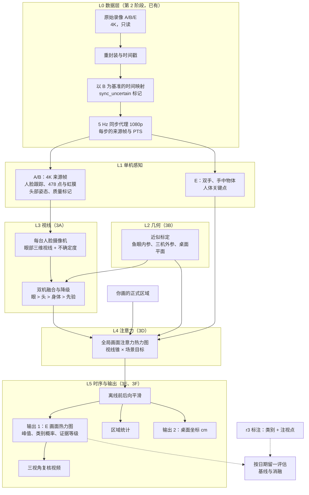
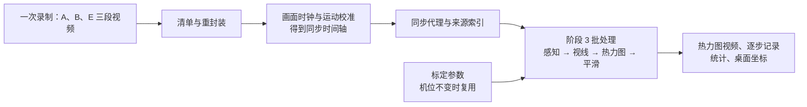
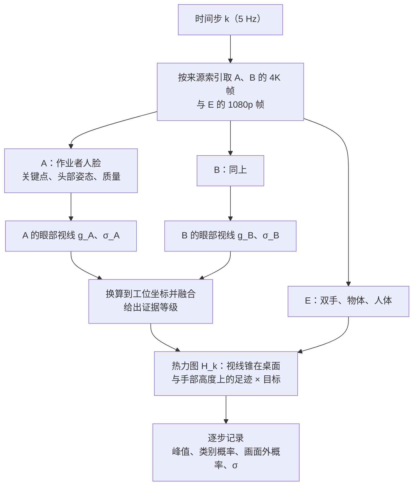
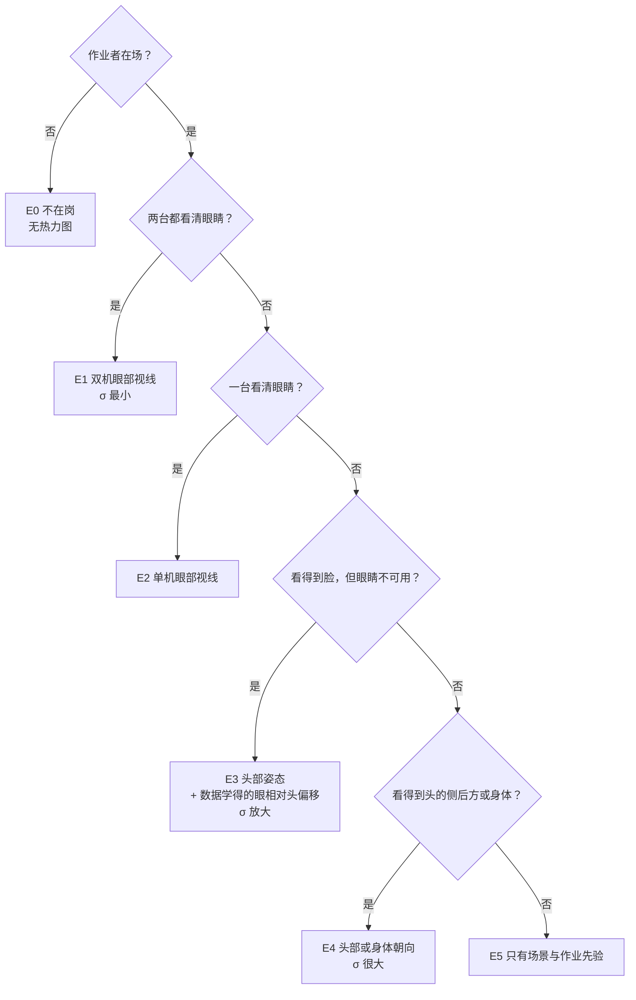
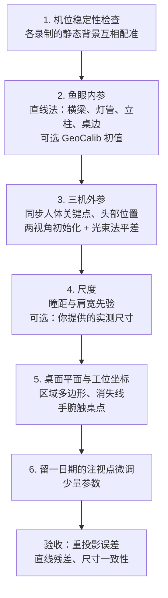
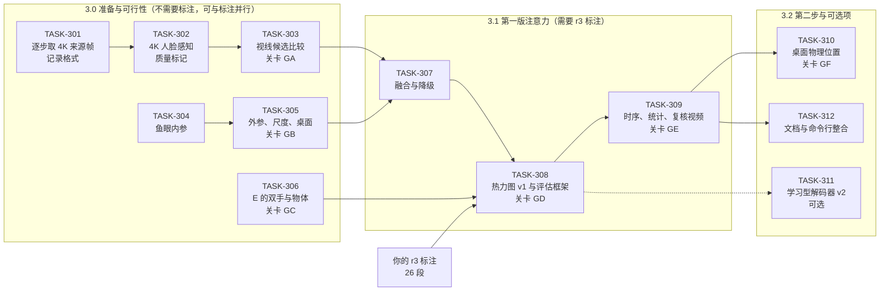

# 阶段 3 视线与注意力位置估计设计

- 状态与版本：见文件头与文末“版本记录”。待用户确认（STATE 待决问题 Q-018；确认后记为 D22 至 D24）。
- 作者：Claude（协调者）。全系统的总图见[系统总体设计](2026-10-18-system-overview-design.md)。
- 取代：[2026-10-15 多摄像机注意区域设计](2026-10-15-multicamera-attention-design.md)的方法部分（D15）。
  - 保留：D13 的分析时间轴（以前方摄像机 B 为基准、内容校准后的 5 Hz，D18 修订）；D14 的连续片段标注（由 D20 扩充为方案 r3）；按录制日期留一评估。
- 依据：
  - [项目目标 v3](../../collab/PROJECT_GOALS_CN.md) §0，即用户 2026-10-18 的三点说明与 D19 至 D21；
  - [验证集设计](2026-10-15-workdata-validation-set-design.md) §10（标注方案 r3）；
  - 第 2 阶段的数据与工具；
  - 本文 §3 的实测。

English abstract. The goal is the same as Gaze-LLE's: estimate from video where the worker looks, as a centre-graded heatmap. Our cameras split the problem, though:
- the face cameras see the eyes but not the desk;
- the overview camera sees the desk and hands but not the eyes.

Gaze-LLE assumes that the head and the target appear in one image, so it cannot be applied as is. The design therefore works across views:
1. Estimate eye-aware 3D gaze per face camera on 4K source frames.
2. Fuse the two face cameras, with an explicit fallback hierarchy (eyes > head > body > prior) and per-step uncertainty.
3. Transfer the gaze to the overview camera through an approximate calibration. No board is used (D19); the calibration relies on lines, synchronized body keypoints and the desk plane.
4. Combine it there with scene targets (hands, held objects, the user's regions) into a heatmap.
5. Smooth offline over time. Derive region statistics, and later desk coordinates in centimetres.

A read-only measurement on all 7 sessions shows two things:
- The iris spans about 27–29 px at 4K (median).
- At least one face camera sees usable eyes in about 76% of the steps where the worker is detected.

Evaluation uses the r3 attention points, leave-one-date-out. The key ablation is eyes versus head-only, which tests requirement 3 directly. Feasibility gates with go/no-go criteria precede each stage.

---

## 0. 结论摘要

1. **目标与方向正确，可以分阶段实现。** 要做的事与 Gazelle（Gaze-LLE）相同：从视频估计作业者在看哪里，用中心渐变的热力图表示。不同之处在于摄像机布置（§2）。
2. **Gazelle 不能直接套用。** Gaze-LLE 假设头部与注视目标在同一张画面里。我们的情况是：
   - 人脸摄像机 A、B 看得到眼睛，看不到桌面和手；
   - 全局摄像机 E 看得到桌面和手，几乎看不到头（56 帧抽样中不到 10 帧露出帽子或头顶）。
   单独在任何一台上运行 Gazelle，都回答不了“看着桌上哪里”。
3. **本设计的核心是“跨视角”。**
   - 在人脸摄像机的 4K 原分辨率画面中，估计包含眼球转动的三维视线；
   - 经近似几何标定，把视线换算到全局画面；
   - 在全局画面中与双手、手中物体、你画的区域等目标结合，得到热力图。
   这与 ICCV 2025 的多视角注视目标估计（§4）同一思路。区别是：我们的工位与机位固定、只有一名作业者，可以更多依靠几何与作业先验。
4. **实测支持这条路线**（§3.2，只读运行，2026-10-18）：
   - 4K 下虹膜直径中位数约 27–29 像素，眼部特征可以测量；1080p 代理只有一半，所以视线必须用 4K 原片。
   - 作业者在场时，约 76% 的时间至少一台人脸摄像机看得清眼睛，各次录制在 47% 至 95% 之间。两台同时看得清的时间只有约 4%。
   - 其余时间（转身、侧脸、背对）只能降级为头部或身体方向，结果会标明证据等级并给出更大的不确定度。
   - 眼球相对头部的转动很常见：MediaPipe 的眼球转动系数超过 0.5 的样本，向下约占 12%，水平约占 14–20%。这从数据上支持你的第 3 点：不能只看头部方向。
   - 全局摄像机上，MediaPipe 人体姿态只在约 30% 的样本中检出（头部在画面外）。双手检测需要专门的方法（3C）。
5. **精度只能用人工标注的注视点间接评估**（D19）。估计量级如下，需经可行性关卡实测确认：
   - 公开的眼部外观法模型跨人跨场景的误差通常为 5 至 12 度，在约 70 厘米的视距上对应约 6 至 15 厘米。
   - 结合双手、物体与区域等场景先验后，“看哪个目标”的判断可以明显好于单纯几何。
   - 核心检验是消融实验：加入眼部信息是否显著优于只用头部方向（§8.3）。
6. **需要你决定的事项在 §12。** 主要是：
   - 批准本设计；
   - 模型与许可策略（沙盒环境、逐项下载授权、是否接受非商业许可模型）；
   - 标注方案 r3 的一处补充：注视目标在全局画面之外时可以标“画面外”；
   - 阶段 3 使用的分支。

---

## 1. 需求（对照你的原话）

| 编号 | 需求 | 来源 | 本设计的对应 |
| --- | --- | --- | --- |
| R1 | 高精度估计视线方向，包括头部转动与眼球转动带来的变化 | 你的第 1 点 | M2 眼部三维视线；输出分别给出头部方向与眼球相对头部的转动（§6.2、§6.4） |
| R2 | 推断实际注视位置，用中心渐变的热力图表示；目标包括桌面区域，也包括双手、手中物体等会移动的目标 | 你的第 2 点 | M5 全局画面目标；M6 注意力热力图 |
| R3 | 眼、头、身体不同步，不能只用头部方向推断视线 | 你的第 3 点 | 眼部证据优先；头部只作降级证据并放大不确定度；由数据学习“眼相对头”的偏移；消融检验（§8.3） |
| R4 | 输出分两步：先全局画面热力图，再桌面物理位置 | D21 | 3D（第一步交付）与 3F（第二步交付） |
| R5 | 区域统计保留，由热力图积分得到 | 目标 v3 | M7 |
| R6 | 离线处理；先单人 | 目标 v2/v3 | 允许非因果（前后向）时序平滑 |
| R7 | 结果可审计：每个结果说明依据、证据等级与不确定度 | AGENTS.md 研究完整性 | 每步记录证据等级、σ、同步与标定版本（§7） |
| R8 | 精度以人工注视点评估，不追加录制 | D19、D20 | 方案 r3 的注视点；人工重复标注给出真值本身的精度（§8） |
| R9 | 隐私：仓库只放汇总数字，不放图像、人名、公司名 | 数据规则 | 人脸裁剪只在本地派生目录，不提交 |
| R10 | 不改动现有环境；下载逐项授权 | AGENTS.md | 候选模型在克隆的沙盒环境中评估（§11.3） |

---

## 2. 与 Gazelle 的对照：为什么不能直接套用

### 2.1 Gaze-LLE 做什么

- 冻结的 DINOv2 提取整张图的特征，加上头部位置提示，经轻量解码器输出同一张图上 64×64 的注视热图，以及“目标是否在画面内”（in/out）。
- 它从头部外观推断朝向，从场景中找最可能被看的物体。训练数据（GazeFollow、VideoAttentionTarget）都是头和目标同在一张图里的照片或视频。
- 公开指标：GazeFollow 上 AUC 0.958，平均 L2 0.099（ViT-L）。没有时序模型。

### 2.2 三台摄像机各自的情况

| 摄像机 | 看到头部与眼睛 | 看到桌面、手与物体 | 单独运行 Gazelle 的结果 |
| --- | --- | --- | --- |
| A 右侧（カメラ1） | 是。作业者面向右侧桌面时看到正脸；在前方桌面作业时多为侧脸；仰视 | 很少，只在画面下缘偶尔出现 | 热图落在天花板、背景或画面外，回答不了看桌上哪里 |
| B 前方（カメラ2） | 是。在前方桌面作业时，从下方看到脸，向下看时眼睛朝向摄像机，对眼部估计有利 | 很少，治具与双手只在画面下缘 | 同上 |
| E 全局（設備カメラ） | 几乎没有：头部大多在画面上缘之外 | 是：两张桌面、双手、工件、治具 | 缺少头部线索，只剩场景显著性 |

结论：
- 要回答“看着哪里”，需要把 A/B 的视线信息与 E 的场景信息结合起来。
- 第 2 阶段的分析（[作业数据分析](../../collab/analysis/2026-10-15-workdata-analysis.md)）已经得出同样的结论。

### 2.3 Gazelle 在本系统中的位置

- **保留它的思想**：注视位置 = 视线线索 × 场景中可能被看的东西。
  - Gaze-LLE 的视线线索是头部位置提示；
  - 本设计换成从人脸摄像机换算过来的三维视线锥。
- **作为基线**：在 E 上直接运行 Gazelle 或更新的 PaGE，就是“照搬 Gazelle”的方案，用来证明本设计确有提升（§8.3 的 B3）。
- **作为可选组件**：第二版热力图模型可以采用 Gaze-LLE 式的轻量解码器。它使用 E 的 DINOv2 特征，以视线锥为条件（§6.6 v2）。
  - DINOv2 ViT-B/14 已在本地缓存，不需要下载。

---

## 3. 现状与实测

### 3.1 第 2 阶段可以直接使用的基础

| 基础 | 状态 | 阶段 3 的用途 |
| --- | --- | --- |
| 数据接入：时间戳严格递增、AVI 无损重封装（TASK-131、132、135） | accepted | 解码 4K 原片 |
| 三机同步：协议 r2，以 B 为基准，残差约 0.05 秒；切点不确定区间标 `sync_uncertain`（TASK-139、140） | 实现通过；第 2 轮待完成 | 统一时间轴；不确定的步不参与跨机融合 |
| 5 Hz 同步代理，带每步的来源帧与 PTS（`proxy_*.frames.json`） | 待正式切换（TASK-140 第 2 轮） | 由每步的来源索引取 4K 原片帧，不另建时间轴 |
| 头部检测与跟踪：MediaPipe 提供者、首帧确认（TASK-102），跨人误配修复（TASK-101，第 6 轮） | 部分 | 锁定作业者，排除背景人物 |
| 你画的正式区域：4 个目标区域与 1 个工作区 | 完成 | 静态目标；类别定义 |
| 标注工具与验证集（TASK-121、138、124；r3 由 TASK-125 实现） | 进行中 | 注视点真值 |

### 3.2 本次实测（2026-10-18，只读，Claude 实际运行）

方法：
- 在 7 次录制的同步代理上抽样：两台人脸摄像机每 5 秒取同一时间步配对，共 4,697 对；全局摄像机每 10 秒取一次，共 2,350 个样本。
- 使用本地已缓存的 MediaPipe 模型：人脸检测、478 点人脸关键点（含虹膜）、眼球转动系数与人体姿态。
- 只记录数字，不保存图像，没有下载。像素按 4K 原片换算，即代理像素 × 2。
- 脚本与结果在仓库外 `gazelle_runs\claude-design-r1\`。

<!-- portal:table feasibility-cameras -->
| 指标 | 前方 B | 右侧 A |
| --- | --- | --- |
| 检出人脸 / 得到关键点（占全部样本） | 56.7% / 37.0% | 66.8% / 40.1% |
| 人脸宽度（4K 像素，中位数；10%–90% 分位） | 340（206–464） | 350（212–508） |
| 虹膜直径（4K 像素） | 28.9（16.3–33.1） | 26.6（15.2–37.2） |
| 眼裂宽度（4K 像素） | 76.5 | 72.6 |
| 头部偏离该摄像机视线的角度（中位数；≤45° 的比例） | 19.9°；91% | 26.2°；85% |
| 眼睛基本闭合（开合比 < 0.15） | 1.6% | 2.7% |
| 眼球转动系数 > 0.5：向下 / 向内 / 向外 | 12.0% / 12.5% / 14.0% | 12.5% / 20.1% / 18.0% |
| “眼部可用”：有关键点、偏离 ≤45°、眼睛睁开、虹膜 ≥ 8 像素 | 33.0% | 32.8% |

两台人脸摄像机合并（同一时间步）：

<!-- portal:table feasibility-combined -->
| 指标 | 数值 |
| --- | --- |
| 至少一台眼部可用（全部步） | 62.0% |
| 两台同时可用 | 3.9% |
| 作业者在场的步中（代理判断：A/B 有人脸，或 E 有人体），至少一台眼部可用 | 76.4% |
| 按录制（在场步中） | 0821：78.5%；0828：83.3%；0903：63.5%；0911：46.9%；0925：76.3%；1002：89.1%；1009：95.2% |
| 全局摄像机：检出人体姿态 / 至少一只手腕可见 | 31.5% / 26.7% |

解读：
- 4K 下一个像素约等于眼球表面 0.5 毫米。虹膜中心定位误差 1 像素，大约对应 2 至 4 度的视线角度。所以眼部估计在原片上可行，在 1080p 代理上会明显变差。
- 两台人脸摄像机大致互补：前方 B 在前方桌面作业时看得清，右侧 A 在作业者转向右侧桌面时看得清。两台同时看得清的时间很少，因此两台之间的一致性检验样本有限，但总数仍有数千步。
- 0911 的可用比例最低。抽看画面发现，作业者常转向左侧的设备，两台人脸摄像机都只拍到侧后方。这些时段需要降级处理。
- 作业者佩戴透明护目镜和帽子，抽看画面中可以看到镜片反光。这是眼部估计的主要风险之一（§10）。
- 局限：
  - 本测量在 1080p 代理上运行关键点，在 4K 原片上的检出率可能更高；
  - “在场”是近似判断；
  - 眼球转动系数没有单位，只作定性证据。

### 3.3 约束

- 不追加录制（D19）：没有标定板、注视标记、眼动仪，机位不变。
- 不修改 `Gazelle-next` 与 `Gazelle`。候选模型只在克隆的沙盒环境中试用，下载逐项授权（AGENTS.md）。
- 许可：优先 MIT 或 Apache 许可。非商业许可的模型需要你判断是否适用（§12）。
- 隐私：仓库报告只有汇总数字；人脸裁剪只放在本地派生目录。
- 计算资源：i9-14900K 与 RTX 4080 SUPER。长时间 CPU 任务以低优先级运行，GPU 推理前检查空闲显存。

---

## 4. 公开模型与方法调研

| 方法 | 做什么 | 输入要求 | 与本项目的匹配 | 许可 | 代价 | 结论 |
| --- | --- | --- | --- | --- | --- | --- |
| [Gaze-LLE](https://github.com/fkryan/gazelle)（CVPR 2025，当前仓库） | 同一画面内的注视目标热图与 in/out | 一张图 + 头部框 | 头与目标不同画面，不能直接回答 | MIT | 已有 | 基线 B3；解码器思路可复用 |
| [PaGE](https://github.com/OctopusWen/PaGE)（arXiv 2607.04860，2026） | 同上，精度更高：VAT 上 L2 0.064 对比 Gaze-LLE 的 0.103；GazeFollow 上 AUC 0.966 | 一张图 + 一个头部框；DINOv3 骨干；逐帧 | 同 Gaze-LLE 的限制 | 代码 MIT；权重内含 DINOv3，需核对 DINOv3 许可 | 需要 Python 3.12+ 与 `transformers==5.6.2`，只能在单独的沙盒中运行 | 可选：作为更强的单视角基线 |
| [多视角注视目标估计](https://arxiv.org/abs/2508.05857)（Miao 等，ICCV 2025） | 用标定过的多视角，在一个视角里预测注视目标；含“头只在另一视角”的跨视角设定 | 已知内外参；跨视角时还需三维重建 | 范式最接近：跨视角时距离误差 0.188，对比中心先验 0.245，提升有限 | 代码许可未写明；数据需注册 | 需要标定，正是我们缺的 | 作为方法参照，不直接采用 |
| MediaPipe Face Landmarker | 478 点（含 10 个虹膜点）、52 个表情系数（含眼球转动）、头部变换矩阵 | 人脸裁剪 | 已在仓库中使用 | Apache-2.0 | 已缓存，无需下载 | 采用：人脸关键点、头部姿态、眼部几何法 |
| [L2CS-Net](https://github.com/Ahmednull/L2CS-Net)（Gaze360 权重） | 外观法三维视线（pitch、yaw） | 人脸裁剪 | 适合大角度头部姿态与远距离人脸；Gaze360 上误差 10.41° | 代码 MIT；权重由 Gaze360 训练，该数据集限非商业研究 | 权重约百 MB 量级（下载前确认）；ResNet-50 | 候选（3A） |
| [UniGaze](https://github.com/ut-vision/UniGaze)（WACV 2026） | 大规模预训练的外观法三维视线，跨数据集泛化最好之一 | 归一化人脸裁剪 | 精度潜力最高 | MG-NC-RAI-2.0，非商业 | 官方安装固定 torch 2.0.1 与 timm 0.3.2，需要单独的沙盒；ViT-B/L/H | 候选，需你确认可以接受非商业许可 |
| [MCGaze](https://github.com/zgchen33/MCGaze) | 视频时序的头、脸、眼联合视线 | 视频片段 | 思路相符 | MIT | 依赖 torch 1.7 与 mmcv 1.4，与本机环境差距太大 | 不采用；时序思路由 M7 实现 |
| [GeoCalib](https://github.com/cvg/GeoCalib)（ECCV 2024） | 单张图估计内参、畸变与重力方向；有适用于强鱼眼的除法模型 | 单张图 | 无标定板时的内参初值 | 代码 Apache-2.0；权重 CC-BY-4.0 | 下载权重；鱼眼精度没有公开基准 | 候选（3B 初值）；以直线法核对 |
| MediaPipe Pose / Hand Landmarker | 人体与手部关键点 | 整图或裁剪 | E 上人体检出约 30%，不够；手部模型未测 | Apache-2.0 | Pose 已缓存；Hand 需下载（约 8 MB，下载前确认） | Hand 为 3C 候选；另比较手套颜色与运动的检测 |

几点结论：
- 公开领域还没有能直接处理“头在 A/B、目标在 E、鱼眼且未标定”这种布置的现成模型。最接近的 ICCV 2025 多视角方法也要求标定，跨视角时提升有限。所以几何标定与作业先验是本项目必须自己做的部分。
- 眼部三维视线有成熟的公开模型可选。需要实测哪一种在我们的画面上最好（3A 的可行性比较）：远距离、仰视、护目镜、帽檐。
- 非商业许可（UniGaze，以及由 Gaze360 训练的权重）是否适用于本项目，取决于你与数据提供方的约定，需要你判断。

---

## 5. 系统架构

### 5.1 总体流程

### 5.2 从三段视频到注视目标（端到端使用流程）

“像 Gazelle 一样从视频估计注视目标”，对一次新的录制来说是下面的完整流程。前半段已由第 2 阶段工具实现。

- 机位固定时，标定只需做一次，所有录制共用。每次录制先检查机位是否移动（§6.3 第 1 步）。
- 批处理以录制为单位，可以续跑。中间结果按模块缓存，换一个模块不必从头重算。

### 5.3 每个时间步的处理

### 5.4 证据降级层级（对应你的第 3 点）

<!-- portal:mermaid evidence -->

- 每一步都记录证据等级（E0 至 E5）和不确定度 σ。区域统计可以按证据等级分别报告。
- 头部方向只在眼睛不可用时使用，并且：
  - 加上从 E1、E2 步学到的“眼相对头”的典型偏移。这一步不需要人工标注，例如人低头看桌面时，眼球往往比头转得更多。
  - 把这一偏移的离散程度计入 σ。

---

## 6. 模块设计

每个模块给出输入、输出、方法、候选与验收要点。正式的任务契约在本设计批准后编写（§11）。

### 6.1 M1 人脸摄像机感知（4K）

- **输入**：每个时间步 k，从代理的来源索引取 A、B 的 4K 原片帧。必要时取 k 前后各 1 帧，用于降噪与检测眨眼。
- **作业者锁定**：沿用第 2 阶段的跟踪（TASK-101/102），只处理作业者，背景人物不进入视线估计。
- **关键点**：MediaPipe Face Landmarker 在 4K 人脸裁剪上运行，输出 478 点（含虹膜）、眼球转动系数与头部变换矩阵。
- **去畸变**：有了 M3 的内参后，对人脸做局部透视归一化，即建立以人脸为中心的虚拟针孔相机（Zhang 等 2018 的数据归一化）。这一步去除鱼眼畸变，并让外观法模型的输入与训练分布一致。
- **质量标记**：
  - 头部偏离摄像机视线的角度；
  - 虹膜像素直径；
  - 眼睛开合比；
  - 模糊程度；
  - 镜片反光（眼部区域的过曝像素比例）；
  - 遮挡（手或物体挡在脸前）。
- **输出**：`face_obs`，每步每台摄像机一条。
- **隐私**：只在本地派生目录缓存人脸裁剪，不提交，不上传。

### 6.2 M2 眼部三维视线（3A）

- **候选**：
  - (a) **虹膜几何法**，无需下载：由眼角与头部姿态估计眼球中心，由虹膜中心得到光轴方向，再加人群平均的光轴与视轴夹角修正。对小幅眼球转动敏感，绝对方向的偏差较大。
  - (b) **L2CS-Net**（Gaze360 权重）：外观法，对大角度头部姿态较稳。
  - (c) **UniGaze**：外观法，泛化最好之一。非商业许可，需你确认。
  - (d) **组合**：外观法给出绝对方向，虹膜几何法补充短时的小幅眼球转动。
- **输出**（摄像机坐标系）：
  - 视线单位向量 g；
  - 双眼中点的三维位置 e，由瞳距的人群先验（约 63 毫米）与内参估计距离；
  - 不确定度 σ（度）；
  - 头部方向 h 与眼球相对头部的转动（yaw、pitch）。后者直接对应你的第 1 点。
- **σ 的来源**：由质量标记映射得到。映射用两台摄像机之间的不一致与留一日期的标注残差校准，不用测试日期的数据。
- **选型方法**：§9 关卡 GA 与 GD。最终以注视点误差选定，不以论文指标选定。

### 6.3 M3 近似几何标定（3B）

不追加录制（D19），只用现有画面中的信息：

- **第 1 步**：检查机位是否在各次录制之间移动。若移动，对应录制单独估计外参。
- **第 2 步**：A、B 很可能是同型号摄像机，可以共享内参初值；E 单独估计。直线法只需要 opencv-contrib 与 scipy，环境中已有。
- **第 3 步**：作业者的肩、肘、腕、头在两台以上摄像机同时可见的步，作为跨视角对应点。几千步覆盖了工位空间，足以做稳健的光束法平差。
  - A、B 之间还可以用两台同时看到的人脸来约束。
- **第 4 步**：单目尺度来自瞳距先验（个体差异约 5%）。如果你能提供一两个实际尺寸（例如桌宽），可以进一步核对（§12）。
- **第 5 步**：工位坐标以前方桌面为基准，单位厘米。原点、x、y 轴沿桌边，z 轴向上。
- **第 6 步**：用训练日期的注视点微调少量参数，例如 E 与 B 的相对旋转、桌面高度。只用训练日期，所以不泄漏测试数据。
- **输出**：
  - 每台摄像机的内参与外参，带协方差；
  - 桌面平面；
  - 标定版本号，记录在所有下游结果中。

### 6.4 M4 双机融合与降级

- 把每台摄像机的 (g, e, σ) 换算到工位坐标系。
- **E1**（两台都可用）：按逆方差加权平均。若两者差异超过 3σ，标记冲突，并取头部更正对的一台。
- **E2**：使用单台。
- **E3**：头部方向加上学到的“眼相对头”偏移。偏移按头部俯仰与偏航分箱，从 E1、E2 步统计得到，不需要标注；σ 包含这一偏移的离散程度。
- **E4**：头部侧后方或身体朝向（A/B 的头部框，E 的人体关键点），σ 很大。
- **E5**：只有场景与作业先验。
- **输出** `gaze_fused`：
  - 视线方向；
  - 眼位置；
  - σ；
  - 证据等级；
  - 头部方向与眼球相对头部的转动；
  - `sync_uncertain` 标记，继承第 2 阶段，这些步不做跨机融合。

### 6.5 M5 全局画面目标（3C）

- **双手**：E 上 MediaPipe 人体只检出约 30%（§3.2），需要专门的方法。候选：
  - MediaPipe Hand Landmarker（需下载约 8 MB）；
  - 白色手套的颜色与运动检测（不需要模型，但要防止误检白色物体，例如风扇、标签）；
  - 两者结合并做跟踪。
  - 关卡 GC 实测选定。
- **手中物体**：第一版用双手周围的区域与运动区域近似。后续可在需要时加入开放词汇检测或分割（模型需授权）。
- **静态目标**：你画的 4 个目标区域与工作区。
- **画面外目标**：作业者转向左侧设备、货架等 E 画面以外的位置时，用“画面外”类别表示，对应 Gaze-LLE 的 in/out。
- **作业者归属**：只保留属于作业者的手（与作业者手臂和身体位置一致），排除其他人员。
- **三维化**：手的三维位置由 E 的二维位置加上“手在桌面以上 0 至 30 厘米”的先验得到；B 也看到手时做三角测量。

### 6.6 M6 注意力热力图（3D，第一步交付）

**v1：概率模型，参数少，先做。** 对 E 画面中的每个像素 x：

- 按候选目标类型，取像素对应的三维点 X(x)：静态区域取桌面平面上的点，双手与物体取手部高度层上的点。
- 视线似然：用 von Mises–Fisher 分布描述视线方向 g 与“眼睛 → X(x)”方向之间的夹角，集中度由 σ 决定。
- 热力图：H(x) ∝ Σ_c w_c · S_c(x) · vMF(g, X(x) − e; σ)。其中：
  - c 是目标类别：4 个区域、手部/手中物体、工作区内其他；
  - S_c 是该类目标在画面中的空间范围，例如模糊后的手部掩膜或区域多边形；
  - w_c 是类别先验，由时序模型提供，见 M7。
- 画面外概率：视线锥中不落在 E 可见表面上的那部分质量。
- 输出：归一化热力图（画面内）、画面外概率、峰值、加权均值，以及按类别积分得到的类别概率。
- 可调参数只有 σ 的缩放、类别先验与手部高度等少数几个，用训练日期拟合。

**v2：学习型解码器，可选。**
- 仿照 Gaze-LLE：在 E 的 DINOv2 ViT-B/14 特征上加一个小解码器，额外输入 v1 的视线锥图、手部图与区域图。用 r3 注视点按留一日期训练。
- 只有当 v1 出现场景外观可以修正的系统误差，并且标注量足够时才做。26 段约有数百到上千个注视点，数量有限，需要防止过拟合。

### 6.7 M7 时序、统计与复核（3E）

- **类别层面**：用隐马尔可夫模型做前后向平滑。
  - 状态为 4 个区域、手部/手中物体、工作区内其他、画面外或离开工作、不在岗；
  - 观测为热力图的类别积分；
  - 转移与停留先验从训练日期的标注估计。
  - 离线处理，可以同时利用前后的信息。
- **位置层面**：在同一类别的连续时段内，对注视位置做平滑，并在检测到眼跳时断开。
- **手眼协调先验**：手工操作中，眼睛通常先于手约 0.5 至 1 秒到达下一个操作目标（Land 与 Hayhoe 2001；Johansson 等 2001）。离线处理时，可以用“稍后双手要去的位置”作为当前注视的候选目标，作为可选特征，由消融实验检验。
- **统计**：各区域注视占比、每次注视的时长分布、切换次数、离开工作的比例，并可按证据等级分层报告。
- **复核视频**：A | B | E 三视角拼接；E 上叠加热力图，A、B 上画出视线箭头，并显示证据等级与 σ。

### 6.8 M8 桌面物理位置（3F，第二步交付）

- 用 M3 的桌面平面，把 E 画面上的热力图换算到桌面俯视图，网格 1 厘米。
- 协方差来自标定误差与热力图的展开，给出不确定度。
- 用已知尺寸（若你提供）与跨日期的一致性做核对。

---

## 7. 数据与输出格式（草案，契约中定稿）

- **时间轴**：步 k、时间 t_k，与同步代理一致。
- **坐标**：
  - E 画面：代理的 1920×1080 像素，x 向右，y 向下；
  - 工位坐标：厘米，z 向上；
  - 角度：度。
- **每次录制的输出**（仓库外派生目录）：
  - `face_obs.jsonl`：M1，每步每台摄像机一条；
  - `gaze.jsonl`：M2/M4，含每台摄像机的估计、融合结果、证据等级、σ、头部方向与眼球相对头部的转动；
  - `targets.jsonl`：M5，含双手、物体与画面外判断；
  - `attention.jsonl`：M6/M7，含峰值、均值、类别概率、画面外概率、熵与证据等级；
  - `heatmaps.npz`：120×68 的 float16 热力图，约 0.3 GB 每小时，按需生成；
  - `stats.json`：区域统计；
  - `review.mp4`：复核视频。
- **出处**：每个文件都记录代码版本、模型名称与版本、标定版本、同步版本与参数，满足可复现要求（G8）。
- 失败、跳过与缺失分开记录：不在岗、无视线证据、跳过推理与实际预测，各自有明确状态，与运行时现有规则一致。

---

## 8. 评估方案

### 8.1 真值与其局限

- 真值是你按方案 r3 标注的类别与注视点：26 段，每段 60 秒，覆盖 7 次录制（验证集设计 §10）。
- 它是人对视频的判断，不是眼动仪测得的视线（D19）。所以：
  - “精度”指与人工判断的一致程度；
  - 由重复标注得到人与人之间的差异，作为真值本身的精度参考。模型好过这一水平没有意义。
- 以后若能追加录制（眼动仪或注视标记），再用测得的真值补充评估。

### 8.2 指标

沿用验证集设计 §10.5：
- **注视点误差**：热力图峰值与加权均值到注视点的像素距离；注视点半径 25、50、100 像素内的热力图质量。报告中位数与 90% 分位。第二步再报告桌面上的厘米距离。
- **类别**：每步的准确率；每类召回率，尤其是“手部/手中物体”。
- **区域统计**：各段的占比误差、停留时长与切换次数误差。
- **画面外**：r3.1 中“画面外”标记的检出率（§12 第 3 项）。
- **视线方向的间接指标**（无真值，D19）：
  - 两台摄像机同时可用时的角度差异，其中包含标定误差，因此是上界；
  - 由注视点与标定反推的“标注视线方向”与估计方向之间的夹角；
  - 注视稳定期内逐帧的抖动。

### 8.3 基线与消融：核心问题是“眼睛是否带来提升”

| 编号 | 方案 | 检验什么 |
| --- | --- | --- |
| B0 | 训练集注视点的平均分布（中心先验） | 最低参照 |
| B1 | 只看双手：注视位置等于作业者双手的位置 | 场景先验能做到多少 |
| B2 | 只用头部方向，其余与完整方案相同 | 你的第 3 点：眼部信息是否必要 |
| B3 | 在 E 上直接运行 Gazelle（或 PaGE） | 照搬 Gazelle 的效果 |
| 完整 | 眼部视线 + 标定 + 场景目标 + 时序 | 本设计 |
| 消融 | 去掉眼部（即 B2）、去掉场景先验、去掉时序、去掉注视点微调 | 各模块的贡献 |

- **按录制日期留一**：所有拟合与学习（标定微调、σ 映射、先验、v2 解码器）只用训练日期。
- **统计检验**：以片段为单位做配对自助法，报告 95% 置信区间，并分录制日期报告。
- **预先登记的假设**：
  - H1：完整方案的注视点误差显著小于 B2，检验你的第 3 点；
  - H2：完整方案优于 B1，并且在非手部的类别上优势更明显；
  - H3：区域统计的误差在 §9 的门槛之内。
  - 若 H1 不成立，如实报告“现有数据不足以证明眼部信息的价值”，并说明需要的追加数据。

---

## 9. 可行性关卡（未通过时先停下来报告，不放宽门槛）

| 关卡 | 时点 | 通过条件（提议，可由你调整） | 未通过时 |
| --- | --- | --- | --- |
| G0 | 已完成（本文 §3.2） | 4K 下虹膜中位数 ≥ 20 像素：实测 27–29，**通过** | — |
| GA | 3A 候选比较后，不需要标注 | 在两个日期的眼部可用步上：(1) 输出率 ≥ 95%；(2) 注视稳定期逐帧抖动中位数 ≤ 3°；(3) 估计的眼球相对头部转动与虹膜位移的相关系数 ≥ 0.5，证明它确实反映眼动；(4) 有外参后，两台同时可用时角度差中位数 ≤ 12° | 先改为组合法或调整裁剪与归一化；仍不行就报告，并以 E3 降级为主 |
| GB | 3B 完成后 | (1) 保留的步上关键点重投影误差中位数 ≤ 8 像素（1080p）；(2) 去畸变后长直线残差 ≤ 2 像素；(3) 两种尺度来源相差 ≤ 5%（若有实测尺寸）；(4) 机位稳定性已确认，或已按录制估计外参 | 报告误差，并把标定协方差传到热力图 |
| GC | 3C 完成后 | 在约 200 帧人工核对样本上，手部检出召回 ≥ 90%，定位误差中位数 ≤ 25 像素（1080p） | 换方法或组合方法 |
| GD | 有 r3 标注后 | (1) H1 成立：置信区间不含 0；(2) H2 成立；(3) 注视点误差中位数 ≤ 1.5 倍人与人差异中位数；E1 至 E3 步的类别准确率 ≥ 80% | 先分析误差来自视线、标定还是目标，再决定是否做 v2；如实报告 |
| GE | 时序与统计完成后 | 每段区域占比误差中位数 ≤ 5 个百分点；停留时长与切换次数误差 ≤ 20% | 调整时序模型并报告 |
| GF | 物理位置完成后 | 桌面坐标附带不确定度；与已知尺寸、跨日期结果一致；由你验收 | 只交付画面热力图（第一步） |

---

## 10. 风险与对策

| 风险 | 影响 | 对策 |
| --- | --- | --- |
| 护目镜反光、帽檐遮挡、侧脸、低头时眼睑下垂 | 眼部可用比例下降，误差增大 | 用 4K 原片；使用野外数据训练的外观法模型；质量标记与 σ；降级层级；GA 实测 |
| 无标定板，鱼眼近似标定误差 | 视线换算到 E 时偏移 | 多种线索交叉核对；协方差传播；留一日期的注视点微调；请你提供少量实测尺寸 |
| 真值是人的判断，不是测得的视线 | 精度只能间接评估 | 重复标注给出人与人差异；如实写明局限 |
| 标注量少（26 分钟） | 学习型模型容易过拟合 | 先做参数少的 v1；留一日期；v2 只在必要时做 |
| 日期与作业者之间的差异 | 泛化不稳定 | 按日期留一；逐录制统计；分日期报告 |
| 许可限制（非商业） | 某些模型不能用 | 默认用 MIT 与 Apache 许可的模型；非商业模型由你决定 |
| 新模型的依赖与现有环境冲突 | 破坏现有环境 | 只在克隆的沙盒中运行；必要时用单独进程隔离，以 JSON 交换结果 |
| 计算量 | 时间长 | 离线批处理、可续跑、按模块缓存；7 次录制约需数小时 CPU 加 1 至 3 小时 GPU（视模型） |
| 隐私 | 外泄风险 | 仓库只放汇总；人脸裁剪只在本地；不上传 |
| 同步误差与不确定区间 | 跨机错位 | 沿用 `sync_uncertain`，这些步不做跨机融合 |
| 背景人物 | 视线或双手归属错误 | 作业者跟踪（TASK-101/102）；手部归属检查 |
| 注视目标在 E 之外 | 热力图无处可放 | “画面外”类别与概率；r3.1 标注补充 |

---

## 11. 开发路线

### 11.1 对第 2 阶段剩余工作的影响

- **第 5 轮照常进行**：TASK-140 第 2 轮（正式代理与数据集）、TASK-124 第 2 轮（标注工具加固）、TASK-125（标注方案 r3 的工具）。
  - TASK-125 按 §12 第 3 项加入“画面外”的标记方式（r3.1），前提是你同意这一补充。
- 第 6 轮的 TASK-101（人脸与姿态关联）仍然需要，阶段 3 的作业者锁定依赖它。
- GZ-28（二维参考射线的像素各向同性）不再是阶段 3 的前置条件，因为阶段 3 使用三维视线。它作为现有输出的正确性问题，留到阶段 4。
- 你的正式标注（约 3 小时）在第 5 轮通过审查后开始，可以与阶段 3 的前期任务并行。

### 11.2 阶段 3 的任务拆分

<!-- portal:mermaid stage3-tasks -->

| 任务 | 内容 | 依赖 | 真实活动 | 规模 |
| --- | --- | --- | --- | --- |
| TASK-301 | 由代理来源索引逐步解码 4K 帧；各模块的记录格式与出处；按模块缓存 | 第 5 轮正式代理 | CPU 解码 | M |
| TASK-302 | 4K 人脸感知与质量标记，全部录制批处理 | 301、TASK-101 | CPU 约 1 至 3 小时 | M |
| TASK-303 | 视线候选在沙盒中比较（几何法、L2CS-Net，经你同意再加 UniGaze），关卡 GA | 302；你的下载授权 | GPU；下载需授权 | L |
| TASK-304 | 鱼眼内参：直线法，可选 GeoCalib 初值 | 301 | CPU；GeoCalib 需下载授权 | M |
| TASK-305 | 外参、尺度、桌面平面、机位稳定性，关卡 GB | 302、304 | CPU | L |
| TASK-306 | E 的双手与物体检测和跟踪，关卡 GC | 301；手部模型需下载授权 | CPU/GPU | M |
| TASK-307 | 双机融合、降级层级、眼相对头偏移的学习 | 303、305 | CPU | M |
| TASK-308 | 热力图 v1、评估框架、基线 B0 至 B3、消融，关卡 GD | 306、307、r3 标注 | CPU/GPU | L |
| TASK-309 | 时序平滑、统计、复核视频，关卡 GE | 308 | CPU、FFmpeg | M |
| TASK-310 | 桌面物理位置，关卡 GF | 305、309 | CPU | M |
| TASK-311 | 学习型解码器 v2（可选） | 308 的误差分析 | GPU | L |
| TASK-312 | 用户文档（四份文档同步）、命令行整合 | 309 | — | S |

- 执行方式不变：Claude 写契约与审查，Codex 实现与发布，你决策与验收。每个关卡的结果写入 `docs/collab/evidence/`，只含汇总数字。
- 代码位置：新增 `tools/attention/`，放批处理、评估与工具脚本；可复用的库代码按需放进 `gazelle/` 下的新模块。现有 `main.py` 的行为不变，直到 TASK-312 有意整合。默认测试保持离线：不联网、不下载、不需要 CUDA。
- 阶段 3 使用哪个分支由你决定（§12 第 5 项）。

### 11.3 资源与授权清单（每一项在执行前再逐项向你确认）

| 项目 | 内容 | 何时需要 |
| --- | --- | --- |
| 沙盒环境 | 把 `Gazelle-next` 克隆为一次性环境，用于试装候选模型的依赖；PaGE 与 UniGaze 可能各需要单独的环境 | TASK-303 前 |
| 下载：L2CS-Net Gaze360 权重 | 来源为作者链接或 Hugging Face 转存，大小在下载前确认 | TASK-303 |
| 下载：UniGaze 权重 | 非商业许可，只在你同意后下载 | TASK-303（可选） |
| 下载：GeoCalib 权重 | Apache-2.0 / CC-BY-4.0 | TASK-304（可选） |
| 下载：MediaPipe Hand Landmarker | 约 8 MB，Apache-2.0 | TASK-306 |
| 下载：PaGE 学生模型 | 代码 MIT；权重内含 DINOv3 | 基线 B3 的可选加强 |
| 计算 | 7 次录制全量：CPU 数小时，GPU 1 至 3 小时（视所选模型） | 各批处理任务 |

---

## 12. 需要你决定的事项（Q-018）

1. **批准本设计（D22）**：方向、架构、评估、关卡与路线。可以全部批准，也可以指出要改的地方。
2. **模型与许可策略（D23）**：
   - 推荐：先只用 MIT 与 Apache 许可的模型（MediaPipe、L2CS-Net、GeoCalib、PaGE 代码），并建立克隆的沙盒环境；每次下载前逐项列出文件名、来源与大小请你确认。
   - 非商业许可的 UniGaze 是否可以用于本项目，取决于你与数据提供方的约定：可以用、不用，或者以后再定。由 Gaze360 数据训练的权重同样受限于“非商业研究”的条款，也请一并判断。
3. **标注方案 r3 的补充（r3.1，并入 Q-017）**：
   - 注视目标在全局画面之外时（例如左侧设备、货架），可以按一个键标为“画面外”，代替点注视点或“跳过”。
   - “跳过”只表示拿不准。
   - 原 r3 的其他细则不变。同意的话，请连同 Q-017 一起回复。
4. **可选：现场实测几个尺寸，不需要录制。** 例如两张桌面的宽、深与高度，摄像机离桌面的高度，某个治具的长度。这些尺寸可以核对标定的尺度，提高第二步物理位置的精度。做不到也可以，系统用人体尺寸先验代替。
5. **阶段 3 的分支（D24）**：
   - 推荐：第 5 轮通过审查后，从阶段 2 的验收点新建分支与 draft PR，这样 PR #6 只包含阶段 2 的内容；
   - 也可以继续使用当前分支。

批准后，Claude 依次：
- 更新 ROADMAP、STATE 与目标文档；
- 把第 5 轮交给 Codex（TASK-125 按 r3.1）；
- 在第 5 轮审查通过后，写阶段 3 的第一批契约：TASK-301、302、304、306。

---

## 13. 参考

- Ryan 等，Gaze-LLE（CVPR 2025）：https://github.com/fkryan/gazelle
- PaGE（arXiv 2607.04860，2026）：https://github.com/OctopusWen/PaGE
- Miao 等，Multi-view Gaze Target Estimation（ICCV 2025，arXiv 2508.05857）：https://www3.cs.stonybrook.edu/~cvl/multiview_gte.html
- UniGaze（WACV 2026，arXiv 2502.02307）：https://github.com/ut-vision/UniGaze
- Abdelrahman 等，L2CS-Net（arXiv 2203.03339）：https://github.com/Ahmednull/L2CS-Net
- Kellnhofer 等，Gaze360（ICCV 2019）
- MCGaze（IEEE SPL，arXiv 2310.18131）：https://github.com/zgchen33/MCGaze
- Veicht 等，GeoCalib（ECCV 2024，arXiv 2409.06704）：https://github.com/cvg/GeoCalib
- Zhang、Sugano、Bulling，Revisiting Data Normalization for Appearance-Based Gaze Estimation（ETRA 2018）
- Land、Hayhoe，In what ways do eye movements contribute to everyday activities?（Vision Research，2001）
- Johansson 等，Eye–hand coordination in object manipulation（Journal of Neuroscience，2001）
- Freedman，Coordination of the eyes and head during visual orienting（Experimental Brain Research，2008）

## 附录 A：实测的定义

- “眼部可用”：得到 478 点关键点；头部偏离该摄像机视线 ≤ 45°；两眼中较大的开合比 ≥ 0.15；虹膜直径 ≥ 8 像素（4K）。
- “头部偏离角”：由 MediaPipe 的头部变换矩阵得到人脸正前方向，计算它与“摄像机到人脸”方向之间的夹角。由于在裁剪图上估计且未去畸变，只是近似值。
- “在场”：A 或 B 检出人脸，或 E 检出人体（E 每隔一个样本检查一次），是保守的近似判断。
- 运行环境：`Gazelle-next`（MediaPipe 1.1.1，CPU），低优先级。代理：0903 与 0911 用重建版，其余 5 次用保留版。

## 附录 B：术语

- **视线（gaze）**：从眼睛出发的三维方向，由头部方向与眼球相对头部的转动共同决定。
- **注意力位置**：视线落在的实际位置，表示为热力图。
- **证据等级 E0 至 E5**：本步视线依据的来源，见 §5.4。
- **σ**：视线方向的不确定度，单位为度。
- **留一日期**：每次用 6 个日期拟合，在剩下的 1 个日期上评估，轮流 7 次。

## 版本记录

<!-- portal:versions -->
| 版本 | 日期 | 状态 | 变更摘要 | 确认 | 归档 |
| --- | --- | --- | --- | --- | --- |
| 2.0.1 | 2026-10-18 | 待确认 | 加入文件头、版本记录与网页标记；标题去掉“v2”；指向系统总体设计；内容不变 | Q-018 | [v2.0.1](../../archive/STAGE3/STAGE3_v2.0.1.md) |
| 2.0.0 | 2026-10-18 | 已取代 | 按目标 v3 重写为新文件：跨视角眼部视线、近似标定、全局画面热力图、证据降级、评估与关卡、任务划分，含只读可行性实测 | Q-018 | [v2.0.0](../../archive/STAGE3/STAGE3_v2.0.0.md) |
| 1.1.1 | 2026-10-18 | 已取代 | 原文件 `2026-10-15-multicamera-attention-design.md` 标为被目标 v3 取代 | — | [v1.1.1](../../archive/STAGE3/STAGE3_v1.1.1.md) |
| 1.1.0 | 2026-10-15 | 已取代 | 你批准 D13–D15：逐时间步区域分类、可解释分类器、HMM 平滑、按日期留一 | 用户 2026-10-15 | [v1.1.0](../../archive/STAGE3/STAGE3_v1.1.0.md) |
| 1.0.0 | 2026-10-15 | 已取代 | 多摄像机注意区域设计（提议） | — | [v1.0.0](../../archive/STAGE3/STAGE3_v1.0.0.md) |
