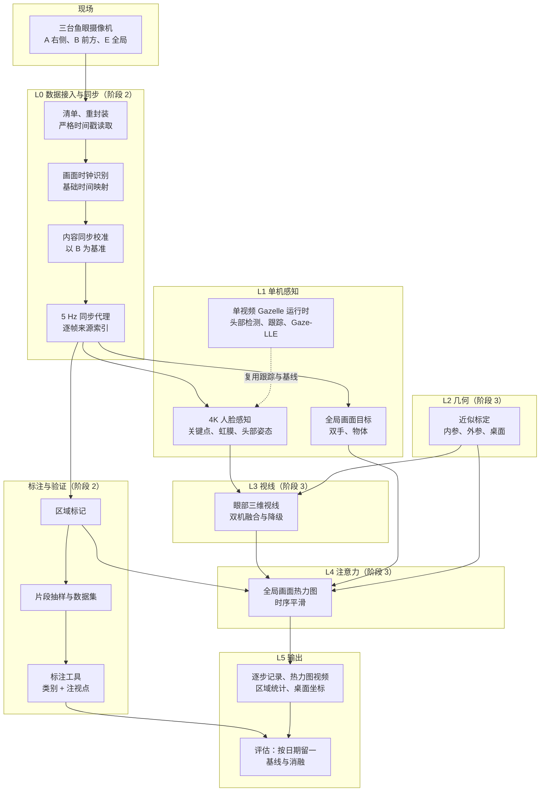
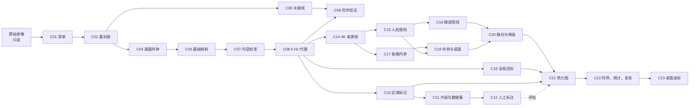

# 系统总体设计

## 0. 文档定位

本文是全系统的总图。它说明系统由哪些部分组成、数据怎样流动、产物放在哪里；细节在各专项设计中：

| 主题 | 文档 |
| --- | --- |
| 目标与需求 | [项目目标与需求基线](../../collab/PROJECT_GOALS_CN.md) |
| 阶段 3：视线与注意力位置 | [阶段 3 视线与注意力位置估计设计](2026-10-18-gaze-attention-system-design.md) |
| 验证集与标注 | [作业数据验证集设计](2026-10-15-workdata-validation-set-design.md) |
| 作业者锁定（D1、D2） | [人脸与姿态关联、新轨迹确认设计](2026-10-15-face-pose-association-and-track-confirmation-design.md) |
| 三机同步协议 r2（D18） | [同步分析](../../collab/evidence/2026-10-17-sync-analysis.md) §7；任务 [TASK-139](../../collab/tasks/TASK-139-content-calibrated-sync.md)、[TASK-140](../../collab/tasks/TASK-140-sync-validation-and-steps.md)；[作业数据工具说明](../../../tools/workdata/README_CN.md) |
| 进展与决策 | [ROADMAP](../../collab/ROADMAP.md)、[STATE](../../collab/STATE.md) |
| 文档与版本规则 | [文档记录体系与版本规则](../../DOCS_SYSTEM_CN.md) |

本文只写设计，不写进展。各组件的完成情况以 ROADMAP 的任务状态为准，总览网页会把两者对应起来。

## 1. 系统做什么

<!-- portal:block system-summary -->
- **输入**：同一工位三台固定鱼眼摄像机的同步录像。
  - 前方 B、右侧 A 两台对着作业者的脸；
  - 全局 E 俯视两张桌面。
- **输出**：
  - 第一步：作业者每一时刻的视线方向，含头部与眼球各自的贡献；
  - 第一步：全局画面上的注意力热力图，区分你画的区域、双手与手中物体、工作区内其他、画面外；
  - 第一步：由热力图得到的区域统计，包括占比、停留时长、切换次数与离开工作的比例；
  - 第二步：桌面上的物理坐标（厘米）。
- **方式**：离线批处理。先单人，结果可审计：每一步都记录证据等级与不确定度。
- **结构**：
  - 第 2 阶段已建成数据层：解码、同步、代理视频、区域与标注工具；
  - 第 3 阶段在其上建视线、标定、目标、热力图与统计。
<!-- /portal:block -->

## 2. 现场与数据

| 摄像机 | 物理编号 | 文件名中的名称 | 位置与视角 | 格式 |
| --- | --- | --- | --- | --- |
| A 右侧 | `cam_a` | 表情解析用カメラ1（20260903 文件夹中为カメラ2） | 右侧桌面上，强烈仰视；作业者转向右侧时看到正脸 | 3840×2160，H.264 MP4（标称 30 fps，可变帧率）；0821、0828 为 HEVC AVI |
| B 前方 | `cam_b` | 表情解析用カメラ2（20260903 文件夹中为カメラ1） | 前方桌面货架横梁下，接近水平略仰；在前方桌面作业时看到脸 | 3840×2160，H.264 MP4（标称 50 fps，可变帧率）；0821、0828 为 HEVC AVI |
| E 全局 | `cam_e` | 設備カメラ | 两张桌面之间高处俯视；看到桌面、双手与躯干，头部大多在画面外 | 3840×2160，HEVC AVI，30 fps |

- **录制**：7 次（20260821、0828、0903、0911、0925、1002、1009），三机重叠约 6.5 小时。每次一名作业者，不同日期作业者不同，机位不变。新出现的 `20261016` 不纳入研究集。
- **时钟**：三台摄像机都有烧录的画面时钟，但彼此不同步。AVI 的容器时间有约 0.2% 的漂移。同步由协议 r2 用画面内容校准（§6）。
- **源数据**：`E:\Gazelle_Workdata\` 只读。所有派生数据只放在仓库之外（§5）。
- **隐私**：录像中有可识别的人脸，仓库与报告只写汇总数字。

## 3. 总体架构

<!-- portal:mermaid architecture -->

<!-- portal:table system-layers -->
| 层 | 做什么 | 主要组件 | 阶段 |
| --- | --- | --- | --- |
| L0 数据接入与同步 | 让三台摄像机的录像可以完整、准确地解码，并对齐到同一时间轴 | C01–C09 | 2 |
| 标注与验证 | 画区域、抽片段、人工标注，作为评估真值 | C10–C12 | 2 |
| L1 单机感知 | 在每台摄像机中找到作业者、人脸关键点与双手 | C13–C15、C19 | 2、3 |
| L2 几何 | 三台摄像机的近似内外参与桌面平面 | C17、C18 | 3 |
| L3 视线 | 每台人脸摄像机的眼部三维视线，融合并标明证据等级 | C16、C20 | 3 |
| L4 注意力 | 全局画面热力图与时序平滑 | C21、C22 | 3 |
| L5 输出与评估 | 逐步记录、复核视频、统计、桌面坐标、评估报告 | C22、C23 | 3 |

## 4. 数据处理流程

<!-- portal:mermaid pipeline -->

<!-- portal:table components -->
| 编号 | 环节 | 实现 | 输入 → 输出 | 阶段 | 相关任务 |
| --- | --- | --- | --- | --- | --- |
| C01 | 清单 | `tools/workdata/inventory.py` | 原始录像 → `inventory/inventory.json`：指纹、流信息、摄像机身份 | 2 | TASK-132 |
| C02 | 重封装 | `tools/workdata/remux.py` | AVI → 无损 MP4（`remux/`），去掉空包，严格校验 | 2 | TASK-132、TASK-135 |
| C03 | 严格读取 | `gazelle/runtime/media.py`、`tools/workdata/video_source.py` | 视频 → 带容器时间戳的帧；时间戳严格递增，截断即失败 | 2 | TASK-131 |
| C04 | 画面时钟识别 | `tools/workdata/osd_clock.py` | 帧 → 烧录时钟读数，识别不可靠时不造读数 | 2 | TASK-133 |
| C05 | 基础时间映射 | `tools/workdata/timemap.py` | 时钟锚点 → `timemaps_v2_base`：每个文件 wall = a + b × pts | 2 | TASK-133、TASK-139 |
| C06 | 关键帧索引 | `tools/workdata/keyframes.py` | 源文件 → `keyframes_v3`，供同步时屏蔽关键帧脉冲 | 2 | TASK-140 |
| C07 | 内容同步校准 | `tools/workdata/sync_calibrate.py` | 5 Hz 灰度样本 → `timemaps_v3`：以 B 为基准的偏移、漂移与分段，标出 `sync_uncertain` | 2 | TASK-139、TASK-140 |
| C08 | 5 Hz 同步代理 | `tools/workdata/proxies.py` | 时间映射 → `proxies/`：三机 1080p 视频与逐帧来源（源文件与 PTS） | 2 | TASK-134、TASK-139、TASK-140 |
| C09 | 同步验证 | `tools/workdata/sync_validate.py` | 代理 → `sync_validation_v3`：跨机残差、时钟抽查、事件条图 | 2 | TASK-140 |
| C10 | 区域标记 | `tools/validation/roi_server.py` 等 | 全局画面 → `roi/`：4 个目标区域与 1 个工作区、类别文件 | 2 | TASK-123、TASK-138 |
| C11 | 片段抽样与数据集 | `tools/validation/sample_segments.py`、`extract_frames.py` | 代理与区域 → `gazelle_validation/roi_r2`：26 个 60 秒片段 | 2 | TASK-121、TASK-140 |
| C12 | 人工标注 | `tools/validation/annotate_server.py`、`labels.py` | 片段 → 标注文件：类别与注视点（方案 r3） | 2 | TASK-121、TASK-138、TASK-124、TASK-125 |
| C13 | 单视频 Gazelle 运行时 | `main.py`、`gazelle/runtime/` | 单段视频 → 头部观测、Gaze-LLE 热图与 in/out、渲染视频 | 2 | TASK-001、TASK-002、TASK-102、TASK-136、TASK-101 |
| C14 | 4K 来源帧访问 | 计划：`tools/attention/` | 代理的来源索引 → 每步的 4K 原片帧 | 3 | TASK-301 |
| C15 | 人脸感知 | 计划 | 4K 帧 → 478 点关键点、虹膜、头部姿态、质量标记 | 3 | TASK-302 |
| C16 | 眼部三维视线 | 计划 | 人脸 → 每台摄像机的视线方向与不确定度 | 3 | TASK-303 |
| C17 | 鱼眼内参 | 计划 | 静态画面 → 三台摄像机的内参与畸变 | 3 | TASK-304 |
| C18 | 外参、尺度与桌面 | 计划 | 同步人体关键点、场景结构 → 三机外参、尺度、桌面平面 | 3 | TASK-305 |
| C19 | 全局画面目标 | 计划 | E 的代理帧 → 双手、手中物体、画面外判断 | 3 | TASK-306 |
| C20 | 融合与降级 | 计划 | 两台摄像机的视线 + 标定 → 工位坐标中的视线与证据等级 | 3 | TASK-307 |
| C21 | 注意力热力图与评估 | 计划 | 视线锥 × 目标 → 全局画面热力图；对照标注评估 | 3 | TASK-308、TASK-311 |
| C22 | 时序、统计与复核 | 计划 | 热力图 → 平滑结果、区域统计、三视角复核视频 | 3 | TASK-309 |
| C23 | 桌面物理位置 | 计划 | 热力图 + 桌面平面 → 厘米坐标 | 3 | TASK-310 |

## 5. 数据产物与存放位置

所有派生数据都在仓库之外，不提交，不上传。

<!-- portal:table products -->
| 产物 | 位置 | 生成者 | 说明 |
| --- | --- | --- | --- |
| 清单 | `gazelle_data\workdata\inventory\inventory.json` | C01 | 40 个文件的指纹、流信息与摄像机身份 |
| 重封装视频 | `gazelle_data\workdata\remux\<日期>\` | C02 | AVI 改为无损 MP4，附 `remux_report.json` |
| 时间映射 | `gazelle_data\workdata\timemaps_v2_base\`、`timemaps_v3\` | C05、C07 | v3 为协议 r2 的正式映射 |
| 同步样本与关键帧 | `gazelle_data\workdata\sync_samples_v2\`、`keyframes_v3\` | C06、C07 | 校准与验证用的缩略图样本、关键帧位置 |
| 同步代理 | `gazelle_data\workdata\proxies\` | C08 | 每次录制三段 1080p、5 Hz 视频与逐帧来源；TASK-140 第 2 轮切换为正式版本 |
| 同步验证 | `gazelle_data\workdata\sync_validation_v3\` | C09 | 残差、时钟抽查、条图 |
| 区域 | `gazelle_data\workdata\roi\` | C10 | 正式区域、类别文件、参考图；只读，经批准的修正除外 |
| 验证集 | `gazelle_validation\roi_r2\`、`roi_r2_trial\` | C11、C12 | 片段帧、清单与标注 |
| 运行输出 | `gazelle_runs\` | 各任务 | 真实运行与审查的记录 |
| 阶段 3 结果（计划） | `gazelle_data\workdata\attention\<日期>\` | C14–C23 | `face_obs.jsonl`、`gaze.jsonl`、`targets.jsonl`、`attention.jsonl`、`heatmaps.npz`、`stats.json`、`review.mp4` |
| 标定（计划） | `gazelle_data\workdata\calibration\` | C17、C18 | 内参、外参、桌面平面，带版本号与协方差 |

路径前缀 `gazelle_data`、`gazelle_validation`、`gazelle_runs` 都在 `C:\Users\yun\Documents\Claude_Code\` 下。

## 6. 时间轴与同步（协议 r2，D18）

- **基准**：以前方摄像机 B 的画面时钟为时间轴，分析步长 5 Hz（D13，经 D18 修订）。
- **校准**：A 与 E 用画面运动和 B 做互相关，估计偏移、漂移与少数台阶式跳变。跳变附近的步标为 `sync_uncertain`，不参与跨机融合，也不进入抽样。
- **精度**：7 次录制全部通过验证，跨机残差约 0.05 秒。
- **来源索引**：代理的每一步都记录三台摄像机各自的源文件与 PTS。阶段 3 由此取 4K 原片帧，不另建时间轴。

## 7. 单视频运行时（现有 Gazelle CLI）

- **流程**：`main.py` 读取一段视频；头部来源可以是静态框、JSON 或 MediaPipe 感知与跟踪；对选中的头部运行 Gaze-LLE（DINOv2 ViT-B/14，in/out）；输出逐帧 JSONL 与渲染视频。
- **在本系统中的作用**：
  - 作业者跟踪（D1、D2）供阶段 3 的人脸感知复用；
  - 在全局画面上直接运行 Gaze-LLE，作为评估基线 B3；
  - 运行时的不变量见 `AGENTS.md`，阶段 3 不改变其公开行为。

## 8. 阶段 3 的处理（摘要）

- 在 A、B 的 4K 画面估计含眼球转动的三维视线。
- 经近似标定换算到全局画面，与双手、物体、区域结合成热力图。
- 每步记录证据等级：眼 > 头 > 身体 > 先验，以及不确定度。
- 用 r3 注视点按日期留一评估，核心对比是“眼部”与“只用头部”。
- 详见阶段 3 设计。

## 9. 质量保障

- **离线门**：编译、全部单元测试、CLI 帮助与模型列表、diff 检查。默认测试不联网、不下载、不需要 CUDA。
- **真实运行**：GPU、MediaPipe、FFmpeg 只在授权范围内运行，记录命令、版本与产物。
- **审查**：
  - Codex 实施，Claude 按提交审查并独立复跑；
  - 研究语义与评估协议的改动需要独立审查；
  - 用户在独立目录做最终验收。
- **可行性关卡**：阶段 3 每一步都有通过条件（阶段 3 设计 §9）。未通过时停下报告，不放宽门槛。
- **文档**：受控文档有版本号与归档；网页与 Markdown 总览由工具生成并检查同步（文档记录体系）。

## 版本记录

<!-- portal:versions -->
| 版本 | 日期 | 状态 | 变更摘要 | 确认 | 归档 |
| --- | --- | --- | --- | --- | --- |
| 1.0.0 | 2026-10-18 | 待确认 | 首版：系统定位、现场与数据、总体架构、组件 C01–C23、数据产物、同步、运行时、阶段 3 摘要、质量保障 | Q-018 | [v1.0.0](../../archive/SYSTEM/SYSTEM_v1.0.0.md) |
