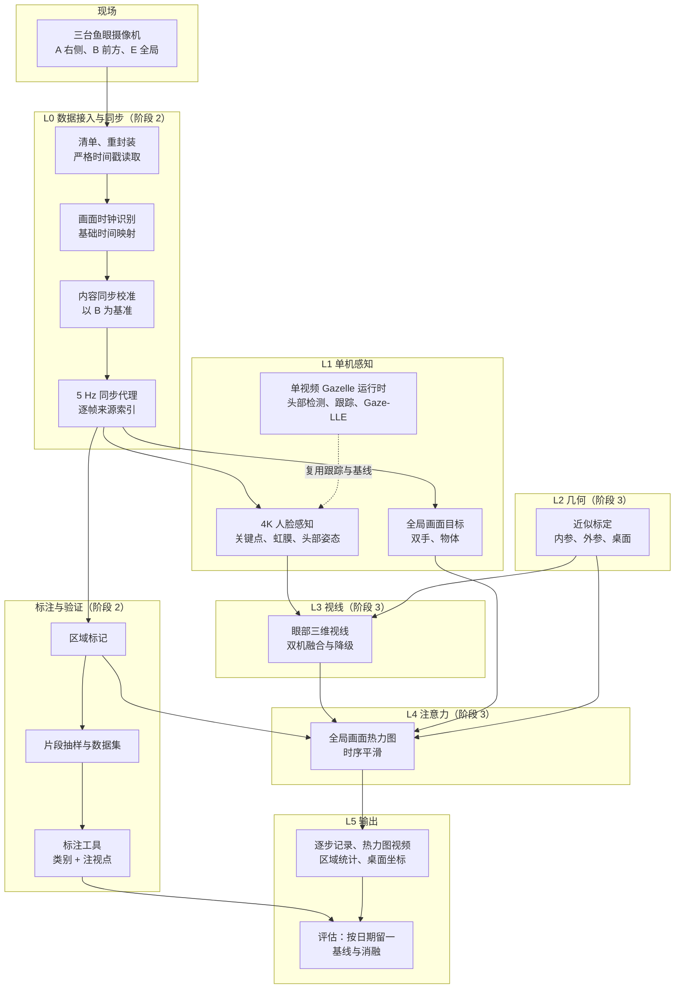
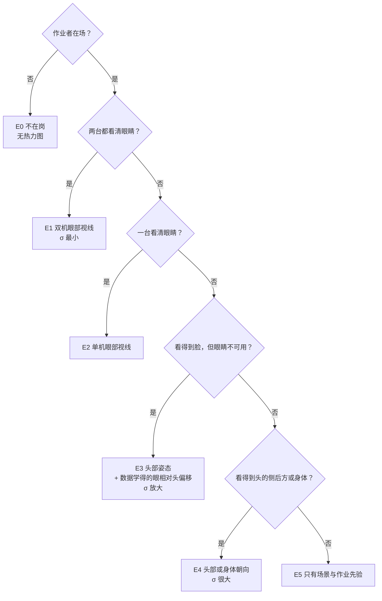
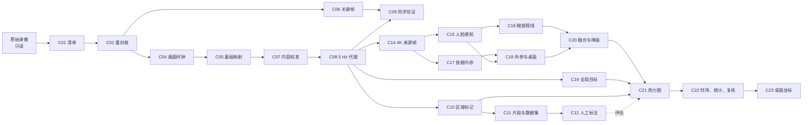
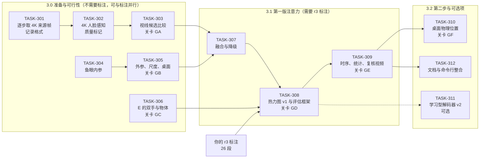

# Gazelle 项目总览

> 本文件由 `python -m tools.docs build` 自动生成，与 `docs/portal/index.html` 内容相同，不要手改。规则见 [文档记录体系与版本规则](../../../DOCS_SYSTEM_CN.md)。

当前基线：**B001**（2026-10-18）。

## 1. 总览

| 项目 | 内容 |
| --- | --- |
| 当前阶段 | 阶段 2：作业数据可用、多机同步、正确性修复，建立区域标注 |
| 当前任务 | 等待用户确认：系统总体设计 v1.0.0 与阶段 3 设计 v2.0.1（Q-018）；文档记录体系 v1.0.0 与协同开发方案 v0.7.0（Q-019）。用户要求：确认设计之前不继续开发 |
| 轮到 | 你（用户） |
| 最近更新 | 2026-10-18 16–17 时，Claude：按用户要求建立文档记录体系（版本号、归档、基线、回档；总览网页 `docs/portal/index.html` 与 Markdown 总览由工具生成），新增系统总体设计，发布基线 B001；开发仍暂停，等用户确认（Q-018、Q-019）。此前 04 时：阶段 3 设计 v2 与只读可行性实测 |

### 需要你处理

- **问题 Q-017**：确认标注方案 r3 的细则
- **问题 Q-018**：系统总体设计 v1.0.0 与阶段 3 设计 v2.0.1 的批准
- **问题 Q-019**：确认文档记录体系 v1.0.0 与协同开发方案 v0.7.0
- **决策**：D22 阶段 3 系统设计 v2；D23 模型与许可策略；D24 阶段 3 使用的分支；D25 文档记录体系
- **待确认文档**：系统总体设计 v1.0.0、阶段 3 视线与注意力位置估计设计 v2.0.1、作业数据验证集设计 v3.1.1、Claude × Codex 协同开发方案 v0.7.0、文档记录体系与版本规则 v1.0.0

### 阶段

| 阶段 | 目标 | 状态 |
| --- | --- | --- |
| 1 | 迁移与基线 | done |
| 2 | 作业数据可用、多机同步、正确性修复，建立区域标注 | 进行中 |
| 3 | 视线与注意力位置估计：头 + 眼的视线、全局画面热力图（含手部与物体）、区域统计，之后是桌面物理位置 | 2026-10-18 按目标 v3 重新定向；[系统总体设计](../../../superpowers/specs/2026-10-18-system-overview-design.md)与[阶段 3 设计](../../../superpowers/specs/2026-10-18-gaze-attention-system-design.md)已写好，待你确认（Q-018） |
| 4 | 工程加固 | proposed |
| 5 | 多人同时推断 | 未开始 |
| 远期 | 实时处理 | 不纳入当前计划 |

### 项目目标

最终要达到两个主要目的，并遵守一条方法要求：

1. **高精度视线估计**：高精度地估计目标作业者的视线方向，包括头部转动与眼球转动带来的视线变化。
2. **注意力位置估计**：由视线推断作业者此刻实际注视的位置，结果要较为精确，用中心浓、外围渐淡的热力图表示注意力范围。
   - 注视目标不只是桌面上的固定区域，也包括双手、手中的工件和其他会移动的物体。这是难点所在。
3. **方法要求**：作业时眼球、头部与身体的朝向并不同步，不能只用头部方向推断视线，要尽量使用能得到更精确视线的特征，例如眼部信息。

区域统计（各区域注视占比、每次注视时长、切换次数、看向工作区以外的比例）继续保留，改为由注意力热力图在各区域内积分得到。

你同日的回答（D19 至 D21）：

| 决定 | 内容 |
| --- | --- |
| D19 | 暂时不能追加现场录制，包括标定板、注视标记点、眼动仪与机位调整。只用现有 7 次录制：几何标定只能做近似；视线与注意力位置的精度，用人工标注的注视点间接评估。以后若能追加录制，再补真值 |
| D20 | 正式标注暂停，先修订标注方案：在区域之外增加“手部/手中物体”类别，并在注视变化处点出注视位置。方案与工具就绪后再开始 26 段 |
| D21 | 输出分两步：先在全局摄像机画面上给出注意力热力图，区分桌面区域与手部、物体；完成近似几何标定后，再给出桌面上的物理位置（厘米） |

### 目标进展

| 编号 | 目标 | 当前状态 |
| --- | --- | --- |
| G1 | 数据接入 | **已满足**（TASK-131、132、135）：AVI 无损重封装，时间戳严格递增，截断即失败 |
| G2 | 多机同步 | **基本满足**：同步协议 r2（D18），7 次录制的跨机残差约 0.05 秒；正式切换与不确定区间由 TASK-140 第 2 轮完成 |
| G3 | 主体感知 | 部分：首帧丢失已修复（TASK-102）；跨人误配（GZ-01）由 TASK-101 修复，尚未在作业视频上验证 |
| G4 | 单机视线证据 | 已实现（单视频 CLI）。按 v3，它只是辅助证据：人脸摄像机拍不到桌面，全局摄像机拍不到头，Gaze-LLE 无法直接给出注意力位置 |
| G5 | 注意力位置 | 未开始；原设计（D13 至 D15，区域分类）需按 v3 重新设计 |
| G6 | 统计 | 未开始 |
| G7 | 可审计输出与复核 | 部分：单机输出与渲染已实现 |
| G8 | 研究可复现 | 部分：输出不记录代码版本（P5）；标注与评估待建 |
| G9 | 多人与实时（远期） | 未开始 |
| G10 | 视线方向 | 未开始；候选方法待评估：MediaPipe 虹膜关键点的几何法（无需下载），以及公开的外观法模型（下载需要你授权） |
| G11 | 近似几何标定 | 未开始；不追加录制（D19），只能用同步的人体关键点与场景结构做近似，精度待评估 |
| G12 | 动态目标 | 未开始 |
| G13 | 精度评估 | 未开始；按 D19 用人工标注的注视点评估（标注方案 r3，D20），并用两台人脸摄像机之间的一致性旁证 |

## 2. 系统设计

- **输入**：同一工位三台固定鱼眼摄像机的同步录像。
  - 前方 B、右侧 A 两台对着作业者的脸；
  - 全局 E 俯视两张桌面。
- **输出**：
  - 第一步：作业者每一时刻的视线方向，含头部与眼球各自的贡献；
  - 第一步：全局画面上的注意力热力图，区分你画的区域、双手与手中物体、工作区内其他、画面外；
  - 第一步：由热力图得到的区域统计，包括占比、停留时长、切换次数与离开工作的比例；
  - 第二步：桌面上的物理坐标（厘米）。
- **方式**：离线批处理。先单人，结果可审计：每一步都记录证据等级与不确定度。
- **结构**：
  - 第 2 阶段已建成数据层：解码、同步、代理视频、区域与标注工具；
  - 第 3 阶段在其上建视线、标定、目标、热力图与统计。

### 总体架构

### 分层

| 层 | 做什么 | 主要组件 | 阶段 |
| --- | --- | --- | --- |
| L0 数据接入与同步 | 让三台摄像机的录像可以完整、准确地解码，并对齐到同一时间轴 | C01–C09 | 2 |
| 标注与验证 | 画区域、抽片段、人工标注，作为评估真值 | C10–C12 | 2 |
| L1 单机感知 | 在每台摄像机中找到作业者、人脸关键点与双手 | C13–C15、C19 | 2、3 |
| L2 几何 | 三台摄像机的近似内外参与桌面平面 | C17、C18 | 3 |
| L3 视线 | 每台人脸摄像机的眼部三维视线，融合并标明证据等级 | C16、C20 | 3 |
| L4 注意力 | 全局画面热力图与时序平滑 | C21、C22 | 3 |
| L5 输出与评估 | 逐步记录、复核视频、统计、桌面坐标、评估报告 | C22、C23 | 3 |

### 视线证据的降级层级（阶段 3）

### 可行性实测（2026-10-18，只读）

| 指标 | 前方 B | 右侧 A |
| --- | --- | --- |
| 检出人脸 / 得到关键点（占全部样本） | 56.7% / 37.0% | 66.8% / 40.1% |
| 人脸宽度（4K 像素，中位数；10%–90% 分位） | 340（206–464） | 350（212–508） |
| 虹膜直径（4K 像素） | 28.9（16.3–33.1） | 26.6（15.2–37.2） |
| 眼裂宽度（4K 像素） | 76.5 | 72.6 |
| 头部偏离该摄像机视线的角度（中位数；≤45° 的比例） | 19.9°；91% | 26.2°；85% |
| 眼睛基本闭合（开合比 < 0.15） | 1.6% | 2.7% |
| 眼球转动系数 > 0.5：向下 / 向内 / 向外 | 12.0% / 12.5% / 14.0% | 12.5% / 20.1% / 18.0% |
| “眼部可用”：有关键点、偏离 ≤45°、眼睛睁开、虹膜 ≥ 8 像素 | 33.0% | 32.8% |

| 指标 | 数值 |
| --- | --- |
| 至少一台眼部可用（全部步） | 62.0% |
| 两台同时可用 | 3.9% |
| 作业者在场的步中（代理判断：A/B 有人脸，或 E 有人体），至少一台眼部可用 | 76.4% |
| 按录制（在场步中） | 0821：78.5%；0828：83.3%；0903：63.5%；0911：46.9%；0925：76.3%；1002：89.1%；1009：95.2% |
| 全局摄像机：检出人体姿态 / 至少一只手腕可见 | 31.5% / 26.7% |

## 3. 数据流程

完成情况由 ROADMAP 中相关任务的状态推算。

| 编号 | 环节 | 实现 | 输入 → 输出 | 阶段 | 相关任务 | 完成情况 |
| --- | --- | --- | --- | --- | --- | --- |
| C01 | 清单 | `tools/workdata/inventory.py` | 原始录像 → `inventory/inventory.json`：指纹、流信息、摄像机身份 | 2 | TASK-132 | 已实现 |
| C02 | 重封装 | `tools/workdata/remux.py` | AVI → 无损 MP4（`remux/`），去掉空包，严格校验 | 2 | TASK-132、TASK-135 | 已实现 |
| C03 | 严格读取 | `gazelle/runtime/media.py`、`tools/workdata/video_source.py` | 视频 → 带容器时间戳的帧；时间戳严格递增，截断即失败 | 2 | TASK-131 | 已实现 |
| C04 | 画面时钟识别 | `tools/workdata/osd_clock.py` | 帧 → 烧录时钟读数，识别不可靠时不造读数 | 2 | TASK-133 | 已实现 |
| C05 | 基础时间映射 | `tools/workdata/timemap.py` | 时钟锚点 → `timemaps_v2_base`：每个文件 wall = a + b × pts | 2 | TASK-133、TASK-139 | 已实现 |
| C06 | 关键帧索引 | `tools/workdata/keyframes.py` | 源文件 → `keyframes_v3`，供同步时屏蔽关键帧脉冲 | 2 | TASK-140 | 进行中 |
| C07 | 内容同步校准 | `tools/workdata/sync_calibrate.py` | 5 Hz 灰度样本 → `timemaps_v3`：以 B 为基准的偏移、漂移与分段，标出 `sync_uncertain` | 2 | TASK-139、TASK-140 | 进行中 |
| C08 | 5 Hz 同步代理 | `tools/workdata/proxies.py` | 时间映射 → `proxies/`：三机 1080p 视频与逐帧来源（源文件与 PTS） | 2 | TASK-134、TASK-139、TASK-140 | 进行中 |
| C09 | 同步验证 | `tools/workdata/sync_validate.py` | 代理 → `sync_validation_v3`：跨机残差、时钟抽查、事件条图 | 2 | TASK-140 | 进行中 |
| C10 | 区域标记 | `tools/validation/roi_server.py` 等 | 全局画面 → `roi/`：4 个目标区域与 1 个工作区、类别文件 | 2 | TASK-123、TASK-138 | 已实现 |
| C11 | 片段抽样与数据集 | `tools/validation/sample_segments.py`、`extract_frames.py` | 代理与区域 → `gazelle_validation/roi_r2`：26 个 60 秒片段 | 2 | TASK-121、TASK-140 | 进行中 |
| C12 | 人工标注 | `tools/validation/annotate_server.py`、`labels.py` | 片段 → 标注文件：类别与注视点（方案 r3） | 2 | TASK-121、TASK-138、TASK-124、TASK-125 | 进行中 |
| C13 | 单视频 Gazelle 运行时 | `main.py`、`gazelle/runtime/` | 单段视频 → 头部观测、Gaze-LLE 热图与 in/out、渲染视频 | 2 | TASK-001、TASK-002、TASK-102、TASK-136、TASK-101 | 进行中 |
| C14 | 4K 来源帧访问 | 计划：`tools/attention/` | 代理的来源索引 → 每步的 4K 原片帧 | 3 | TASK-301 | 计划 |
| C15 | 人脸感知 | 计划 | 4K 帧 → 478 点关键点、虹膜、头部姿态、质量标记 | 3 | TASK-302 | 计划 |
| C16 | 眼部三维视线 | 计划 | 人脸 → 每台摄像机的视线方向与不确定度 | 3 | TASK-303 | 计划 |
| C17 | 鱼眼内参 | 计划 | 静态画面 → 三台摄像机的内参与畸变 | 3 | TASK-304 | 计划 |
| C18 | 外参、尺度与桌面 | 计划 | 同步人体关键点、场景结构 → 三机外参、尺度、桌面平面 | 3 | TASK-305 | 计划 |
| C19 | 全局画面目标 | 计划 | E 的代理帧 → 双手、手中物体、画面外判断 | 3 | TASK-306 | 计划 |
| C20 | 融合与降级 | 计划 | 两台摄像机的视线 + 标定 → 工位坐标中的视线与证据等级 | 3 | TASK-307 | 计划 |
| C21 | 注意力热力图与评估 | 计划 | 视线锥 × 目标 → 全局画面热力图；对照标注评估 | 3 | TASK-308、TASK-311 | 计划 |
| C22 | 时序、统计与复核 | 计划 | 热力图 → 平滑结果、区域统计、三视角复核视频 | 3 | TASK-309 | 计划 |
| C23 | 桌面物理位置 | 计划 | 热力图 + 桌面平面 → 厘米坐标 | 3 | TASK-310 | 计划 |

### 数据产物与位置

| 产物 | 位置 | 生成者 | 说明 |
| --- | --- | --- | --- |
| 清单 | `gazelle_data\workdata\inventory\inventory.json` | C01 | 40 个文件的指纹、流信息与摄像机身份 |
| 重封装视频 | `gazelle_data\workdata\remux\<日期>\` | C02 | AVI 改为无损 MP4，附 `remux_report.json` |
| 时间映射 | `gazelle_data\workdata\timemaps_v2_base\`、`timemaps_v3\` | C05、C07 | v3 为协议 r2 的正式映射 |
| 同步样本与关键帧 | `gazelle_data\workdata\sync_samples_v2\`、`keyframes_v3\` | C06、C07 | 校准与验证用的缩略图样本、关键帧位置 |
| 同步代理 | `gazelle_data\workdata\proxies\` | C08 | 每次录制三段 1080p、5 Hz 视频与逐帧来源；TASK-140 第 2 轮切换为正式版本 |
| 同步验证 | `gazelle_data\workdata\sync_validation_v3\` | C09 | 残差、时钟抽查、条图 |
| 区域 | `gazelle_data\workdata\roi\` | C10 | 正式区域、类别文件、参考图；只读，经批准的修正除外 |
| 验证集 | `gazelle_validation\roi_r2\`、`roi_r2_trial\` | C11、C12 | 片段帧、清单与标注 |
| 运行输出 | `gazelle_runs\` | 各任务 | 真实运行与审查的记录 |
| 阶段 3 结果（计划） | `gazelle_data\workdata\attention\<日期>\` | C14–C23 | `face_obs.jsonl`、`gaze.jsonl`、`targets.jsonl`、`attention.jsonl`、`heatmaps.npz`、`stats.json`、`review.mp4` |
| 标定（计划） | `gazelle_data\workdata\calibration\` | C17、C18 | 内参、外参、桌面平面，带版本号与协方差 |

## 4. 开发进展

### 本轮与下一轮

| 轮次 | 任务 | 状态 | 说明 |
| --- | --- | --- | --- |
| Codex 第 5 轮 | [TASK-140](../../../collab/tasks/TASK-140-sync-validation-and-steps.md) 第 2 轮：切点不确定区间、时钟同源帧补读、正式切换与两个数据集 | ready（用户确认设计后开始） | 第 5 轮第一项 |
| Codex 第 5 轮 | [TASK-124](../../../collab/tasks/TASK-124-annotation-hardening.md) 第 2 轮：手动逐步的写盘降频等 | ready | 正式标注之前完成 |
| Codex 第 5 轮 | [TASK-125](../../../collab/tasks/TASK-125-annotation-points-and-hands-class.md) 标注方案 r3（含条件项 r3.1） | ready（条件：Q-017） | Q-017 未确认则跳过 |
| Codex 第 6 轮 | [TASK-101](../../../collab/tasks/TASK-101-face-pose-association.md) 人脸与姿态关联修正（D1，契约 r2） | ready | 阶段 3 的作业者锁定依赖它 |
| 用户 | 回复 Q-017、Q-018、Q-019 | 待你确认 | 确认之前不继续开发 |
| 用户 | 按方案 r3 标注 26 段，约 3 小时 | 暂停（D20） | 需 r3 细则确认、TASK-125 与第 5 轮通过审查，并生成正式数据集 `roi_r2` |
| Claude | 阶段 3 第一批契约：TASK-301、302、304、306 | proposed | 设计批准且第 5 轮审查通过后编写 |
| Claude | 阶段 2 验收：离线门、作业数据真实 smoke、同步精度、修复前后对比 | proposed | — |

### 阶段 2 任务

| 轮次 | 任务 | 状态 | 问题 | 规模 | 真实运行 |
| --- | --- | --- | --- | --- | --- |
| 1 | [TASK-131](../../../collab/tasks/TASK-131-video-reader-timestamps-and-truncation.md) 读取器：容器时间戳、严格递增、截断即失败 | accepted | GZ-07、GZ-21 | M | CPU 读取检查；一次 GPU smoke |
| 1 | [TASK-132](../../../collab/tasks/TASK-132-workdata-inventory-and-avi-remux.md) 作业数据清单与 AVI 无损重封装 | accepted | 数据 P0、GZ-22 | M | FFmpeg 流复制 |
| 1 | [TASK-123](../../../collab/tasks/TASK-123-overview-region-marking-tool.md) 全局摄像机画面中的区域标记工具 | accepted（第 2 轮修复后） | Q8 | M | CPU，抽取候选帧 |
| 1 | [TASK-001](../../../collab/tasks/TASK-001-overwrite-safe-validation.md) 参数在 `--overwrite` 删除前校验 | accepted | GZ-04 | S–M | 否 |
| 2 | [TASK-137](../../../collab/tasks/TASK-137-switch-to-gazelle-next.md) 项目环境切换到 `Gazelle-next`（仓库侧） | accepted | D16 | S–M | GPU smoke 三次 |
| 2 | [TASK-135](../../../collab/tasks/TASK-135-round1-followups.md) 第 1 轮审查的后续加固 | accepted | GZ-07、GZ-21 | S–M | CPU，重新校验重封装 |
| 2 | [TASK-133](../../../collab/tasks/TASK-133-osd-clock-time-maps.md) 画面时钟识别、时间映射与同步检验 | 部分通过（时间映射由 TASK-139 取代） | 同步、GZ-22、GZ-26 | L | CPU |
| 2 | [TASK-134](../../../collab/tasks/TASK-134-synchronized-proxies.md) 5 Hz 同步代理视频 | accepted（生成机制；代理由 TASK-139 重新生成） | 同步 | M | CPU，数小时 |
| 2 | [TASK-121](../../../collab/tasks/TASK-121-validation-annotation-toolkit.md) 多视角同步片段的区域标注工具（D12 r2） | accepted（连同 TASK-138） | F2、GZ-27 | L | CPU |
| 你 | 用区域标记工具画出区域 | 完成（2026-10-17） | — | — | — |
| 你 | 决定 D18：同步协议 r2 | 已批准（2026-10-17） | GZ-26 | — | — |
| 3 | [TASK-138](../../../collab/tasks/TASK-138-annotation-and-roi-followups.md) 标注与区域工具的后续修复 | accepted | GZ-27 | M | CPU，浏览器实测 |
| 3 | [TASK-136](../../../collab/tasks/TASK-136-gazelle-device-preprocessing.md) Gazelle 输入预处理移到推理设备 | accepted | GZ-25 | S–M | 是，CUDA smoke |
| 3 | [TASK-139](../../../collab/tasks/TASK-139-content-calibrated-sync.md) 同步协议 r2：以前方摄像机为基准的画面内容校准 | 部分通过（余项由 TASK-140 完成） | GZ-26 | L | CPU，约 6 小时后台 |
| 3 | [TASK-102](../../../collab/tasks/TASK-102-spawn-frame-confirmation.md) 新轨迹首帧立即确认（D2） | accepted（第 4 轮修复后） | GZ-03、GZ-30 | M | 是 |
| 3 | [TASK-002](../../../collab/tasks/TASK-002-face-ray-sign-alignment.md) 面部射线与 roll 符号对齐 | accepted | GZ-02 | M | 是 |
| 4 | [TASK-140](../../../collab/tasks/TASK-140-sync-validation-and-steps.md) 同步协议 r2 的验证与分段修订 | 实现通过；第 2 轮 ready | GZ-26、GZ-29 | L | CPU |
| 4 | [TASK-124](../../../collab/tasks/TASK-124-annotation-hardening.md) 标注工具加固 | changes-requested（第 2 轮） | GZ-27 后续 | S | CPU，浏览器实测 |
| 5 | TASK-140 第 2 轮：切点不确定区间、时钟同源帧补读、正式切换与两个数据集 | ready（本轮第一项） | GZ-26、GZ-29 | M | CPU，不到 1 小时 |
| 5 | TASK-124 第 2 轮：手动逐步的写盘降频等 | ready | GZ-27 后续 | S | CPU，浏览器实测 |
| 5 | [TASK-125](../../../collab/tasks/TASK-125-annotation-points-and-hands-class.md) 标注方案 r3：“手部/手中物体”类别与注视点 | ready（条件：Q-017 已确认） | D20 | M | CPU，浏览器实测 |
| 6 | [TASK-101](../../../collab/tasks/TASK-101-face-pose-association.md) 人脸与姿态关联修正（D1，契约 r2） | ready | GZ-01 | L | 是 |
| 你 | 标注 26 段，约 3 小时（方案 r3：区域、手部/手中物体、注视点） | 暂停（D20）；待 r3 细则确认、TASK-125 与第 5 轮通过审查 | — | — | — |
| — | 阶段 2 验收：离线门、作业数据真实 smoke、同步精度、修复前后对比 | 未开始 | — | — | Claude 执行 |

### 阶段 3 任务（提议）

| 任务 | 内容 | 阶段 | 状态 | 关卡 | 依赖 |
| --- | --- | --- | --- | --- | --- |
| TASK-301 | 由代理来源索引逐步解码 4K 帧；各模块的记录格式与出处；按模块缓存 | 3.0 | proposed（待 D22） | — | 第 5 轮正式代理 |
| TASK-302 | 4K 人脸感知与质量标记，全部录制批处理 | 3.0 | proposed（待 D22） | — | TASK-301、TASK-101 |
| TASK-303 | 视线候选在沙盒中比较：几何法、L2CS-Net，经你同意再加 UniGaze | 3.0 | proposed（待 D22、D23） | GA | TASK-302；下载授权 |
| TASK-304 | 鱼眼内参：直线法，可选 GeoCalib 初值 | 3.0 | proposed（待 D22） | — | TASK-301 |
| TASK-305 | 外参、尺度、桌面平面、机位稳定性 | 3.0 | proposed（待 D22） | GB | TASK-302、TASK-304 |
| TASK-306 | 全局画面的双手与物体检测和跟踪 | 3.0 | proposed（待 D22） | GC | TASK-301；手部模型需下载授权 |
| TASK-307 | 双机融合、降级层级、眼相对头偏移的学习 | 3.1 | proposed（待 D22） | — | TASK-303、TASK-305 |
| TASK-308 | 热力图 v1、评估框架、基线 B0 至 B3、消融 | 3.1 | proposed（待 D22） | GD | TASK-306、TASK-307、r3 标注 |
| TASK-309 | 时序平滑、区域统计、复核视频，即 D21 第一步交付 | 3.1 | proposed（待 D22） | GE | TASK-308 |
| TASK-310 | 桌面物理位置，即 D21 第二步 | 3.2 | proposed（待 D22） | GF | TASK-305、TASK-309 |
| TASK-311 | 学习型解码器 v2（可选） | 3.2 | proposed（待 D22） | — | TASK-308 的误差分析 |
| TASK-312 | 用户文档（四份同步）与命令行整合 | 3.2 | proposed（待 D22） | — | TASK-309 |

### 可行性关卡

| 关卡 | 内容 | 任务 | 状态 | 证据 |
| --- | --- | --- | --- | --- |
| G0 | 4K 下虹膜直径中位数 ≥ 20 像素 | 设计实测 | 通过 | [阶段 3 设计](../../../superpowers/specs/2026-10-18-gaze-attention-system-design.md) §3.2：实测 27–29 像素 |
| GA | 视线候选：输出率、抖动、眼动敏感性、两机一致性 | TASK-303 | 未开始 | — |
| GB | 标定：重投影、直线残差、尺度一致性、机位稳定性 | TASK-305 | 未开始 | — |
| GC | 双手检出召回与定位误差 | TASK-306 | 未开始 | — |
| GD | 热力图：眼部优于只用头部（H1）、优于只看双手（H2）、误差与类别准确率 | TASK-308 | 未开始 | — |
| GE | 区域统计误差 | TASK-309 | 未开始 | — |
| GF | 桌面坐标的不确定度，由你验收 | TASK-310 | 未开始 | — |

## 5. 决策与待确认

### 决策

| 决策 | 内容 | 状态 | 说明 |
| --- | --- | --- | --- |
| D1 | 单人模式人脸与姿态关联 | 已批准 | 已批准，TASK-101 |
| D2 | 新轨迹首帧策略 | 已批准 | 已批准，TASK-102 |
| D3 | 子格头框（GZ-05） | 待决 | 待决：预测记录增加 `head_map_empty`，不改框与状态 |
| D4 | 时间戳时钟（GZ-07） | 已批准 | **已批准**，并入 TASK-131 |
| D5 | 桥接与跟踪窗口（GZ-12） | 待决 | 待决：两侧窗口由 `--head-track-max-gap-ms` 统一推导；多人桥接后空间去重 |
| D6 | 失败路径（GZ-13） | 待决 | 待决：维持致命失败；JSON 加载期全量校验；删除后置；写完成标记 |
| D7 | 图像预测状态（GZ-14） | 待决 | 待决：`predictions.json` 增加帧级 `status` |
| D8 | DINOv2 与 checkpoint 完整性（GZ-10、GZ-11） | 待决 | 待决：固定 commit、校验权重 SHA-256、strict 校验移到替换前 |
| D9 | MediaPipe 阈值与裁剪（GZ-16） | 待决 | 待决：冻结当前默认阈值；裁剪内 `num_faces=1` |
| D10 | 单机门控默认值（F1） | 暂停 | **暂停**：在此之前不改 CLI 默认值。原计划并入 TASK-143；按系统设计 v2，阶段 3 不使用单机 Gazelle 门控，留待阶段 4 决定 |
| D11 | 主体身份长期稳定（F4） | 待决 | 待决，第 3、5 阶段一并考虑 |
| D12 | 目标场景验证集（F2） | 已批准 | **已批准 r2**：作业数据的连续片段区域标注，撤回 sample2 |
| D13 | 分析时间轴 | 已批准 | **已批准**：5 Hz、1080p 同步代理。2026-10-17 经 D18 修订为“以前方摄像机 B 的画面时钟为基准、内容校准后的 5 Hz”；网格、分辨率与片段长度不变 |
| D14 | 区域类别与标注方式 | 已批准 | **已批准**：连续 60 秒片段，按变化点标注；类别由你在全局摄像机画面上画出的区域生成。2026-10-18 由 D20 扩充：增加“手部/手中物体”类别与注视点（验证集设计 r3） |
| D15 | 融合方法 | 已取代 | 2026-10-15 批准；**2026-10-18 被目标 v3 取代**：原方案是逐时间步特征、可解释分类器、HMM 时序平滑，几何标定留作后续。新方法见[系统设计 v2](../../../superpowers/specs/2026-10-18-gaze-attention-system-design.md)（待你批准，D22）。按录制日期留一评估仍保留 |
| D16 | 切换到新环境 `Gazelle-next`（Python 3.14、PyTorch 2.14、MediaPipe 1.1.1 等） | 已批准 | **你已决定（2026-10-17）**：尽早切换；现有 `Gazelle` 原样保留作回退，项目改用 `Gazelle-next`。仓库侧由 TASK-137 完成。依据：[环境评估](../../../collab/evidence/2026-10-17-env-next-evaluation.md) |
| D17 | Gazelle 输入预处理移到推理设备（TASK-136） | 已批准 | **你已同意（2026-10-17），已完成**：TASK-136 在第 3 轮实施并通过审查。Claude 的 CUDA 对照中，4K 推理中位数由 106.5 至 121.0 ms 降到 42.7 ms，输出等价 |
| D18 | 同步协议 r2：以前方摄像机 B 为基准，右侧 A 与全局 E 用画面运动校准偏移与漂移（TASK-139、TASK-140） | 已批准 | **你已批准（2026-10-17）**，原话为“D18 批准，按你的推荐进行。”D13 的时间轴已相应修订。依据：[同步分析](../../../collab/evidence/2026-10-17-sync-analysis.md)、[第 3 轮同步验证复核](../../../collab/evidence/2026-10-17-sync-validation-r3.md)。复核结果：18 段新代理的 A–B、E–B 残差中位数为 0.02 至 0.08 秒 |
| D19 | 追加现场录制（标定板、注视标记点、眼动仪、机位调整） | 已批准 | **你已决定（2026-10-18）：暂时都不能**。只用现有 7 次录制；几何标定只能近似；精度以人工标注的注视点间接评估。以后能追加时再补真值 |
| D20 | 正式标注 | 已批准 | **你已决定（2026-10-18）：暂停，先修订方案**。增加“手部/手中物体”类别，并在注视变化处点出注视位置（验证集设计 r3，细则待你确认，Q-017；工具见 TASK-125）。2026-10-18 提议补充 r3.1：目标在全局画面之外时可以标“画面外”（Q-018 第 3 项） |
| D21 | 注意力位置的输出 | 已批准 | **你已决定（2026-10-18）：分两步**。先在全局摄像机画面上给出中心渐变的热力图，区分桌面区域与手部、物体；近似标定后再给出桌面上的物理位置 |
| D22 | 阶段 3 系统设计 v2：跨视角眼部视线、近似标定、全局画面热力图、证据降级、评估与关卡、任务划分 | 待你决定 | **待你决定**（Q-018）。依据：[系统设计 v2](../../../superpowers/specs/2026-10-18-gaze-attention-system-design.md) |
| D23 | 模型与许可策略：沙盒环境、逐项下载授权、是否接受非商业许可的模型（UniGaze，以及由 Gaze360 训练的权重） | 待你决定 | **待你决定**（Q-018）。建议先只用 MIT 与 Apache 许可的模型 |
| D24 | 阶段 3 使用的分支 | 待你决定 | **待你决定**（Q-018）。建议第 5 轮通过审查后，从阶段 2 的验收点新建分支与 draft PR |
| P-merge | PR #2 至 #5 堆叠链 | 已批准 | 你已决定：项目达到目标功能后集中梳理合并 |
| P-pr | 阶段分支 draft PR | 已批准 | 你已批准 |
| D25 | 文档记录体系：受控文档的版本号与归档、基线、回档、生成的总览网页与 Markdown（DOCS v1.0.0、COLLAB v0.7.0） | 待你决定 | Q-019。按你 2026-10-18 的要求建立，先行生效；细则可以修改。依据：[文档记录体系与版本规则](../../../DOCS_SYSTEM_CN.md) |

### 待决问题

| 编号 | 级别 | 提出者 | 内容 | 位置 | 状态 | 处理记录 |
| --- | --- | --- | --- | --- | --- | --- |
| Q-001 | B | Codex | TASK-131 第 4 步在 2000 FPS 时取整后不递增，违反 R1 | TASK-131 实施报告与审查结论 | 已解决 | 已解决：契约 r3 |
| Q-002 | C | Claude | MediaPipe 0.10.35 的遥测如何处理（GZ-23） | 问题登记表 §5 | 已解决 | 已决定（2026-10-16）：开发阶段接受遥测，研究完成后再做安全处理 |
| Q-003 | B | Codex | Torch Hub 加载 DINOv2 时联网探测（GZ-24） | 问题登记表 §5 | 已解决 | 已决定：与 D8 一并在第 4 阶段处理 |
| Q-004 | C | Claude | D16：何时切换到候选环境 `Gazelle-next` | `evidence/2026-10-17-env-next-evaluation.md` §0、§7 | 已解决 | 已决定（2026-10-17）：尽早切换；现有 `Gazelle` 保留作回退，项目改用 `Gazelle-next`；仓库侧由 TASK-137 完成 |
| Q-005 | C | Claude | D17：是否实施 TASK-136（Gazelle 输入预处理移到推理设备） | 同上；`tasks/TASK-136-gazelle-device-preprocessing.md` | 已解决 | 已决定（2026-10-17）：同意，第 3 轮开头实施 |
| Q-006 | B | Codex | TASK-137 与环境评估称 pydeprecate/defusedxml 不再需要，但实际仍是 trackers/supervision 的必需依赖 | TASK-137 实施报告 | 已解决 | 已解决（2026-10-17）：Codex 正确，评估记录已更正；不显式固定可以接受 |
| Q-007 | B | Codex | TASK-133 运动同步仅 9/42 通过；画面时钟一致不等于物理运动同步 | TASK-133 实施报告 | 已解决 | 已查明（2026-10-17）：三机画面时钟各自设定，A 偏 −0.63 至 +2.83 秒，E 偏 −0.95 至 +2.47 秒并有漂移；E 的显示时钟有亚秒级跳变。见同步分析；改方法需用户批准，见 Q-010 |
| Q-008 | B | Codex | TASK-134 固定连续网格与“完全落在重叠时段”存在冲突：20260903 共同覆盖有 0.079/0.134 秒内部缺口 | TASK-134 实施报告 | 已解决 | 已确认（2026-10-17）：采用 Codex 的做法（整体网格、记录覆盖缺口、最近帧与半步长缺口标记），TASK-139 中作为默认行为 |
| Q-009 | B | Codex | TASK-134 固定抽查 60/63：两项识别缺失，20261002 E/k1750 为 −1.4 秒超限 | TASK-134 实施报告 | 已解决 | 已查明（2026-10-17）：超限来自 20261002 E 前 571 秒的显示时钟成片偏移（−0.93 秒）加整秒读数下限；新抽查规则（邻帧补读、E 按 ±2 秒粗查）在 TASK-139 实施 |
| Q-010 | C | Claude | D18：采用同步协议 r2（以前方摄像机 B 为基准，A 与 E 用画面运动校准偏移与漂移）；D13 的时间轴定义随之改为“以 B 的画面时钟为基准、内容校准后的 5 Hz” | `evidence/2026-10-17-sync-analysis.md` §7；`tasks/TASK-139-content-calibrated-sync.md` | 已解决 | 已决定（2026-10-17）：用户直接批准，原话为“D18 批准，按你的推荐进行。”，由 Codex 收讫。Claude 已归档到 ROADMAP、同步分析 §7 与「给用户的说明」 |
| Q-011 | B | Codex | TASK-002：原始 GIF 与转码视频第 15 帧均无 face head-pose；原图旋转组漏检，转码旋转组 roll 与方向检查通过 | TASK-002 §2；外部 task-002/comparison.json、extra-comparison.json | 已解决 | 已解决（2026-10-17）。Claude 复跑：第 15 帧能否检出头姿取决于输入编码，不是代码缺陷。用 2026-10-14 的验收转码，第 15 帧射线 (−0.902, +0.431)，旋转后 roll 变化 +19.9° 与 −19.3°。验收输入与旋转判据按 TASK-002 §3 澄清，阈值未降低 |
| Q-012 | B | Codex | TASK-139 协议边界及真实失败：MAD 可掩盖少数台阶；正台阶可能无解；B 时间轴与各自 OSD 容差冲突；新代理六对残差超限 | TASK-139 §2 最终报告；外部 task-139/protocol-edge-cases.json、0911-split-diagnostics.json、final-output-audit.json | 已解决 | 0911 E：53 窗、MAD=0.101424>0.08，最佳分段比=0.592274；同样本互相关与参考一致。新代理 0903 E-B/A-E、0925 A-B/A-E、1009 A-B/E-B 残差失败；1002 A 三项 +2.8/+2/+2 s、1009 A 两项 +1.8/+1.4 s 的 OSD 超限。18/21 代理、12/18 残差对、49/54 时钟通过，七会话数据集阻塞。未改门槛、删窗口或会话；推荐 Claude 先复核源帧/固定产物再修订契约，尚未暂定实施（以上为 Codex 报告的原状态）。已决定（2026-10-17）：（1）分段：增加尾部条件，总是尝试切分，按 L1 选切点；（2）台阶处：在各摄像机自身基础时间上显式计算最终时间，规定重叠与缺口，并标记 `sync_uncertain`；（3）时钟抽查：与该摄像机自己的显示时钟比较。六对残差失败来自测量方法（GZ-29），不是代理时间轴。见第 3 轮同步验证复核 §6 与 TASK-140 |
| Q-013 | C | Claude | 确认：正式区域中 `work_area` 的类型由“目标”改为“工作区”（cell），是用户批准的唯一修正。批准由 Codex 转述，Claude 只读核对，确认这是唯一的语义变化 | TASK-138 §2、§3 | 已解决 | 已确认（2026-10-17）：用户直接回复 Claude“是的，我确认” |
| Q-014 | B | Codex | 0903 E 第一切点 23 个细化短窗均无效，粗切点 b=961.247810 s 的 ±10 s 定位无法验证；切点条图为空工位 | TASK-140 §2；外部 task-140/refinement-reference.json、proposed-exclusion-impact.json | 已解决 | 待 Claude：参考算法复算一致。推荐按相邻有效长窗界限（必要时加半窗裕量）保守扩大不确定区间后排除抽样；固定种子四段起点不变。未暂定采用，未改正式数据（以上为 Codex 报告的原状态）。已决定（2026-10-18）：采纳并推广到所有切点。每个切点的不确定区间，从切点前最近的有效窗中心到切点后最近的有效窗中心，两端各加该窗长度的一半，有效窗含 60 秒长窗与 20 秒短窗；细化无有效窗时记为“未定位”。区间内的步标 `sync_uncertain` 并从抽样中排除。由 TASK-140 第 2 轮实施，见第 4 轮同步验证复核 §3 |
| Q-015 | B | Codex | 0911 时钟只有 8/9 可评估；E 固定 k=15804 及原定四个邻帧的代理 OCR 均缺失。同源精确 PTS 可读，d=+0.023192 s | TASK-140 §2；外部 task-140/clock-diagnostic.json/.png/.log | 已解决 | 待 Claude：推荐决定是否允许带来源的同一源帧/PTS 补读；当前原验证仍失败，未改 OCR、阈值或固定样本。切换与数据集暂停（以上为 Codex 报告的原状态）。已决定（2026-10-18）：允许同源帧补读。读数顺序为代理帧 k → 其源帧（PTS 完全一致）→ k−1 → 其源帧 → k+1、k−2、k+2……，记录读数来源；阈值、固定 k、通过区间与可评估比例 ≥ 90% 不变。7 次录制全部重跑，由 TASK-140 第 2 轮实施 |
| Q-016 | B | Codex | TASK-102 修复后真实 A 的旧三行 tracked_only 未恢复，因对应帧现在有合法 provisional 观测；契约 P0/P1 回归与真实仲裁前桥接诊断通过 | TASK-102 §2 第 2 轮；外部 task-102-r2/smoke.py、bridge_diagnostic.py 及日志 | 已解决 | 待 Claude：推荐按 P0/P1 契约及仲裁前证据验收桥接保护，澄清 smoke A 计数预期；原包装断言失败保留，未改 selector/验收标准，TASK-101 仍 blocked（以上为 Codex 报告的原状态）。已决定（2026-10-18）：Codex 正确，是 Claude 第 3 轮的预期有误。smoke A 中三行 `tracked_only` 被合法的临时观测替代，修复后没有任何帧变为 `no_head`；GZ-30 由合成场景 S1 证明已修复。TASK-102 accepted；“临时头中立”的细化写入 TASK-101 契约 r2 |
| Q-017 | C | Claude | 确认标注方案 r3 的细则：新类别“手部/手中物体”及其优先规则与键位；注视点规则（必点、可跳过、额外点每秒最多一个、离开/不在岗/无法判断不点）；判断依据为眼睛优先于头部、头部优先于手部；为加入新类别重新导出正式类别文件，区域本身不变。2026-10-18 补充提议 r3.1：目标在全局画面之外时可以标“画面外”，与“跳过（拿不准）”区分 | 验证集设计 §10、§10.8；`tasks/TASK-125-annotation-points-and-hands-class.md` | 待用户 | 待用户确认，可与 Q-018 一起回复 |
| Q-018 | C | Claude | 系统总体设计 v1.0.0 与阶段 3 设计 v2.0.1 的批准：（1）D22 设计本身；（2）D23 模型与许可策略，包括沙盒环境、逐项下载授权、是否接受非商业许可的模型；（3）标注方案 r3.1 的“画面外”标记；（4）可选：现场实测几个尺寸；（5）D24 阶段 3 的分支 | `../superpowers/specs/2026-10-18-system-overview-design.md`；`../superpowers/specs/2026-10-18-gaze-attention-system-design.md` §12 | 待用户 | 待用户确认；确认前不继续开发 |
| Q-019 | C | Claude | 确认文档记录体系 v1.0.0 与协同开发方案 v0.7.0：受控文档的版本号与归档、基线、回档、生成的总览网页与 Markdown、活文档约定；网页发布到外部服务需逐次同意 | `../DOCS_SYSTEM_CN.md`；`COLLABORATION_PLAN_CN.md` §3 | 待用户 | 按你 2026-10-18 的要求建立，先行生效；可以要求修改 |

## 6. 文档与版本

1. **单一来源**：每类信息只在一个文件里维护。网页与 Markdown 总览由工具从这些文件生成，不手改。
2. **设计与进展分开**：
   - 受控文档只写“做什么、怎么做”，例如目标、设计、规则；
   - 进展只写在 ROADMAP 与 STATE 里，例如任务状态、关卡结果、轮到谁。
3. **每次修改都有版本**：受控文档的任何修改，包括错别字，都要升版本号、写一行版本记录，并用工具留档。
4. **归档只增不改**：每个版本存一份原样快照，并登记哈希，之后不修改也不删除。
5. **历史只向前**：回档也生成一个新版本，内容取自旧版本，不删除、不改写历史，与 Git 安全规则一致。
6. **交接前检查**：工具会检查网页是否与来源同步、版本是否已留档、归档是否完好。检查不通过就不交接。
7. **隐私**：文档与网页只含汇总数字，不放图像、人名与企业名。网页发布到任何外部服务前，都要逐次征得用户同意。

### 受控文档

| ID | 名称 | 版本 | 状态 | 日期 | 确认 | 文件 |
| --- | --- | --- | --- | --- | --- | --- |
| GOALS | 项目目标与需求基线 | v3.0.1 | 已确认 | 2026-10-18 | 用户 2026-10-18（开发目的与 D19–D21） | [PROJECT_GOALS_CN.md](../../../collab/PROJECT_GOALS_CN.md) |
| SYSTEM | 系统总体设计 | v1.0.0 | 待确认 | 2026-10-18 | Q-018 | [2026-10-18-system-overview-design.md](../../../superpowers/specs/2026-10-18-system-overview-design.md) |
| STAGE3 | 阶段 3 视线与注意力位置估计设计 | v2.0.1 | 待确认 | 2026-10-18 | Q-018 | [2026-10-18-gaze-attention-system-design.md](../../../superpowers/specs/2026-10-18-gaze-attention-system-design.md) |
| VALSET | 作业数据验证集设计 | v3.1.1 | 待确认 | 2026-10-18 | Q-017 | [2026-10-15-workdata-validation-set-design.md](../../../superpowers/specs/2026-10-15-workdata-validation-set-design.md) |
| PERCEPTION | 人脸与姿态关联、新轨迹确认设计（D1、D2） | v1.1.1 | 已确认（协调者） | 2026-10-18 | 用户 2026-10-15（方向）；协调者 2026-10-18（§4.4） | [2026-10-15-face-pose-association-and-track-confirmation-design.md](../../../superpowers/specs/2026-10-15-face-pose-association-and-track-confirmation-design.md) |
| COLLAB | Claude × Codex 协同开发方案 | v0.7.0 | 待确认 | 2026-10-18 | Q-019（先行生效） | [COLLABORATION_PLAN_CN.md](../../../collab/COLLABORATION_PLAN_CN.md) |
| DOCS | 文档记录体系与版本规则 | v1.0.0 | 待确认 | 2026-10-18 | Q-019（先行生效） | [DOCS_SYSTEM_CN.md](../../../DOCS_SYSTEM_CN.md) |

### 版本历史

#### GOALS 项目目标与需求基线

| 版本 | 日期 | 状态 | 变更摘要 | 确认 | 快照 |
| --- | --- | --- | --- | --- | --- |
| v3.0.1 | 2026-10-18 | 已确认 | 结构调整：加入文件头与版本记录；§1 的“当前状态”移到 ROADMAP「目标进展」，改为“对应阶段与任务”；目标内容不变 | 用户 2026-10-18（开发目的与 D19–D21） | [快照](../../GOALS/GOALS_v3.0.1.md) |
| v3.0.0 | 2026-10-18 | 已取代 | v3：按你 2026-10-18 的说明修订开发目的（高精度视线含眼动、注意力热力图含手部与物体、不只用头部方向），记录 D19–D21 | 用户 2026-10-18 | [快照](../../GOALS/GOALS_v3.0.0.md) |
| v2.2.0 | 2026-10-17 | 已取代 | 记录 2026-10-17 的决定：D16、D17、D18 与正式区域 | 用户 2026-10-17 | [快照](../../GOALS/GOALS_v2.2.0.md) |
| v2.1.0 | 2026-10-15 | 已取代 | 记录你对摄像机角色、区域标记与阶段 3（D13–D15）的决定 | 用户 2026-10-15 | [快照](../../GOALS/GOALS_v2.1.0.md) |
| v2.0.0 | 2026-10-15 | 已取代 | v2：依据你的回答与作业数据分析重写 | 用户 2026-10-15 | [快照](../../GOALS/GOALS_v2.0.0.md) |
| v1.0.0 | 2026-10-15 | 已取代 | v1：依据交接材料与 sample1、sample2 的历史输出 | — | [快照](../../GOALS/GOALS_v1.0.0.md) |

#### SYSTEM 系统总体设计

| 版本 | 日期 | 状态 | 变更摘要 | 确认 | 快照 |
| --- | --- | --- | --- | --- | --- |
| v1.0.0 | 2026-10-18 | 待确认 | 首版：系统定位、现场与数据、总体架构、组件 C01–C23、数据产物、同步、运行时、阶段 3 摘要、质量保障 | Q-018 | [快照](../../SYSTEM/SYSTEM_v1.0.0.md) |

#### STAGE3 阶段 3 视线与注意力位置估计设计

| 版本 | 日期 | 状态 | 变更摘要 | 确认 | 快照 |
| --- | --- | --- | --- | --- | --- |
| v2.0.1 | 2026-10-18 | 待确认 | 加入文件头、版本记录与网页标记；标题去掉“v2”；指向系统总体设计；内容不变 | Q-018 | [快照](../../STAGE3/STAGE3_v2.0.1.md) |
| v2.0.0 | 2026-10-18 | 已取代 | 按目标 v3 重写为新文件：跨视角眼部视线、近似标定、全局画面热力图、证据降级、评估与关卡、任务划分，含只读可行性实测 | Q-018 | [快照](../../STAGE3/STAGE3_v2.0.0.md) |
| v1.1.1 | 2026-10-18 | 已取代 | 原文件 `2026-10-15-multicamera-attention-design.md` 标为被目标 v3 取代 | — | [快照](../../STAGE3/STAGE3_v1.1.1.md) |
| v1.1.0 | 2026-10-15 | 已取代 | 你批准 D13–D15：逐时间步区域分类、可解释分类器、HMM 平滑、按日期留一 | 用户 2026-10-15 | [快照](../../STAGE3/STAGE3_v1.1.0.md) |
| v1.0.0 | 2026-10-15 | 已取代 | 多摄像机注意区域设计（提议） | — | [快照](../../STAGE3/STAGE3_v1.0.0.md) |

#### VALSET 作业数据验证集设计

| 版本 | 日期 | 状态 | 变更摘要 | 确认 | 快照 |
| --- | --- | --- | --- | --- | --- |
| v3.1.1 | 2026-10-18 | 待确认 | 加入文件头与版本记录；标题去掉 revision 编号；内容不变 | Q-017 | [快照](../../VALSET/VALSET_v3.1.1.md) |
| v3.1.0 | 2026-10-18 | 已取代 | r3.1 提议：“画面外”标记（§10.8） | Q-017、Q-018 | [快照](../../VALSET/VALSET_v3.1.0.md) |
| v3.0.0 | 2026-10-18 | 已取代 | r3：“手部/手中物体”类别、注视点、schema v3、新增指标（§10）。快照由 3.1.0 去掉 r3.1 的增补重建 | Q-017 | [快照](../../VALSET/VALSET_v3.0.0.md) |
| v2.0.1 | 2026-10-15 | 已取代 | 你批准 r2（D12 r2） | 用户 2026-10-15 | [快照](../../VALSET/VALSET_v2.0.1.md) |
| v2.0.0 | 2026-10-15 | 已取代 | r2：作业数据连续片段的区域标注。r1 未进入 Git，没有留档 | — | [快照](../../VALSET/VALSET_v2.0.0.md) |

#### PERCEPTION 人脸与姿态关联、新轨迹确认设计（D1、D2）

| 版本 | 日期 | 状态 | 变更摘要 | 确认 | 快照 |
| --- | --- | --- | --- | --- | --- |
| v1.1.1 | 2026-10-18 | 已确认（协调者） | 加入文件头与版本记录，内容不变 | 用户 2026-10-15（方向）；协调者 2026-10-18（§4.4） | [快照](../../PERCEPTION/PERCEPTION_v1.1.1.md) |
| v1.1.0 | 2026-10-18 | 已取代 | §4.4 修订：临时头中立的保留集合（TASK-101 契约 r2） | 协调者 2026-10-18（B 级） | [快照](../../PERCEPTION/PERCEPTION_v1.1.0.md) |
| v1.0.0 | 2026-10-15 | 已取代 | D1、D2 设计：单人模式的人脸与姿态关联、新轨迹首帧确认 | 用户 2026-10-15（方向） | [快照](../../PERCEPTION/PERCEPTION_v1.0.0.md) |

#### COLLAB Claude × Codex 协同开发方案

| 版本 | 日期 | 状态 | 变更摘要 | 确认 | 快照 |
| --- | --- | --- | --- | --- | --- |
| v0.7.0 | 2026-10-18 | 待确认 | 加入文档记录体系：受控文档的版本发布、视图生成与检查、每轮结束的基线快照；STATE 与 HISTORY 的分工；文档索引更新；文件头与版本记录 | Q-019（先行生效） | [快照](../../COLLAB/COLLAB_v0.7.0.md) |
| v0.6.1 | 2026-10-17 | 已取代 | 预检解释器改为 Gazelle-next（D16） | 用户 2026-10-17 | [快照](../../COLLAB/COLLAB_v0.6.1.md) |
| v0.6.0 | 2026-10-16 | 已取代 | v0.6：分级自主（§3.5）与常设批准（§7） | 用户 2026-10-16 | [快照](../../COLLAB/COLLAB_v0.6.0.md) |
| v0.5.0 | 2026-10-15 | 已取代 | v0.5：Codex 接手核对后修订 | — | [快照](../../COLLAB/COLLAB_v0.5.0.md) |
| v0.4.1 | 2026-10-15 | 已取代 | 授权记录加入你对摄像机、区域与阶段 3 的决定 | 用户 2026-10-15 | [快照](../../COLLAB/COLLAB_v0.4.1.md) |
| v0.4.0 | 2026-10-15 | 已取代 | v0.4：阶段分支与 draft PR | 用户 2026-10-15 | [快照](../../COLLAB/COLLAB_v0.4.0.md) |
| v0.3.0 | 2026-10-15 | 已取代 | v0.3：首版协作方案 | — | [快照](../../COLLAB/COLLAB_v0.3.0.md) |

#### DOCS 文档记录体系与版本规则

| 版本 | 日期 | 状态 | 变更摘要 | 确认 | 快照 |
| --- | --- | --- | --- | --- | --- |
| v1.0.0 | 2026-10-18 | 待确认 | 首版：原则、分层、受控文档清单、版本号与状态、归档、基线、回档、生成视图、活文档约定、工作流程、命令 | Q-019（先行生效） | [快照](../../DOCS/DOCS_v1.0.0.md) |

### 基线快照

| 基线 | 日期 | 说明 | 文档版本 | 快照 |
| --- | --- | --- | --- | --- |
| B001 | 2026-10-18 | 建立文档记录体系：全部受控文档的首个受控版本与历史版本归档 | COLLAB v0.7.0、DOCS v1.0.0、GOALS v3.0.1、PERCEPTION v1.1.1、STAGE3 v2.0.1、SYSTEM v1.0.0、VALSET v3.1.1 | [网页](index.html) |

### 文档分层

| 层 | 回答的问题 | 文件 | 版本方式 | 维护者 |
| --- | --- | --- | --- | --- |
| 规则 | 两个 agent 如何工作、文档如何记录 | `AGENTS.md`、`CLAUDE.md`、协同开发方案、本文件 | 协同开发方案与本文件为受控文档；`AGENTS.md`、`CLAUDE.md` 由 Git 记录 | Claude 起草，用户确认 |
| 基线 | 要做什么、怎么做 | 目标、系统总体设计、阶段 3 设计、验证集设计、D1/D2 设计 | 受控文档：版本号、版本记录、归档 | Claude 起草，用户确认 |
| 计划 | 分几个阶段、有哪些任务、关卡与决策 | `docs/collab/ROADMAP.md` | 活文档：Git 记录，基线快照留档 | Claude |
| 现状 | 现在轮到谁、做什么、等谁回答 | `docs/collab/STATE.md` | 活文档：Git 记录；结束的轮次移到 HISTORY | Claude 与 Codex 按字段 |
| 记录 | 每个任务的契约、报告与审查；证据；分析 | `docs/collab/tasks/`、`evidence/`、`analysis/`、`HISTORY.md` | 只增；任务文件按节维护 | 按节归属 |
| 视图 | 一页看懂全局 | `docs/portal/index.html`、`docs/PROJECT_OVERVIEW_CN.md` | 工具生成，不手改；建立基线时留档 | 工具 |
| 归档 | 历史版本与基线快照 | `docs/archive/` | 只增不改，哈希登记 | 工具 |
| 用户文档 | 如何使用 Gazelle | `README*.md`、`docs/USAGE*.md` | Git 记录；按 `AGENTS.md` 四份同步 | Codex 实施，Claude 审查 |
