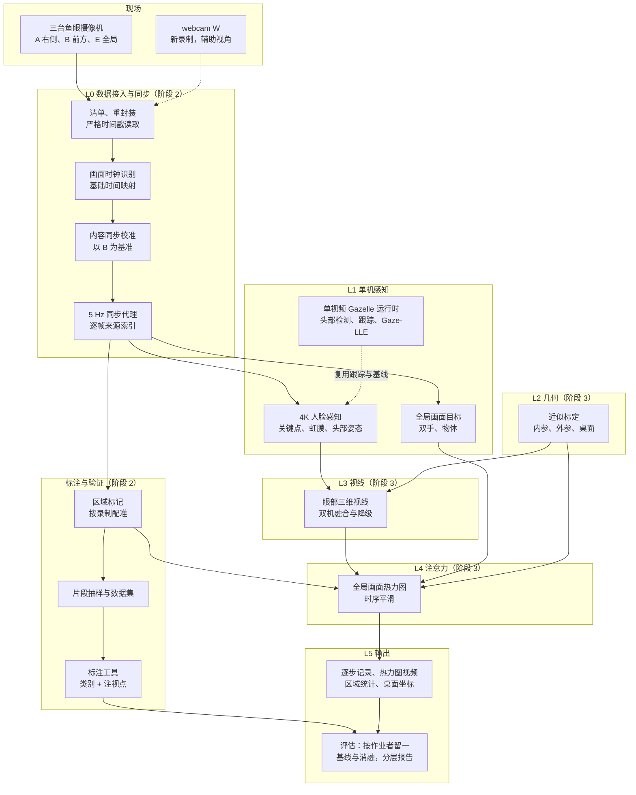
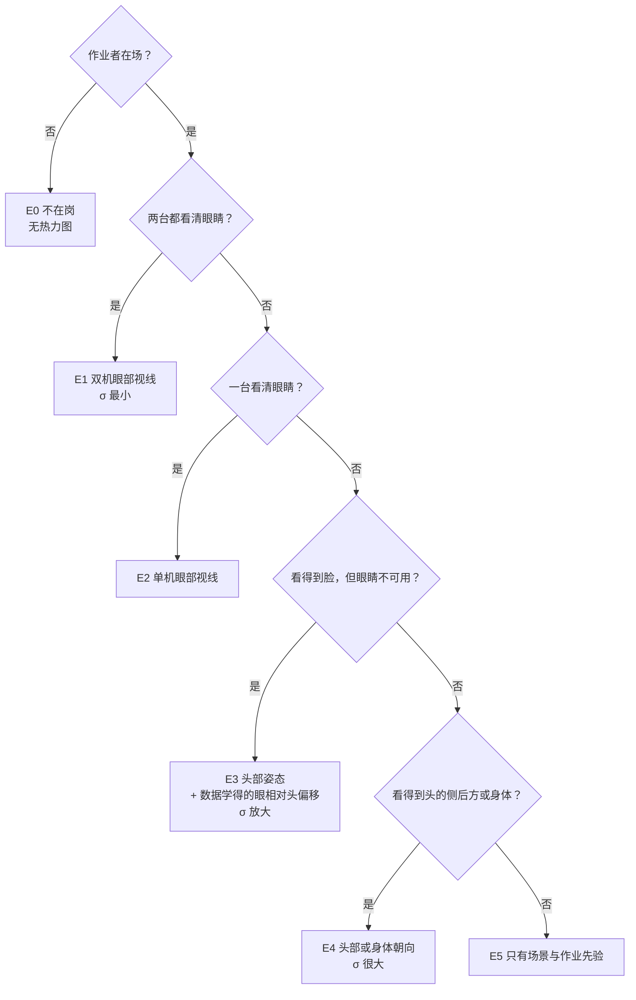
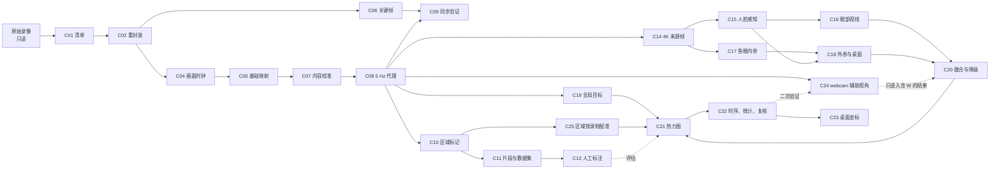
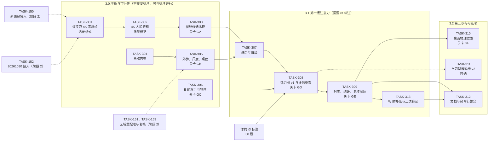
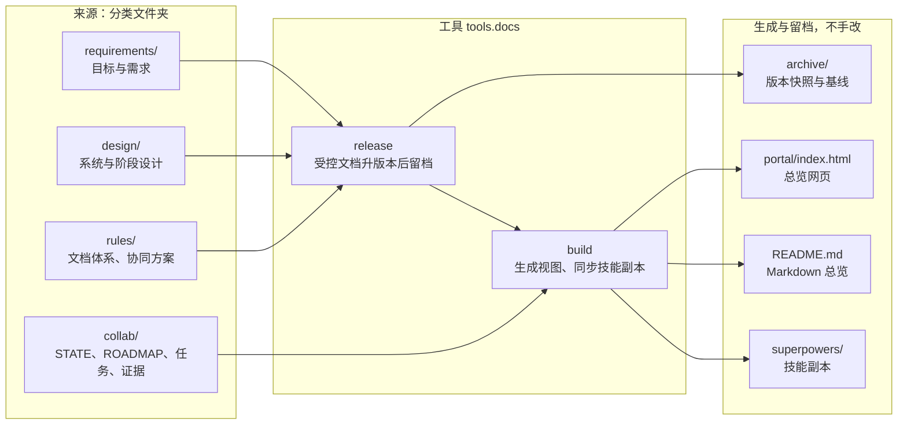
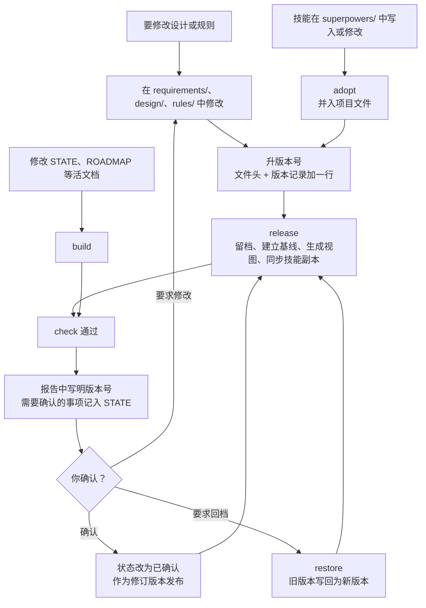

# Gazelle 项目总览

> 本文件由 `python -m tools.docs build` 自动生成，与 [总览网页](../../../portal/index.html) 内容相同，不要手改。规则见 [文档记录体系与版本规则](../../../rules/DOCS_SYSTEM_CN.md)。

当前基线：**B021**（2026-10-31）。

## 1. 总览

| 项目 | 内容 |
| --- | --- |
| 当前阶段 | 阶段 2：作业数据可用、多机同步、正确性修复，建立区域标注 |
| 当前任务 | 第 8 轮已交付审查：TASK-125 第 4 轮、TASK-101 契约 r2、TASK-150 契约 r2 至 r4、TASK-140 第 3 轮；TASK-150 真实数据目标未达成，见 Q-029 至 Q-031 |
| 轮到 | Claude |
| 最近更新 | 2026-10-31，Codex 完成第 8 轮可独立执行的工作并交回 Claude。最终离线门 749 tests / 0 skip；TASK-150 的两次校准与交接边界失败保留，待 Claude 判断，未放宽研究门槛。正式标注文件未读写 |

### 需要你处理

- **问题 Q-023**：协调者的细化与新分支的发布批准
- **问题 Q-026**：新录制 `20261030`（2026-10-30 出现，画面时钟 2026-10-29 17

### 阶段

| 阶段 | 目标 | 状态 |
| --- | --- | --- |
| 1 | 迁移与基线 | done |
| 2 | 作业数据可用、多机同步、正确性修复，建立区域标注 | 进行中 |
| 3 | 视线与注意力位置估计：头 + 眼的视线、全局画面热力图（含手部与物体）、区域统计，之后是桌面物理位置 | 设计已确认（2026-10-29，D22）：[系统总体设计](../../../design/SYSTEM_OVERVIEW_CN.md)、[阶段 3 设计](../../../design/STAGE3_GAZE_ATTENTION_CN.md)。第一批契约在阶段 2 验收之前编写 |
| 4 | 工程加固 | proposed |
| 5 | 多人同时推断 | 未开始 |
| 远期 | 实时处理 | 不纳入当前计划 |

### 项目目标

最终要达到两个主要目的，并遵守一条方法要求：

1. **高精度视线估计**：高精度地估计目标作业者的视线方向，包括头部转动与眼球转动带来的视线变化。
2. **注意力位置估计**：由视线推断作业者此刻实际注视的位置，结果要较为精确，用中心浓、外围渐淡的热力图表示注意力范围。
   - 注视目标不只是桌面上的固定区域，也包括双手、手中的工件和其他会移动的物体。这是难点所在。
3. **方法要求**：作业时眼球、头部与身体的朝向并不同步，不能只用头部方向推断视线，要尽量使用能得到更精确视线的特征，例如眼部信息。

区域统计（各区域注视占比、每次注视时长、切换次数、看向工作区以外的比例）继续保留，改为由注意力热力图在各区域内积分得到。

你同日的回答（D19 至 D21）：

| 决定 | 内容 |
| --- | --- |
| D19 | 暂时不能追加现场录制，包括标定板、注视标记点、眼动仪与机位调整。只用现有 7 次录制：几何标定只能做近似；视线与注意力位置的精度，用人工标注的注视点间接评估。以后若能追加录制，再补真值 |
| D20 | 正式标注暂停，先修订标注方案：在区域之外增加“手部/手中物体”类别，并在注视变化处点出注视位置。方案与工具就绪后再开始 26 段 |
| D21 | 输出分两步：先在全局摄像机画面上给出注意力热力图，区分桌面区域与手部、物体；完成近似几何标定后，再给出桌面上的物理位置（厘米） |

2026-10-29：数据提供方新增了 2 次录制（画面时钟 2026-10-14、10-19），另有一台 webcam。你决定纳入研究集，作为单独分层（D26）。2026-10-30 又到了 1 次录制（`20261030`，画面时钟 2026-10-29），你同日决定纳入研究集（Q-026）；把它归入该分层是协调者的安排。D19 所说的专门录制（标定板、注视标记点、眼动仪、机位调整）仍不追加。

### 目标进展

| 编号 | 目标 | 当前状态 |
| --- | --- | --- |
| G1 | 数据接入 | **已满足**（旧 7 次；TASK-131、132、135）：AVI 无损重封装，时间戳严格递增，截断即失败。2026-10-29 新增的 2 次录制与第 4 台摄像机（webcam）按 D26 纳入，由 TASK-150 接入。2026-10-30 源目录改为 `E:\Gazelle_Workdata\`，文件不变（已核对）；又有新录制 `20261030`，你决定纳入（Q-026），由 TASK-152 接入 |
| G2 | 多机同步 | **已满足**（旧 7 次）：同步协议 r2（D18），跨机残差约 0.05 秒；TASK-140 第 2 轮完成正式切换与切点的不确定区间，2026-10-29 通过审查。新录制由 TASK-150、TASK-152 接入 |
| G3 | 主体感知 | 部分：首帧丢失已修复（TASK-102）；跨人误配（GZ-01）由 TASK-101 修复，尚未在作业视频上验证；作业者交接时的片段切分由 TASK-150、TASK-152（片段文件）与 TASK-302 实现 |
| G4 | 单机视线证据 | 已实现（单视频 CLI）。按 v3，它只是辅助证据：人脸摄像机拍不到桌面，全局摄像机拍不到头，Gaze-LLE 无法直接给出注意力位置 |
| G5 | 注意力位置 | 未开始；方法见阶段 3 设计（D22，2026-10-29 确认） |
| G6 | 统计 | 未开始 |
| G7 | 可审计输出与复核 | 部分：单机输出与渲染已实现 |
| G8 | 研究可复现 | 部分：输出不记录代码版本（P5）；标注与评估待建 |
| G9 | 多人与实时（远期） | 未开始 |
| G10 | 视线方向 | 未开始；候选方法待评估：MediaPipe 虹膜关键点的几何法（无需下载），以及公开的外观法模型（下载需要你授权） |
| G11 | 近似几何标定 | 未开始；不追加录制（D19），只能用同步的人体关键点与场景结构做近似，精度待评估 |
| G12 | 动态目标 | 未开始 |
| G13 | 精度评估 | 未开始；按 D19 用人工标注的注视点评估（标注方案 r3，D20），并用两台人脸摄像机之间的一致性旁证；按作业者留一，旧录制与新录制分层报告（D26） |

## 2. 系统设计

- **输入**：同一工位三台鱼眼摄像机的同步录像。
  - 前方 B、右侧 A 两台对着作业者的脸；
  - 全局 E 俯视两张桌面；
  - 机位在录制之间会变，标定与区域按录制处理；
  - 2026-10 的三次新录制另有第 4 台摄像机 webcam（W，用 Windows 标准相机应用录制），头部与桌面同在画面，作辅助视角。你 2026-10-30 说明：这台能拍到更广的范围，避免因身高等原因拿不到头部与眼部数据。你同日确认：W 仍作辅助视角，但尽量利用，在 A、B、E 缺信息时补充和参考，并对视线推测等结果做二次验证（D28）。
- **输出**：
  - 第一步：作业者每一时刻的视线方向，含头部与眼球各自的贡献；
  - 第一步：全局画面上的注意力热力图，区分你画的区域、双手与手中物体、工作区内其他、画面外；
  - 第一步：由热力图得到的区域统计，包括占比、停留时长、切换次数与离开工作的比例；
  - 第二步：桌面上的物理坐标（厘米）。
- **方式**：离线批处理。先单人，结果可审计：每一步都记录证据等级与不确定度。
- **结构**：
  - 第 2 阶段已建成数据层：解码、同步、代理视频、区域与标注工具；
  - 第 3 阶段在其上建视线、标定、目标、热力图与统计。

### 总体架构

### 分层

| 层 | 做什么 | 主要组件 | 阶段 |
| --- | --- | --- | --- |
| L0 数据接入与同步 | 让三台摄像机的录像可以完整、准确地解码，并对齐到同一时间轴 | C01–C09 | 2 |
| 标注与验证 | 画区域、抽片段、人工标注，作为评估真值 | C10–C12 | 2 |
| L1 单机感知 | 在每台摄像机中找到作业者、人脸关键点与双手 | C13–C15、C19 | 2、3 |
| L2 几何 | 三台摄像机的近似内外参与桌面平面 | C17、C18 | 3 |
| L3 视线 | 每台人脸摄像机的眼部三维视线，融合并标明证据等级 | C16、C20 | 3 |
| L4 注意力 | 全局画面热力图与时序平滑 | C21、C22 | 3 |
| L5 输出与评估 | 逐步记录、复核视频、统计、桌面坐标、评估报告 | C22、C23 | 3 |

### 视线证据的降级层级（阶段 3）

### 可行性实测（2026-10-18，只读）

| 指标 | 前方 B | 右侧 A |
| --- | --- | --- |
| 检出人脸 / 得到关键点（占全部样本） | 56.7% / 37.0% | 66.8% / 40.1% |
| 人脸宽度（4K 像素，中位数；10%–90% 分位） | 340（206–464） | 350（212–508） |
| 虹膜直径（4K 像素） | 28.9（16.3–33.1） | 26.6（15.2–37.2） |
| 眼裂宽度（4K 像素） | 76.5 | 72.6 |
| 头部偏离该摄像机视线的角度（中位数；≤45° 的比例） | 19.9°；91% | 26.2°；85% |
| 眼睛基本闭合（开合比 < 0.15） | 1.6% | 2.7% |
| 眼球转动系数 > 0.5：向下 / 向内 / 向外 | 12.0% / 12.5% / 14.0% | 12.5% / 20.1% / 18.0% |
| “眼部可用”：有关键点、偏离 ≤45°、眼睛睁开、虹膜 ≥ 8 像素 | 33.0% | 32.8% |

| 指标 | 数值 |
| --- | --- |
| 至少一台眼部可用（全部步） | 62.0% |
| 两台同时可用 | 3.9% |
| 作业者在场的步中（代理判断：A/B 有人脸，或 E 有人体），至少一台眼部可用 | 76.4% |
| 按录制（在场步中） | 0821：78.5%；0828：83.3%；0903：63.5%；0911：46.9%；0925：76.3%；1002：89.1%；1009：95.2% |
| 全局摄像机：检出人体姿态 / 至少一只手腕可见 | 31.5% / 26.7% |

## 3. 数据流程

完成情况由 ROADMAP 中相关任务的状态推算。

| 编号 | 环节 | 实现 | 输入 → 输出 | 阶段 | 相关任务 | 完成情况 |
| --- | --- | --- | --- | --- | --- | --- |
| C01 | 清单 | `tools/workdata/inventory.py` | 原始录像 → `inventory/inventory.json`：指纹、流信息、摄像机身份；新录制与 W 的角色由 TASK-150 加入，`20261030` 由 TASK-152 加入 | 2 | TASK-132、TASK-150、TASK-152 | 进行中 |
| C02 | 重封装 | `tools/workdata/remux.py` | AVI → 无损 MP4（`remux/`），去掉空包，严格校验 | 2 | TASK-132、TASK-135 | 已实现 |
| C03 | 严格读取 | `gazelle/runtime/media.py`、`tools/workdata/video_source.py` | 视频 → 带容器时间戳的帧；时间戳严格递增，截断即失败 | 2 | TASK-131 | 已实现 |
| C04 | 画面时钟识别 | `tools/workdata/osd_clock.py` | 帧 → 烧录时钟读数，识别不可靠时不造读数 | 2 | TASK-133 | 已实现 |
| C05 | 基础时间映射 | `tools/workdata/timemap.py` | 时钟锚点 → `timemaps_v2_base`：每个文件 wall = a + b × pts | 2 | TASK-133、TASK-139 | 已实现 |
| C06 | 关键帧索引 | `tools/workdata/keyframes.py` | 源文件 → `keyframes_v3`，供同步时屏蔽关键帧脉冲 | 2 | TASK-140 | 进行中 |
| C07 | 内容同步校准 | `tools/workdata/sync_calibrate.py` | 5 Hz 灰度样本 → `timemaps_v3`：以 B 为基准的偏移、漂移与分段，标出 `sync_uncertain`；W 也对 B 校准 | 2 | TASK-139、TASK-140、TASK-150 | 进行中 |
| C08 | 5 Hz 同步代理 | `tools/workdata/proxies.py` | 时间映射 → `proxies/`：三机 1080p 视频与逐帧来源（源文件与 PTS） | 2 | TASK-134、TASK-139、TASK-140 | 进行中 |
| C09 | 同步验证 | `tools/workdata/sync_validate.py` | 代理 → `sync_validation_v3`：跨机残差、时钟抽查、事件条图 | 2 | TASK-140 | 进行中 |
| C10 | 区域标记 | `tools/validation/roi_server.py` 等 | 全局画面 → `roi/`：4 个目标区域与 1 个工作区、类别文件 | 2 | TASK-123、TASK-138 | 已实现 |
| C11 | 片段抽样与数据集 | `tools/validation/sample_segments.py`、`extract_frames.py` | 代理与区域 → `gazelle_validation/roi_r2`：旧 7 次的 26 个 60 秒片段；新录制的 12 段另成一个同格式的数据集 | 2 | TASK-121、TASK-140、TASK-150、TASK-152 | 进行中 |
| C12 | 人工标注 | `tools/validation/annotate_server.py`、`labels.py` | 片段 → 标注文件：类别与注视点（方案 r3） | 2 | TASK-121、TASK-138、TASK-124、TASK-125 | 进行中 |
| C13 | 单视频 Gazelle 运行时 | `main.py`、`gazelle/runtime/` | 单段视频 → 头部观测、Gaze-LLE 热图与 in/out、渲染视频 | 2 | TASK-001、TASK-002、TASK-102、TASK-136、TASK-101 | 进行中 |
| C14 | 4K 来源帧访问 | 计划：`tools/attention/` | 代理的来源索引 → 每步的 4K 原片帧 | 3 | TASK-301 | 计划 |
| C15 | 人脸感知 | 计划 | 4K 帧 → 478 点关键点、虹膜、头部姿态、质量标记 | 3 | TASK-302 | 计划 |
| C16 | 眼部三维视线 | 计划 | 人脸 → 每台摄像机的视线方向与不确定度 | 3 | TASK-303 | 计划 |
| C17 | 鱼眼内参 | 计划 | 静态画面 → 三台摄像机的内参与畸变；W 的内参由 TASK-313 标定 | 3 | TASK-304 | 计划 |
| C18 | 外参、尺度与桌面 | 计划 | 同步人体关键点、场景结构 → 每次录制的三机外参、尺度、桌面平面；W 由 TASK-313 单向配准 | 3 | TASK-305 | 计划 |
| C19 | 全局画面目标 | 计划 | E 的代理帧 → 双手、手中物体、画面外判断 | 3 | TASK-306 | 计划 |
| C20 | 融合与降级 | 计划 | 两台摄像机的视线 + 标定 → 工位坐标中的视线与证据等级 | 3 | TASK-307 | 计划 |
| C21 | 注意力热力图与评估 | 计划 | 视线锥 × 目标 → 全局画面热力图；对照标注评估 | 3 | TASK-308、TASK-311 | 计划 |
| C22 | 时序、统计与复核 | 计划 | 热力图 → 平滑结果、区域统计、三视角复核视频 | 3 | TASK-309 | 计划 |
| C23 | 桌面物理位置 | 计划 | 热力图 + 桌面平面 → 厘米坐标 | 3 | TASK-310 | 计划 |
| C24 | webcam 辅助视角 | 计划 | W 原片 → 对 B 校准的时间轴与代理；标注参考画面；A、B、E 缺信息时的补充（只进入含 W 的结果，主结果不含 W）；单视角基线 B3w 与二次验证 | 2、3 | TASK-150、TASK-152、TASK-313 | 进行中 |
| C25 | 区域按录制配准 | 计划 | 正式区域 + 各次录制的 E 画面 → 区域指纹、逐区域配准、检查提示与录制内监测 → 按录制的区域（新文件），由你确认。方案见[设计](../../../design/REGION_REGISTRATION_CN.md)（Q-028） | 2 | TASK-151、TASK-153 | 计划 |

### 数据产物与位置

| 产物 | 位置 | 生成者 | 说明 |
| --- | --- | --- | --- |
| 清单 | `gazelle_data\workdata\inventory\inventory.json` | C01 | 旧 7 次的 40 个文件的指纹、流信息与摄像机身份；TASK-150 起包括新录制与 W，共 56 个文件；TASK-152 再加 `20261030` 的 8 个，共 64 个 |
| 重封装视频 | `gazelle_data\workdata\remux\<日期>\` | C02 | AVI 改为无损 MP4，附 `remux_report.json` |
| 时间映射 | `gazelle_data\workdata\timemaps_v2_base\`、`timemaps_v3\` | C05、C07 | v3 为协议 r2 的正式映射 |
| 同步样本与关键帧 | `gazelle_data\workdata\sync_samples_v2\`、`keyframes_v3\` | C06、C07 | 校准与验证用的缩略图样本、关键帧位置 |
| 同步代理 | `gazelle_data\workdata\proxies\` | C08 | 每次录制三段 1080p、5 Hz 视频与逐帧来源；TASK-140 第 2 轮切换为正式版本 |
| 同步验证 | `gazelle_data\workdata\sync_validation_v3\` | C09 | 残差、时钟抽查、条图 |
| 区域 | `gazelle_data\workdata\roi\` | C10 | 正式区域、类别文件、参考图；只读，经批准的修正除外 |
| 按录制的区域（计划） | `gazelle_data\workdata\roi_sessions\<录制>\`，与只读的 `roi\` 分开 | C25 | 自动配准后由你复核；原区域文件不改。同一目录下有配准报告与录制内监测，`roi_sessions\_fingerprints\` 放区域指纹 |
| 作业者片段（计划） | `gazelle_data\workdata\workers\worker_spans.json` | TASK-150、TASK-152 | 每次录制的作业者片段，以及你给出的匿名编号 |
| 验证集 | `gazelle_validation\roi_r2\`、`roi_r2_2026_10\`（新录制，计划）、`roi_r2_trial\` | C11、C12 | 片段帧、清单与标注 |
| 运行输出 | `gazelle_runs\` | 各任务 | 真实运行与审查的记录 |
| 阶段 3 结果（计划） | `gazelle_data\workdata\attention\<日期>\` | C14–C23 | `face_obs.jsonl`、`gaze.jsonl`、`targets.jsonl`、`attention.jsonl`、`heatmaps.npz`、`stats.json`、`review.mp4`；有 W 的录制另有 `w_obs.jsonl`、`w_check.jsonl` 与带 `_with_w` 后缀的结果 |
| 标定（计划） | `gazelle_data\workdata\calibration\` | C17、C18 | 内参、外参、桌面平面，带版本号与协方差 |

## 4. 开发进展

### 本轮与下一轮

| 轮次 | 任务 | 状态 | 说明 |
| --- | --- | --- | --- |
| Codex 第 5 轮 | [TASK-140](../../../collab/tasks/TASK-140-sync-validation-and-steps.md) 第 2 轮：切点不确定区间、时钟同源帧补读、正式切换与两个数据集 | accepted | Claude 2026-10-29 审查通过，独立复算一致 |
| Codex 第 5 轮 | [TASK-124](../../../collab/tasks/TASK-124-annotation-hardening.md) 第 2 轮：手动逐步的写盘降频等 | accepted | 页面隐藏时的保存冲突并入 TASK-125 第 2 轮 |
| Codex 第 5 轮 | [TASK-125](../../../collab/tasks/TASK-125-annotation-points-and-hands-class.md) 标注方案 r3 与 r3.1 | changes-requested | 见 TASK-125 §3 |
| Codex 第 6 轮 | TASK-125 第 2 轮：注视点与标记互斥、组合键与按住重复、页面隐藏时的保存、数据集版本门、测试与文档 | changes-requested | 一处回归：按住空格会点击获得焦点的按钮；其余通过真实浏览器实测 |
| Codex 第 7 轮 | TASK-125 第 3 轮：按住按键与撤销键、测试与文档的小项、手部类换色（Q-025） | accepted | Claude 2026-10-30 审查通过，真实按住重复事件已补测 |
| Codex 第 8 轮 | TASK-125 第 4 轮：鼠标用过的滑块、下拉框与按钮释放焦点 | ready-for-review | `980d8ee`；717 tests / 0 skip、Node 与临时浏览器检查通过；待 Claude Edge 独立验收；不改正式数据 |
| Codex 第 8 轮 | [TASK-101](../../../collab/tasks/TASK-101-face-pose-association.md) 人脸与姿态关联修正（D1，契约 r2） | ready-for-review | `569394b`；729 tests / 0 skip；Sunny A/B、office 及两段作业视频真实检查完成；待 Claude 独立验收 |
| Codex 第 8 轮 | [TASK-150](../../../collab/tasks/TASK-150-new-sessions-and-webcam-intake.md) 新录制与 webcam 接入（D26） | ready-for-review | `397c5d1`、`9684f1f`；744 tests / 0 skip；1016 E、1023 A 校准失败，两次代理未生成；交接边界、初稿时钟出处与历史绝对路径见 Q-029 至 Q-031，数据目标未达成 |
| Codex 第 8 轮 | TASK-140 第 3 轮：只补测试与正式字段说明 | ready-for-review | `6270380`；749 tests / 0 skip、13/13 变异捕获；待 Claude 独立审查 |
| Codex 第 9 轮 | [TASK-152](../../../collab/tasks/TASK-152-recording-20261030-intake.md) 新录制 `20261030` 接入与 2026-10 分层数据集（12 段） | proposed | 等 TASK-150 通过审查；你决定纳入（Q-026） |
| Codex 第 9 轮 | TASK-151 工作区域自动重配准：背景图、区域指纹、逐区域配准、检查提示、录制内监测 | proposed | 方案已确认（Q-028）；等 TASK-150；契约在第 8 轮审查时编写；`20261030` 要等 TASK-152 |
| Codex 第 10 轮 | TASK-153 区域复核模式与盲测 | proposed | 等 TASK-151 |
| 用户 | 回复 Q-023（协调者的细化） | 待你确认 | 不阻塞第 7、8 轮 |
| 用户 | 回复 Q-026 第 2、4 项（全局摄像机是否也换了设备、今后的录制） | 待你确认 | 不阻塞 TASK-152 |
| 用户 | 按方案 r3 标注 26 段，约 3 小时 | 可以开始 | 启动方法见「给用户的说明」；先标 pilot。数据集 `roi_r2` 已生成并通过核对 |
| 用户 | 标注新录制的 12 段，约 1.5 小时 | 等 TASK-152 | 数据集 `roi_r2_2026_10` |
| 用户 | 确认按录制配准的区域，估计每次约 5 分钟，共约 50 分钟；在此之前做一次约 15 分钟的盲测 | 等 TASK-153 | D27、D29；TASK-305 要等这一步 |
| Claude | TASK-151、TASK-153 的契约（D27、D29） | proposed | 第 8 轮审查时编写 |
| Claude | 阶段 3 第一批契约：TASK-301、302、304、306 | proposed | 阶段 2 验收之前编写；阶段 3 分支在阶段 2 验收之后建立（D24） |
| Claude | TASK-313 的契约（W 的补充与二次验证，D28） | proposed | 在 TASK-309 完成之前编写（Q-027 已确认） |
| Claude | 阶段 2 验收：离线门、作业数据真实 smoke、同步精度、修复前后对比 | proposed | — |

### 阶段 2 任务

| 轮次 | 任务 | 状态 | 问题 | 规模 | 真实运行 |
| --- | --- | --- | --- | --- | --- |
| 1 | [TASK-131](../../../collab/tasks/TASK-131-video-reader-timestamps-and-truncation.md) 读取器：容器时间戳、严格递增、截断即失败 | accepted | GZ-07、GZ-21 | M | CPU 读取检查；一次 GPU smoke |
| 1 | [TASK-132](../../../collab/tasks/TASK-132-workdata-inventory-and-avi-remux.md) 作业数据清单与 AVI 无损重封装 | accepted | 数据 P0、GZ-22 | M | FFmpeg 流复制 |
| 1 | [TASK-123](../../../collab/tasks/TASK-123-overview-region-marking-tool.md) 全局摄像机画面中的区域标记工具 | accepted（第 2 轮修复后） | Q8 | M | CPU，抽取候选帧 |
| 1 | [TASK-001](../../../collab/tasks/TASK-001-overwrite-safe-validation.md) 参数在 `--overwrite` 删除前校验 | accepted | GZ-04 | S–M | 否 |
| 2 | [TASK-137](../../../collab/tasks/TASK-137-switch-to-gazelle-next.md) 项目环境切换到 `Gazelle-next`（仓库侧） | accepted | D16 | S–M | GPU smoke 三次 |
| 2 | [TASK-135](../../../collab/tasks/TASK-135-round1-followups.md) 第 1 轮审查的后续加固 | accepted | GZ-07、GZ-21 | S–M | CPU，重新校验重封装 |
| 2 | [TASK-133](../../../collab/tasks/TASK-133-osd-clock-time-maps.md) 画面时钟识别、时间映射与同步检验 | 部分通过（时间映射由 TASK-139 取代） | 同步、GZ-22、GZ-26 | L | CPU |
| 2 | [TASK-134](../../../collab/tasks/TASK-134-synchronized-proxies.md) 5 Hz 同步代理视频 | accepted（生成机制；代理由 TASK-139 重新生成） | 同步 | M | CPU，数小时 |
| 2 | [TASK-121](../../../collab/tasks/TASK-121-validation-annotation-toolkit.md) 多视角同步片段的区域标注工具（D12 r2） | accepted（连同 TASK-138） | F2、GZ-27 | L | CPU |
| 你 | 用区域标记工具画出区域 | 完成（2026-10-17） | — | — | — |
| 你 | 决定 D18：同步协议 r2 | 已批准（2026-10-17） | GZ-26 | — | — |
| 3 | [TASK-138](../../../collab/tasks/TASK-138-annotation-and-roi-followups.md) 标注与区域工具的后续修复 | accepted | GZ-27 | M | CPU，浏览器实测 |
| 3 | [TASK-136](../../../collab/tasks/TASK-136-gazelle-device-preprocessing.md) Gazelle 输入预处理移到推理设备 | accepted | GZ-25 | S–M | 是，CUDA smoke |
| 3 | [TASK-139](../../../collab/tasks/TASK-139-content-calibrated-sync.md) 同步协议 r2：以前方摄像机为基准的画面内容校准 | 部分通过（余项由 TASK-140 完成） | GZ-26 | L | CPU，约 6 小时后台 |
| 3 | [TASK-102](../../../collab/tasks/TASK-102-spawn-frame-confirmation.md) 新轨迹首帧立即确认（D2） | accepted（第 4 轮修复后） | GZ-03、GZ-30 | M | 是 |
| 3 | [TASK-002](../../../collab/tasks/TASK-002-face-ray-sign-alignment.md) 面部射线与 roll 符号对齐 | accepted | GZ-02 | M | 是 |
| 4 | [TASK-140](../../../collab/tasks/TASK-140-sync-validation-and-steps.md) 同步协议 r2 的验证与分段修订 | 第 1、2 轮通过（2026-10-29） | GZ-26、GZ-29 | L | CPU |
| 4 | [TASK-124](../../../collab/tasks/TASK-124-annotation-hardening.md) 标注工具加固 | 第 2 轮通过（2026-10-29） | GZ-27 后续 | S | CPU，浏览器实测 |
| 5 | TASK-140 第 2 轮：切点不确定区间、时钟同源帧补读、正式切换与两个数据集 | accepted（2026-10-29） | GZ-26、GZ-29 | M | CPU，不到 1 小时 |
| 5 | TASK-124 第 2 轮：手动逐步的写盘降频等 | accepted（2026-10-29） | GZ-27 后续 | S | CPU，浏览器实测 |
| 5 | [TASK-125](../../../collab/tasks/TASK-125-annotation-points-and-hands-class.md) 标注方案 r3 与 r3.1：“手部/手中物体”类别、注视点与“画面外”标记 | changes-requested（2026-10-29）：注视点与标记可以并存、组合键会改动标注，第 6 轮修复 | D20 | M | CPU，浏览器实测 |
| 6 | TASK-125 第 2 轮：注视点与标记互斥、组合键与按住重复、页面隐藏时的保存、数据集版本门、测试与文档 | changes-requested（2026-10-29）：一处回归，按住空格会点击获得焦点的按钮；其余通过真实浏览器实测 | D20 | S | CPU，浏览器实测 |
| 7 | TASK-125 第 3 轮：按住按键与撤销键、测试与文档的小项、手部类换色（Q-025，`#b6ff00`） | accepted（2026-10-30）：真实按住重复由 Claude 在 Edge 中补测通过 | D20 | S | CPU，浏览器实测 |
| 8 | TASK-125 第 4 轮：鼠标用过的滑块、下拉框与按钮释放焦点（§3） | ready；不改标注格式，不阻塞标注 | D20 | S | CPU，浏览器实测 |
| 8 | [TASK-101](../../../collab/tasks/TASK-101-face-pose-association.md) 人脸与姿态关联修正（D1，契约 r2） | ready | GZ-01 | L | 是 |
| 你 | 标注 26 段，约 3 小时（方案 r3：区域、手部/手中物体、注视点） | 可以开始（2026-10-30），启动方法见 STATE；数据集 `roi_r2` 已生成并通过核对 | — | — | — |
| 8 | [TASK-150](../../../collab/tasks/TASK-150-new-sessions-and-webcam-intake.md) 新录制（20261016、20261023）与 webcam 接入：W 的角色、按录制更新清单与重封装、时间映射与内容校准（含 W）、代理、同步验证、作业者片段与 W 参考画面 | ready；契约 r2 已按第 5 轮产物修订，r3 处理源目录迁移，r4 把分层数据集移到 TASK-152 | 数据、D26 | L | CPU、FFmpeg，数小时 |
| 8 | TASK-140 第 3 轮：只补测试（标记并集、区间换算、E–B 符号等）与正式字段说明 | ready | GZ-26 | S | 否 |
| 9 | [TASK-152](../../../collab/tasks/TASK-152-recording-20261030-intake.md) 新录制 `20261030` 接入（全局摄像机的新时钟版式、W 的新文件名、同步、作业者）与 2026-10 分层数据集 `roi_r2_2026_10`（12 段） | proposed（契约 r1，2026-10-30；等 TASK-150 通过审查） | Q-026、D26 | L | CPU、FFmpeg，数小时 |
| 9 | TASK-151 工作区域自动重配准（[设计](../../../design/REGION_REGISTRATION_CN.md)）：背景图、区域指纹、逐区域配准、检查提示、录制内监测；在阶段 2 分支上。`20261030` 要等 TASK-152 生成代理 | proposed（方案已确认 Q-028，契约在第 8 轮审查时编写） | D27、D29 | L | CPU |
| 10 | TASK-153 区域复核模式与盲测：`roi_server` 的初始多边形、状态提示与分时段缩略图，另存为新文件，原区域文件不改；你逐次确认，估计每次约 5 分钟，全部约 50 分钟 | proposed（等 TASK-151） | D27、D29 | M | CPU，浏览器实测 |
| 你 | 标注新录制的 12 段（约 1.5 小时，方案相同） | 等 TASK-152 通过审查 | — | — | — |
| 你 | 给出匿名作业者编号（Q-022） | 完成（2026-10-29）：4 名作业者 P1 至 P4 | — | — | — |
| 你 | 确认作业者片段表（Q-024） | 完成（2026-10-29） | — | — | — |
| 你 | 确认协调者的评估细化与阶段 3 新分支的常设批准（Q-023） | 待你回复；第 6、7 轮不受影响 | — | — | — |
| 你 | 回复 Q-025：手部类是否换色（需再导出一次类别文件）；“画面外”用法的补充说明 | 已回复（2026-10-29）：同意换色，改为 `#b6ff00`，由第 7 轮实施 | — | — | — |
| 你 | 回复 Q-026：第 1 项已回复（2026-10-30，纳入）；第 3 项已明确（“動作解析カメラ”是第 4 台 W）；第 2、4 项尚待：全局摄像机是否也换了设备、今后的录制 | 第 2、4 项待你回复，不阻塞 TASK-152 | — | — | — |
| 你 | 回复 Q-027：W 的用法中影响评估的各条 | 完成（2026-10-30）：按推荐 | — | — | — |
| 你 | 回复 Q-028：工作区域自动重配准方案 | 完成（2026-10-30）：按推荐 | — | — | — |
| — | 阶段 2 验收：离线门、作业数据真实 smoke、同步精度、修复前后对比 | 未开始 | — | — | Claude 执行 |

### 阶段 3 任务（提议）

| 任务 | 内容 | 阶段 | 状态 | 关卡 | 依赖 |
| --- | --- | --- | --- | --- | --- |
| TASK-301 | 由代理来源索引逐步解码 4K 帧；各模块的记录格式与出处；按模块缓存 | 3.0 | proposed（契约在阶段 2 验收之前编写） | — | 第 5 轮正式代理（已通过审查）；新录制另需 TASK-150、TASK-152 |
| TASK-302 | 4K 人脸感知与质量标记（含戴口罩时的补充检测与作业者片段），全部录制批处理 | 3.0 | proposed（契约在阶段 2 验收之前编写） | — | TASK-301、TASK-101 |
| TASK-303 | 视线候选在沙盒中比较：几何法；L2CS-Net 的 Gaze360 权重与 UniGaze 都要先经你判断许可 | 3.0 | proposed（下载逐项授权；非商业许可的模型暂不使用，D23） | GA | TASK-302；下载授权 |
| TASK-304 | 鱼眼内参：直线法，可选 GeoCalib 初值 | 3.0 | proposed（契约在阶段 2 验收之前编写） | — | TASK-301 |
| TASK-305 | 每次录制的外参、尺度、桌面平面、机位检查 | 3.0 | proposed | GB | TASK-302、TASK-304、TASK-151、TASK-153 |
| TASK-306 | 全局画面的双手与物体检测和跟踪 | 3.0 | proposed（契约在阶段 2 验收之前编写） | GC | TASK-301；手部模型需下载授权 |
| TASK-307 | 双机融合、降级层级、眼相对头偏移的学习 | 3.1 | proposed | — | TASK-303、TASK-305 |
| TASK-308 | 热力图 v1、评估框架、基线 B0 至 B3、消融 | 3.1 | proposed | GD | TASK-306、TASK-307、r3 标注、作业者编号（Q-022；`20261030` 待判定） |
| TASK-309 | 时序平滑、区域统计、复核视频，即 D21 第一步交付 | 3.1 | proposed | GE | TASK-308 |
| TASK-310 | 桌面物理位置，即 D21 第二步 | 3.2 | proposed | GF | TASK-305、TASK-309 |
| TASK-311 | 学习型解码器 v2（可选） | 3.2 | proposed | — | TASK-308 的误差分析 |
| TASK-312 | 用户文档（四份同步）与命令行整合 | 3.2 | proposed | — | TASK-309、TASK-313 |
| TASK-313 | W 的感知、内参与外参、补充（含 W 的结果）、基线 B3w、二次验证、复核视频的 W 格（D28；阶段 3 设计 §6.9） | 3.1 | proposed | — | TASK-309；TASK-150、TASK-152 |

### 可行性关卡

| 关卡 | 内容 | 任务 | 状态 | 证据 |
| --- | --- | --- | --- | --- |
| G0 | 4K 下虹膜直径中位数 ≥ 20 像素 | 设计实测 | 通过 | [阶段 3 设计](../../../design/STAGE3_GAZE_ATTENTION_CN.md) §3.2：实测 27–29 像素 |
| GA | 视线候选：输出率、抖动、眼动敏感性、两机一致性；另单独报告戴口罩分层 | TASK-303 | 未开始 | — |
| GB | 标定：重投影、直线残差、尺度一致性、每次录制的外参 | TASK-305 | 未开始 | — |
| GC | 双手检出召回与定位误差 | TASK-306 | 未开始 | — |
| GD | 热力图：眼部优于只用头部（H1）、优于只看双手（H2）、误差与类别准确率；按作业者留一 | TASK-308 | 未开始 | — |
| GE | 区域统计误差 | TASK-309 | 未开始 | — |
| GF | 桌面坐标的不确定度，由你验收 | TASK-310 | 未开始 | — |

## 5. 决策与待确认

### 决策

| 决策 | 内容 | 状态 | 说明 |
| --- | --- | --- | --- |
| D1 | 单人模式人脸与姿态关联 | 已批准 | 已批准，TASK-101 |
| D2 | 新轨迹首帧策略 | 已批准 | 已批准，TASK-102 |
| D3 | 子格头框（GZ-05） | 待决 | 待决：预测记录增加 `head_map_empty`，不改框与状态 |
| D4 | 时间戳时钟（GZ-07） | 已批准 | **已批准**，并入 TASK-131 |
| D5 | 桥接与跟踪窗口（GZ-12） | 待决 | 待决：两侧窗口由 `--head-track-max-gap-ms` 统一推导；多人桥接后空间去重 |
| D6 | 失败路径（GZ-13） | 待决 | 待决：维持致命失败；JSON 加载期全量校验；删除后置；写完成标记 |
| D7 | 图像预测状态（GZ-14） | 待决 | 待决：`predictions.json` 增加帧级 `status` |
| D8 | DINOv2 与 checkpoint 完整性（GZ-10、GZ-11） | 待决 | 待决：固定 commit、校验权重 SHA-256、strict 校验移到替换前 |
| D9 | MediaPipe 阈值与裁剪（GZ-16） | 待决 | 待决：冻结当前默认阈值；裁剪内 `num_faces=1` |
| D10 | 单机门控默认值（F1） | 暂停 | **暂停**：在此之前不改 CLI 默认值。原计划并入 TASK-143；按系统设计 v2，阶段 3 不使用单机 Gazelle 门控，留待阶段 4 决定 |
| D11 | 主体身份长期稳定（F4） | 待决 | 待决，第 3、5 阶段一并考虑 |
| D12 | 目标场景验证集（F2） | 已批准 | **已批准 r2**：作业数据的连续片段区域标注，撤回 sample2 |
| D13 | 分析时间轴 | 已批准 | **已批准**：5 Hz、1080p 同步代理。2026-10-17 经 D18 修订为“以前方摄像机 B 的画面时钟为基准、内容校准后的 5 Hz”；网格、分辨率与片段长度不变 |
| D14 | 区域类别与标注方式 | 已批准 | **已批准**：连续 60 秒片段，按变化点标注；类别由你在全局摄像机画面上画出的区域生成。2026-10-18 由 D20 扩充：增加“手部/手中物体”类别与注视点（验证集设计 r3） |
| D15 | 融合方法 | 已取代 | 2026-10-15 批准；**2026-10-18 被目标 v3 取代**：原方案是逐时间步特征、可解释分类器、HMM 时序平滑，几何标定留作后续。新方法见[系统设计 v2](../../../design/STAGE3_GAZE_ATTENTION_CN.md)（2026-10-29 你已批准，D22）。按录制日期留一评估由 D26 改为按作业者留一 |
| D16 | 切换到新环境 `Gazelle-next`（Python 3.14、PyTorch 2.14、MediaPipe 1.1.1 等） | 已批准 | **你已决定（2026-10-17）**：尽早切换；现有 `Gazelle` 原样保留作回退，项目改用 `Gazelle-next`。仓库侧由 TASK-137 完成。依据：[环境评估](../../../collab/evidence/2026-10-17-env-next-evaluation.md) |
| D17 | Gazelle 输入预处理移到推理设备（TASK-136） | 已批准 | **你已同意（2026-10-17），已完成**：TASK-136 在第 3 轮实施并通过审查。Claude 的 CUDA 对照中，4K 推理中位数由 106.5 至 121.0 ms 降到 42.7 ms，输出等价 |
| D18 | 同步协议 r2：以前方摄像机 B 为基准，右侧 A 与全局 E 用画面运动校准偏移与漂移（TASK-139、TASK-140） | 已批准 | **你已批准（2026-10-17）**，原话为“D18 批准，按你的推荐进行。”D13 的时间轴已相应修订。依据：[同步分析](../../../collab/evidence/2026-10-17-sync-analysis.md)、[第 3 轮同步验证复核](../../../collab/evidence/2026-10-17-sync-validation-r3.md)。复核结果：18 段新代理的 A–B、E–B 残差中位数为 0.02 至 0.08 秒 |
| D19 | 追加现场录制（标定板、注视标记点、眼动仪、机位调整） | 已批准 | **你已决定（2026-10-18）：暂时都不能**。只用现有录制（2026-10-29 数据提供方新增的 2 次按 D26 纳入）；几何标定只能近似；精度以人工标注的注视点间接评估。以后能追加时再补真值 |
| D20 | 正式标注 | 已批准 | **你已决定（2026-10-18）：暂停，先修订方案**。增加“手部/手中物体”类别，并在注视变化处点出注视位置（验证集设计 r3，细则你 2026-10-29 已确认，Q-017；工具见 TASK-125）。补充 r3.1（目标在全局画面之外时可以标“画面外”）你同日已同意（Q-018 第 3 项）。2026-10-30 TASK-125 第 3 轮通过审查，正式标注可以开始 |
| D21 | 注意力位置的输出 | 已批准 | **你已决定（2026-10-18）：分两步**。先在全局摄像机画面上给出中心渐变的热力图，区分桌面区域与手部、物体；近似标定后再给出桌面上的物理位置 |
| D22 | 阶段 3 系统设计 v2：跨视角眼部视线、近似标定、全局画面热力图、证据降级、评估与关卡、任务划分 | 已批准 | **你已批准（2026-10-29）**，原话为“Q-018至Q-021 我已经确认，请按你的推荐进行。”依据：[系统总体设计](../../../design/SYSTEM_OVERVIEW_CN.md) v1.1.0、[阶段 3 设计](../../../design/STAGE3_GAZE_ATTENTION_CN.md) v2.1.0 |
| D23 | 模型与许可策略：沙盒环境、逐项下载授权、是否接受非商业许可的模型（UniGaze，以及由 Gaze360 训练的权重） | 已批准 | **你已批准（2026-10-29）**：先只用 MIT 与 Apache 许可的模型，在克隆的沙盒环境中试用，下载逐项授权。非商业许可的 UniGaze 与由 Gaze360 训练的权重暂不使用，到 TASK-303 需要时随下载授权请你判断 |
| D24 | 阶段 3 使用的分支 | 已批准 | **你已批准（2026-10-29）**：从阶段 2 的验收点新建阶段 3 分支与 draft PR，PR #6 只含阶段 2。第 6 至 10 轮（TASK-125 第 2、3 轮，TASK-101，TASK-150，TASK-152，TASK-151，TASK-153）属于阶段 2，仍在阶段 2 分支上；它们通过审查、完成阶段 2 验收之后再建分支，不需要合并或变基（协调者的理解）。由 Codex 创建；新分支上是否沿用常设批准，建立前请你确认（Q-023） |
| P-merge | PR #2 至 #5 堆叠链 | 已批准 | 你已决定：项目达到目标功能后集中梳理合并 |
| P-pr | 阶段分支 draft PR | 已批准 | 你已批准 |
| D25 | 文档记录体系：按类别分文件夹；受控文档的版本号与归档、基线、回档；superpowers 技能副本同步；生成的总览网页与 Markdown | 已批准 | **你已确认（2026-10-29，Q-019）**。按你 2026-10-18 的要求建立；细则以后仍可修改。依据：[文档记录体系与版本规则](../../../rules/DOCS_SYSTEM_CN.md) v1.1.1、[协同开发方案](../../../rules/COLLABORATION_PLAN_CN.md) v0.9.0 |
| D26 | 新录制与 webcam：是否纳入研究集；webcam 的角色；评估单位由按日期留一改为按作业者留一 | 已批准 | **你已批准（2026-10-29，Q-020）**：两次新录制作为“戴口罩、新作业者、有 webcam”的单独分层纳入（TASK-150）；webcam 作辅助视角，不作为主系统的必需输入；评估按作业者留一，匿名作业者编号由你提供（Q-022）。依据：[分析 r2](../../../collab/analysis/2026-10-29-workdata-analysis-r2.md) §0、§6，[验证集设计](../../../design/VALIDATION_SET_DESIGN.md) §11。你 2026-10-29 看过截图后判定共 4 名作业者（P1 至 P4），三机重叠段共 11 个作业者片段，见[作业者分析](../../../collab/analysis/2026-10-29-worker-identity-analysis.md)。2026-10-30 你决定再纳入新录制 `20261030`（Q-026）；归入新分层、由 TASK-152 接入是协调者的安排 |
| D27 | 正式区域按录制配准与复核 | 已批准 | **你已批准（2026-10-29，Q-021）**：全局摄像机 0925 起偏移 10 至 28 像素，左侧可移动物体的摆放也有变化。正式区域按录制自动配准后由你逐次复核，另存为按录制的区域，原区域文件不改（TASK-151）。依据：[分析 r2](../../../collab/analysis/2026-10-29-workdata-analysis-r2.md) §5 |
| D28 | W 的用途 | 已批准 | **你已决定（2026-10-30）**，原话为“我依旧希望将其当作辅助视角进行尽可能的利用，在A,B, E都无法获得头部信息，或是存在其他需要的信息缺失的时候，我们可以同时通过W来进行信息补充和参考。同时我们也需要W来针对我们的视线推测等结果进行二次验证。”实现方式由协调者设计，见[阶段 3 设计](../../../design/STAGE3_GAZE_ATTENTION_CN.md) §6.9；影响评估的各条你已确认（2026-10-30，Q-027） |
| D29 | 工作区域自动重配准 | 已批准 | **你已提出要求并批准方案（2026-10-30，Q-028）**：摄像头虽然固定在工作台上，但有震动、工作台移动等情况，会逐渐偏移；在标记工作区域时记录特征，之后自动重新匹配和调整。[实测](../../../collab/evidence/2026-10-30-region-drift-analysis.md)：E 的固定区域在录制内基本不动，变化在录制之间，画面各处移动不同，料箱推车通常靠特征找不回来。方案见[设计](../../../design/REGION_REGISTRATION_CN.md)，你回复“确认 Q-028，请按照你的推荐进行。” |

### 待决问题

| 编号 | 级别 | 提出者 | 内容 | 位置 | 状态 | 处理记录 |
| --- | --- | --- | --- | --- | --- | --- |
| Q-001 | B | Codex | TASK-131 第 4 步在 2000 FPS 时取整后不递增，违反 R1 | TASK-131 实施报告与审查结论 | 已解决 | 已解决：契约 r3 |
| Q-002 | C | Claude | MediaPipe 0.10.35 的遥测如何处理（GZ-23） | 问题登记表 §5 | 已解决 | 已决定（2026-10-16）：开发阶段接受遥测，研究完成后再做安全处理 |
| Q-003 | B | Codex | Torch Hub 加载 DINOv2 时联网探测（GZ-24） | 问题登记表 §5 | 已解决 | 已决定：与 D8 一并在第 4 阶段处理 |
| Q-004 | C | Claude | D16：何时切换到候选环境 `Gazelle-next` | `evidence/2026-10-17-env-next-evaluation.md` §0、§7 | 已解决 | 已决定（2026-10-17）：尽早切换；现有 `Gazelle` 保留作回退，项目改用 `Gazelle-next`；仓库侧由 TASK-137 完成 |
| Q-005 | C | Claude | D17：是否实施 TASK-136（Gazelle 输入预处理移到推理设备） | 同上；`tasks/TASK-136-gazelle-device-preprocessing.md` | 已解决 | 已决定（2026-10-17）：同意，第 3 轮开头实施 |
| Q-006 | B | Codex | TASK-137 与环境评估称 pydeprecate/defusedxml 不再需要，但实际仍是 trackers/supervision 的必需依赖 | TASK-137 实施报告 | 已解决 | 已解决（2026-10-17）：Codex 正确，评估记录已更正；不显式固定可以接受 |
| Q-007 | B | Codex | TASK-133 运动同步仅 9/42 通过；画面时钟一致不等于物理运动同步 | TASK-133 实施报告 | 已解决 | 已查明（2026-10-17）：三机画面时钟各自设定，A 偏 −0.63 至 +2.83 秒，E 偏 −0.95 至 +2.47 秒并有漂移；E 的显示时钟有亚秒级跳变。见同步分析；改方法需用户批准，见 Q-010 |
| Q-008 | B | Codex | TASK-134 固定连续网格与“完全落在重叠时段”存在冲突：20260903 共同覆盖有 0.079/0.134 秒内部缺口 | TASK-134 实施报告 | 已解决 | 已确认（2026-10-17）：采用 Codex 的做法（整体网格、记录覆盖缺口、最近帧与半步长缺口标记），TASK-139 中作为默认行为 |
| Q-009 | B | Codex | TASK-134 固定抽查 60/63：两项识别缺失，20261002 E/k1750 为 −1.4 秒超限 | TASK-134 实施报告 | 已解决 | 已查明（2026-10-17）：超限来自 20261002 E 前 571 秒的显示时钟成片偏移（−0.93 秒）加整秒读数下限；新抽查规则（邻帧补读、E 按 ±2 秒粗查）在 TASK-139 实施 |
| Q-010 | C | Claude | D18：采用同步协议 r2（以前方摄像机 B 为基准，A 与 E 用画面运动校准偏移与漂移）；D13 的时间轴定义随之改为“以 B 的画面时钟为基准、内容校准后的 5 Hz” | `evidence/2026-10-17-sync-analysis.md` §7；`tasks/TASK-139-content-calibrated-sync.md` | 已解决 | 已决定（2026-10-17）：用户直接批准，原话为“D18 批准，按你的推荐进行。”，由 Codex 收讫。Claude 已归档到 ROADMAP、同步分析 §7 与「给用户的说明」 |
| Q-011 | B | Codex | TASK-002：原始 GIF 与转码视频第 15 帧均无 face head-pose；原图旋转组漏检，转码旋转组 roll 与方向检查通过 | TASK-002 §2；外部 task-002/comparison.json、extra-comparison.json | 已解决 | 已解决（2026-10-17）。Claude 复跑：第 15 帧能否检出头姿取决于输入编码，不是代码缺陷。用 2026-10-14 的验收转码，第 15 帧射线 (−0.902, +0.431)，旋转后 roll 变化 +19.9° 与 −19.3°。验收输入与旋转判据按 TASK-002 §3 澄清，阈值未降低 |
| Q-012 | B | Codex | TASK-139 协议边界及真实失败：MAD 可掩盖少数台阶；正台阶可能无解；B 时间轴与各自 OSD 容差冲突；新代理六对残差超限 | TASK-139 §2 最终报告；外部 task-139/protocol-edge-cases.json、0911-split-diagnostics.json、final-output-audit.json | 已解决 | 0911 E：53 窗、MAD=0.101424>0.08，最佳分段比=0.592274；同样本互相关与参考一致。新代理 0903 E-B/A-E、0925 A-B/A-E、1009 A-B/E-B 残差失败；1002 A 三项 +2.8/+2/+2 s、1009 A 两项 +1.8/+1.4 s 的 OSD 超限。18/21 代理、12/18 残差对、49/54 时钟通过，七会话数据集阻塞。未改门槛、删窗口或会话；推荐 Claude 先复核源帧/固定产物再修订契约，尚未暂定实施（以上为 Codex 报告的原状态）。已决定（2026-10-17）：（1）分段：增加尾部条件，总是尝试切分，按 L1 选切点；（2）台阶处：在各摄像机自身基础时间上显式计算最终时间，规定重叠与缺口，并标记 `sync_uncertain`；（3）时钟抽查：与该摄像机自己的显示时钟比较。六对残差失败来自测量方法（GZ-29），不是代理时间轴。见第 3 轮同步验证复核 §6 与 TASK-140 |
| Q-013 | C | Claude | 确认：正式区域中 `work_area` 的类型由“目标”改为“工作区”（cell），是用户批准的唯一修正。批准由 Codex 转述，Claude 只读核对，确认这是唯一的语义变化 | TASK-138 §2、§3 | 已解决 | 已确认（2026-10-17）：用户直接回复 Claude“是的，我确认” |
| Q-014 | B | Codex | 0903 E 第一切点 23 个细化短窗均无效，粗切点 b=961.247810 s 的 ±10 s 定位无法验证；切点条图为空工位 | TASK-140 §2；外部 task-140/refinement-reference.json、proposed-exclusion-impact.json | 已解决 | 待 Claude：参考算法复算一致。推荐按相邻有效长窗界限（必要时加半窗裕量）保守扩大不确定区间后排除抽样；固定种子四段起点不变。未暂定采用，未改正式数据（以上为 Codex 报告的原状态）。已决定（2026-10-18）：采纳并推广到所有切点。每个切点的不确定区间，从切点前最近的有效窗中心到切点后最近的有效窗中心，两端各加该窗长度的一半，有效窗含 60 秒长窗与 20 秒短窗；细化无有效窗时记为“未定位”。区间内的步标 `sync_uncertain` 并从抽样中排除。由 TASK-140 第 2 轮实施，见第 4 轮同步验证复核 §3 |
| Q-015 | B | Codex | 0911 时钟只有 8/9 可评估；E 固定 k=15804 及原定四个邻帧的代理 OCR 均缺失。同源精确 PTS 可读，d=+0.023192 s | TASK-140 §2；外部 task-140/clock-diagnostic.json/.png/.log | 已解决 | 待 Claude：推荐决定是否允许带来源的同一源帧/PTS 补读；当前原验证仍失败，未改 OCR、阈值或固定样本。切换与数据集暂停（以上为 Codex 报告的原状态）。已决定（2026-10-18）：允许同源帧补读。读数顺序为代理帧 k → 其源帧（PTS 完全一致）→ k−1 → 其源帧 → k+1、k−2、k+2……，记录读数来源；阈值、固定 k、通过区间与可评估比例 ≥ 90% 不变。7 次录制全部重跑，由 TASK-140 第 2 轮实施 |
| Q-016 | B | Codex | TASK-102 修复后真实 A 的旧三行 tracked_only 未恢复，因对应帧现在有合法 provisional 观测；契约 P0/P1 回归与真实仲裁前桥接诊断通过 | TASK-102 §2 第 2 轮；外部 task-102-r2/smoke.py、bridge_diagnostic.py 及日志 | 已解决 | 待 Claude：推荐按 P0/P1 契约及仲裁前证据验收桥接保护，澄清 smoke A 计数预期；原包装断言失败保留，未改 selector/验收标准，TASK-101 仍 blocked（以上为 Codex 报告的原状态）。已决定（2026-10-18）：Codex 正确，是 Claude 第 3 轮的预期有误。smoke A 中三行 `tracked_only` 被合法的临时观测替代，修复后没有任何帧变为 `no_head`；GZ-30 由合成场景 S1 证明已修复。TASK-102 accepted；“临时头中立”的细化写入 TASK-101 契约 r2 |
| Q-017 | C | Claude | 确认标注方案 r3 的细则：新类别“手部/手中物体”及其优先规则与键位；注视点规则（必点、可跳过、额外点每秒最多一个、离开/不在岗/无法判断不点）；判断依据为眼睛优先于头部、头部优先于手部；为加入新类别重新导出正式类别文件，区域本身不变。2026-10-18 补充提议 r3.1：目标在全局画面之外时可以标“画面外”，与“跳过（拿不准）”区分 | 验证集设计 §10、§10.8；`tasks/TASK-125-annotation-points-and-hands-class.md` | 已解决 | 已确认（2026-10-29）：用户原话“确认 r3”。r3 的细则与 r3.1 一起生效；VALSET 3.2.1 标为已确认；TASK-125 在第 5 轮实施，包括按正式导出流程重新生成类别文件（区域不变，旧导出备份） |
| Q-018 | C | Claude | 系统总体设计与阶段 3 设计的批准：（1）D22 设计本身；（2）D23 模型与许可策略，包括沙盒环境、逐项下载授权、是否接受非商业许可的模型；（3）标注方案 r3.1 的“画面外”标记；（4）可选：现场实测几个尺寸；（5）D24 阶段 3 的分支 | `../design/SYSTEM_OVERVIEW_CN.md`；`../design/STAGE3_GAZE_ATTENTION_CN.md` §12 | 已解决 | 已决定（2026-10-29）：用户原话“Q-018至Q-021 我已经确认，请按你的推荐进行。”（1）D22 批准设计；（2）D23 先只用 MIT 与 Apache 许可的模型、克隆的沙盒环境、下载逐项授权，非商业许可的模型暂不使用，需要时随下载授权请用户判断；（3）r3.1 同意，与 r3 一起生效；（4）实测尺寸为可选，暂无，先用人体尺寸先验；（5）D24 第 5 轮审查后新建阶段 3 分支与 draft PR。已归档到 ROADMAP、STAGE3 2.1.0 §12、SYSTEM 1.1.0 与协作方案 §7 |
| Q-019 | C | Claude | 确认文档记录体系与协同开发方案的修订：按类别分文件夹、受控文档的版本号与归档、基线、回档、技能副本同步、生成的总览网页与 Markdown、活文档约定；网页发布到外部服务需逐次同意 | `../rules/DOCS_SYSTEM_CN.md`；`../rules/COLLABORATION_PLAN_CN.md` §3 | 已解决 | 已确认（2026-10-29，D25）：DOCS 1.1.1 与 COLLAB 0.9.0 标为已确认 |
| Q-020 | C | Claude | 新录制与 webcam（D26）：（1）是否把 2026-10-14、10-19 两次录制纳入研究集，建议纳入，作为“戴口罩、新作业者、有 webcam”的单独分层；（2）webcam 的角色，建议作为辅助视角，用于标注参考、基线与交叉检验，不作为主系统的必需输入；（3）今后是否还有新录制、是否都带 webcam；（4）按录制与时段给出匿名作业者编号（2026-10-14 的重叠段内有两人），评估改为按作业者留一 | `analysis/2026-10-29-workdata-analysis-r2.md` §0、§2、§3、§6、§7 | 已解决 | 已决定（2026-10-29），按推荐：（1）纳入，作为单独分层，由第 6 轮的 TASK-150 接入；（2）webcam 作辅助视角；（3）今后是否还有新录制尚不知道，接入按可扩展的方式实现，webcam 为可选，这一问并入 Q-022；（4）评估按作业者留一，编号见 Q-022。已写入 STAGE3 §3.4、VALSET §11 与 SYSTEM §2 |
| Q-021 | C | Claude | 正式区域与布局（D27）：全局摄像机 0925 起与你画区域时的画面偏移 10 至 28 像素，左侧可移动物体的摆放也随录制变化。建议自动配准后由你逐次复核，物体移位处按实际物体修正，另存按录制的区域，原区域文件不改；或者继续只用 0821 的区域 | `analysis/2026-10-29-workdata-analysis-r2.md` §5、§7 | 已解决 | 已决定（2026-10-29），按推荐：自动配准后由用户逐次复核，另存按录制的区域，原区域文件不改；由 TASK-151 实施，契约在第 5 轮审查通过后编写 |
| Q-022 | C | Claude | 匿名作业者编号与今后的录制：（1）给每个作业者片段一个匿名编号，例如 P1、P2，同一人用同一编号，不写姓名。片段共 10 个：旧 7 次各一个；2026-10-14 两个，约 12:59 至 13:13 与 13:16 至 13:59；2026-10-19 一个。（2）今后是否还会有新录制，是否都带 webcam | `../design/VALIDATION_SET_DESIGN.md` §11.3；`analysis/2026-10-29-workdata-analysis-r2.md` §3 | 已解决 | 已决定（2026-10-29）：用户看过面部截图后判定共 4 名作业者。P1＝暂定 P1、P2、P4、P7、P8；P2＝P9、P10，另含 0903 开头；P3＝P3、P6；P4＝P5。同一日期、同一段视频中也会换班，三机重叠段共 11 个作业者片段，见 `analysis/2026-10-29-worker-identity-analysis.md`；片段表的确认见 Q-024。今后录制的情况仍未知 |
| Q-023 | C | Claude | 协调者的细化与新分支的发布批准：（1）关卡 GA、GD、GE 只在旧录制分层上判定，新录制分层单独报告、不参与判定；（2）按作业者留一的预先登记：报告编号个数与每折的训练、测试片段数，某一折的训练集不到全部片段的一半或只剩一个分层时停下来请用户决定；（3）标定第 6 步只微调跨录制共用的参数；（4）阶段 3 新分支与其 draft PR 上 Codex 的常规推送与评论，是否沿用 2026-10-16 常设批准的命令范围。另有几项实现细节由协调者确认，用户可以推翻：新录制的段另成数据集（2026-10-30 起为 12 段）、没有试标段、作业者片段只在换人处切分、合并的数字只作参考 | `../design/STAGE3_GAZE_ATTENTION_CN.md` §6.3、§8.3、§9、§12；`../design/VALIDATION_SET_DESIGN.md` §11；`../rules/COLLABORATION_PLAN_CN.md` §7 | 待用户 | 不影响第 5、6 轮；（1）至（3）在 TASK-303、TASK-308 之前需要，（4）在建立阶段 3 分支之前需要 |
| Q-024 | C | Claude | 作业者片段表的确认：（1）0903 开头到 00:14:00 为 P2，00:14:00 至 00:19:35 交接，之后为 P3；（2）1016 在 13:13:39 至 13:16:29 交接，P1 换为 P2；（3）0821、0911、0925、1002、1023 中离开工位的前后为同一人；（4）其余录制全程一人；共 11 个作业者片段 | `analysis/2026-10-29-worker-identity-analysis.md` §3 | 已解决 | 已确认（2026-10-29）：用户确认片段表无误。用户同时指出截图与文字中录制编号的写法不一致，已统一为文件夹名（例如 `20261016`，画面时钟 2026-10-14） |
| Q-025 | C | Claude | 正式标注前的两项确认：（1）“手部/手中物体”的颜色 `#f1c40f` 与用户画的“物品存储盒” `#d4ac0d` 都是黄色（CIE76 色差约 12），时间轴上不易区分。是否同意按正式导出流程再重新导出一次类别文件，只给手部类换色？区域不变，旧导出备份。推荐同意；正式标注开始后类别文件不能再改。（2）告知：同一片段内注视点与“跳过/画面外”标记二选一；“画面外”只用于整段目标都在全局画面外，部分可见时只点可见部分（验证集设计 4.2.0 §10.8，协调者确认，用户可以推翻） | `tasks/TASK-125-annotation-points-and-hands-class.md` §3；`../design/VALIDATION_SET_DESIGN.md` §10.8 | 已解决 | 已决定（2026-10-29）：用户原话“我已经确认Q-025，请按照你的推荐进行。”（1）同意换色：`hands_object` 改为 `#b6ff00`（亮黄绿色），与全部类别、默认类别和调色板颜色的 CIE76 色差最小为 58.0（对物品存储盒），原色只有约 12；按正式导出流程再重新导出一次类别文件，区域不变、旧导出备份，由 TASK-125 第 3 轮（第 7 轮）实施。（2）注视点与标记互斥、“画面外”只用于整段目标都在全局画面外，按验证集设计 4.2.0 执行 |
| Q-026 | C | Claude | 新录制 `20261030`（2026-10-30 出现，画面时钟 2026-10-29 17:57–19:01）：右侧 A、前方 B 各约 63 分钟，全局 E 约 60 分钟，另有一台 webcam 类摄像机“動作解析カメラ” 180 分钟（电脑时间 17:48:55 起），四台约重叠 1 小时。全局摄像机的画面时钟格式、位置与拍摄范围都与以前不同。请说明：（1）是否纳入研究集，与 `20261016`、`20261023` 一样作为 2026-10 分层（推荐纳入，在 TASK-150 之后另开任务接入）；（2）全局摄像机是否换了设备，或改了设置、位置；（3）“動作解析カメラ”是否就是之前的 webcam，位置是否变了；（4）今后是否还有新录制 | `evidence/2026-10-30-source-relocation-check.md` §3；TASK-150 契约修订 r3 第 5 条 | 待用户 | （1）已决定（2026-10-30）：用户原话“请将新数据纳入研究集”。纳入，作为 2026-10 分层的第三次录制；由 TASK-152 在 TASK-150 之后接入，新分层数据集改为 12 段、一次生成（接入方式由协调者安排）。（2）用户 2026-10-30 说明：可能是数据提供方移动了一些摄像头；是否也换了设备未确认（E 的时钟格式变了）。（3）已明确：用户说明共 4 台摄像机，画面比对确认“動作解析カメラ”就是第 4 台 W，这次偏移约 50–80 像素。（4）仍待用户。都不阻塞接入 |
| Q-027 | C | Claude | W 的用法（D28）中影响评估的各条，都由协调者提出：（1）两份结果：所有录制都先只用 A、B、E 得到同一口径的主结果，关卡 GA 至 GF 与假设按它判定；有 W 的录制另算含 W 的结果，默认交付这一份，同时给出主结果；含 W 的结果不经过关卡与二次验证，W 不可用时交付主结果，在 12 段标注上更差时请用户决定；（2）W 只在 A、B、E 缺信息时使用：都没有头部信息时提供头部位置与朝向（E4 级证据），判断不出在场时提供人体，E 上缺双手时提供双手位置；（3）W 的标定单向进行，不进入 A、B、E 的联合标定；W 校准失败的录制不用 W，W 自己的 `sync_uncertain` 步不用 W；（4）二次验证只检查主结果，先只报告、不设通过门槛，不用于调参、选模型或改阈值；（5）12 段标注上的检验只作描述，标注时是否看过 W 不记录；（6）只在三机重叠段输出结果 | `../design/STAGE3_GAZE_ATTENTION_CN.md` §6.9、§8.3、§9 | 已解决 | 已决定（2026-10-30）：用户原话“确认 Q-027，请按照你的推荐进行。”六条全部按推荐执行，已写入 STAGE3 3.6.0 §6.9、§8.3、§9 |
| Q-028 | C | Claude | 工作区域自动重配准方案（D29），都由协调者提出：（1）用逐区域配准、检查提示与录制内监测，取代“一个全局配准”，TASK-151 按此写契约；（2）固定区域跟着工作台走，不跟台面上的物品走；（3）`item_box` 通常不能靠特征找回，每次录制画一个多边形，推车明显离开时才按时段再画，统计单列；（4）所有区域都由用户确认，正式结果只用确认过的区域，检查项只作提示，TASK-305 要等用户确认完；（5）盲测：在确认之前，用户隐藏多边形，在 4 次录制上点约 10 个固定点，`20260821` 点两遍；（6）固定区域在录制中移动时，过渡时段标 `region_uncertain`，不进入区域统计与区域指标；（7）TASK-151 在第 9 轮、TASK-153 在第 10 轮，规模比原计划大 | `../design/REGION_REGISTRATION_CN.md` §15；`evidence/2026-10-30-region-drift-analysis.md` | 已解决 | 已决定（2026-10-30）：用户原话“确认 Q-028，请按照你的推荐进行。”七项全部按推荐执行；ROIREG 1.0.2 标为已确认，已写入 STAGE3 3.7.0 §6.5 |
| Q-029 | B | Codex | TASK-150 两次新录制未通过最终内容校准：1016 E 的尾部 6/50=12%，1023 A 为 7/53=13.2075%，均超过 10%；其余相应 A/E/W 拟合通过。1016 E 粗拟合 5/50=10%，细化切点后变为 12%；1023 A 无切点，粗/最终结果一致 | TASK-150 §2；`gazelle_runs/task-150/calibration-summary-*.json`、`fit-gate-diagnostic-*.json` | 待 Claude | 推荐先复核最终拟合、细化目标与原始固定窗口，再给出修订契约；保留严格失败与采样。未替换成粗拟合、删窗口或放宽门槛；两次正式代理及后续验证暂停 |
| Q-030 | B | Codex | TASK-150 交接“无人脸”前提不成立：0903 A 81 帧、B 64 帧（65 次检测），1016 A 20 帧、B 43 帧满足原宽度/得分门槛且位于交接内部；12 张诊断图确认真实人脸。1016 初稿内部端点的来源摄像机未明确 | TASK-150 §2；`gazelle_runs/task-150/handover-*-summary.json`、原始 hits、`worker-conversion-review.json` | 待 Claude | 原确认边界不变；推荐核对检测与来源时钟，并明确交接条件/端点精度后再写正式表。仅生成匿名候选表，未写 `workers/worker_spans.json`；0903 初始零帧日期错误已修正并保留失败记录，B 计数按原始 hits 去重 |
| Q-031 | B | Codex | 源目录搬迁后，历史同步校准、代理、keyframe 与 ProxyClockReader 的入口仍直接使用旧映射绝对路径；新录制路径可用，但旧录制重处理受影响 | TASK-150 §2「待 Claude 判断」；对 `sync_calibrate.run`、`proxies.full_mapped_frames/prepare_camera/run`、`keyframes.source_keyframes`、`sync_validate.ProxyClockReader._pair` 的检查 | 待 Claude | 推荐在入口增加基于 inventory 相对路径、大小和源 SHA 的解析层；不改已哈希的旧数据或受保护算法。当前只完成契约授权的 inventory/remux/extract 路径兼容，其他入口待修订契约 |

## 6. 文档与版本

1. **按类别分文件夹**：需求、设计、规则、协同记录、使用说明、交接、归档各有一个文件夹，见 §2。
2. **单一来源**：
   - 每类信息只在一个文件里维护；
   - 网页与 Markdown 总览由工具从这些文件生成，不手改；
   - `docs/superpowers/` 中的技能副本由工具从项目文件同步。
3. **设计与进展分开**：
   - 受控文档只写“做什么、怎么做”，例如目标、设计、规则；
   - 进展只写在 ROADMAP 与 STATE 里，例如任务状态、关卡结果、轮到谁。
4. **每次修改都有版本**：受控文档的任何修改，包括错别字，都要升版本号、写一行版本记录，并用工具留档。
5. **归档只增不改**：每个版本存一份原样快照，并登记哈希，之后不修改也不删除。
6. **历史只向前**：回档也生成一个新版本，内容取自旧版本，不删除、不改写历史，与 Git 安全规则一致。
7. **交接前检查**：工具检查网页是否同步、版本是否留档、归档是否完好、技能副本是否一致。检查不通过就不交接。
8. **隐私**：文档与网页只含汇总数字，不放图像、人名与企业名。网页发布到任何外部服务前，都要逐次征得用户同意。

### 文档管理架构

### 修改与发布流程

### 文件夹

| 文件夹 | 放什么 | 类别 | 版本方式 | 维护者 |
| --- | --- | --- | --- | --- |
| 仓库根目录 | `AGENTS.md`、`CLAUDE.md`：两个 agent 的仓库规则；`README.md`、`README_CN.md`：项目说明 | 规则、用户文档 | Git 记录 | Claude 起草，用户确认 |
| `docs/` | `README.md`：项目总览的 Markdown 版，在 GitHub 上打开 docs 文件夹时自动显示；其余文档都在下面的分类文件夹中 | 视图 | 工具生成，不手改 | 工具 |
| `docs/portal/` | `index.html`：项目总览网页 | 视图 | 工具生成，不手改；建立基线时留档 | 工具 |
| `docs/requirements/` | 项目目标与需求基线 | 基线 | 受控：版本号、版本记录、归档 | Claude 起草，用户确认 |
| `docs/design/` | 系统总体设计、阶段 3 设计、验证集设计、D1/D2 设计、工作区域重配准设计 | 基线 | 受控 | Claude 起草，用户确认 |
| `docs/design/history/` | 旧设计与实施计划：2026-07、2026-08 的设计，以及被取代的 2026-10-15 多摄像机设计 | 历史 | 不再修改 | — |
| `docs/rules/` | 文档记录体系、协同开发方案（受控）；跨 agent 协作流程 | 规则 | 前两份受控，其余由 Git 记录 | Claude 起草，用户确认 |
| `docs/collab/` | STATE、ROADMAP、HISTORY、QUICKSTART、PR 正文；`tasks/` 任务契约与报告；`evidence/` 证据；`analysis/` 分析 | 现状与记录 | 活文档：Git 记录，基线快照留档 | Claude 与 Codex 按字段 |
| `docs/usage/` | Gazelle 使用说明，英文与中文 | 用户文档 | Git 记录；与两份 README 共四份同步 | Codex 实施，Claude 审查 |
| `docs/handoff/` | 换机迁移与交接说明 | 交接 | Git 记录 | Claude |
| `docs/archive/` | 受控文档的历史版本、基线快照、归档索引 | 归档 | 只增不改，哈希登记 | 工具 |
| `docs/superpowers/` | superpowers 技能的工作区：`specs/`、`plans/` 中是项目文件的技能副本 | 技能工作区 | 由工具从项目文件同步；技能写入的内容要并入项目文件（§4） | 工具与技能 |

### 受控文档

| ID | 名称 | 版本 | 状态 | 日期 | 确认 | 文件 |
| --- | --- | --- | --- | --- | --- | --- |
| GOALS | 项目目标与需求基线 | v3.5.1 | 已确认 | 2026-10-30 | 用户 2026-10-29（Q-017 至 Q-022）；用户 2026-10-30 决定纳入 `20261030`（Q-026 第 1 项）、webcam 的用途（D28，Q-027）与工作区域自动重配准（D29，Q-028），接入与实现方式由协调者安排 | [PROJECT_GOALS_CN.md](../../../requirements/PROJECT_GOALS_CN.md) |
| SYSTEM | 系统总体设计 | v1.7.1 | 已确认 | 2026-10-30 | 用户 2026-10-29（Q-018、Q-022；新增录制按 Q-020、Q-021）；用户 2026-10-30 决定纳入 `20261030`（Q-026 第 1 项）与 W 的用途（D28，实现方式 Q-027 已确认），并确认工作区域自动重配准方案（D29，Q-028） | [SYSTEM_OVERVIEW_CN.md](../../../design/SYSTEM_OVERVIEW_CN.md) |
| STAGE3 | 阶段 3 视线与注意力位置估计设计 | v3.7.0 | 已确认 | 2026-10-30 | 用户 2026-10-29（Q-017、Q-018、Q-022、Q-024；新增录制按 Q-020、Q-021）；用户 2026-10-30 决定纳入 `20261030`（Q-026 第 1 项）与 W 的用途（D28，实现方式 Q-027 已确认），并确认工作区域自动重配准方案（D29，Q-028）；待定项见 Q-023 | [STAGE3_GAZE_ATTENTION_CN.md](../../../design/STAGE3_GAZE_ATTENTION_CN.md) |
| VALSET | 作业数据验证集设计 | v4.4.1 | 已确认（协调者） | 2026-10-30 | 用户 2026-10-29（Q-017、Q-018、Q-020、Q-021、Q-022、Q-024）；§10.8 的补充说明由协调者确认（2026-10-29），用户已确认 Q-025；用户 2026-10-30 决定纳入 `20261030`（Q-026 第 1 项），接入方式由协调者安排；§11.4 的实测由协调者更新，方案用户 2026-10-30 已确认（Q-028） | [VALIDATION_SET_DESIGN.md](../../../design/VALIDATION_SET_DESIGN.md) |
| PERCEPTION | 人脸与姿态关联、新轨迹确认设计（D1、D2） | v1.1.2 | 已确认（协调者） | 2026-10-18 | 用户 2026-10-15（方向）；协调者 2026-10-18（§4.4） | [PERCEPTION_D1_D2_DESIGN.md](../../../design/PERCEPTION_D1_D2_DESIGN.md) |
| ROIREG | 工作区域自动重配准设计 | v1.0.2 | 已确认 | 2026-10-30 | 用户 2026-10-30（Q-028） | [REGION_REGISTRATION_CN.md](../../../design/REGION_REGISTRATION_CN.md) |
| COLLAB | Claude × Codex 协同开发方案 | v0.10.0 | 已确认 | 2026-10-30 | 用户 2026-10-29（Q-019）；路径变化由用户 2026-10-30 告知；`20261030` 的纳入由用户 2026-10-30 决定（Q-026 第 1 项）；新分支的常设批准待 Q-023 | [COLLABORATION_PLAN_CN.md](../../../rules/COLLABORATION_PLAN_CN.md) |
| DOCS | 文档记录体系与版本规则 | v1.2.0 | 已确认（协调者） | 2026-10-30 | 用户 2026-10-29（Q-019）；清单加一行按本文件 §3 的规定，由协调者确认 | [DOCS_SYSTEM_CN.md](../../../rules/DOCS_SYSTEM_CN.md) |

### 版本历史

#### GOALS 项目目标与需求基线

| 版本 | 日期 | 状态 | 变更摘要 | 确认 | 快照 |
| --- | --- | --- | --- | --- | --- |
| v3.5.1 | 2026-10-30 | 已确认 | 你确认 Q-028，去掉方案待确认的标记；内容不变 | 用户 2026-10-29（Q-017 至 Q-022）；用户 2026-10-30 决定纳入 `20261030`（Q-026 第 1 项）、webcam 的用途（D28，Q-027）与工作区域自动重配准（D29，Q-028），接入与实现方式由协调者安排 | [快照](../../GOALS/GOALS_v3.5.1.md) |
| v3.5.0 | 2026-10-30 | 已取代 | 写入你 2026-10-30 的确认与要求：Q-027；工作区域自动重配准（D29，方案待确认 Q-028） | 用户 2026-10-29（Q-017 至 Q-022）；用户 2026-10-30 决定纳入 `20261030`（Q-026 第 1 项）、webcam 的用途（D28，Q-027）与工作区域自动重配准（D29），接入与实现方式由协调者安排，方案待 Q-028 | [快照](../../GOALS/GOALS_v3.5.0.md) |
| v3.4.0 | 2026-10-30 | 已取代 | 写入你 2026-10-30 的决定：纳入 `20261030`，以及 webcam 的用途（D28）：仍作辅助视角，但尽量利用，用于补充、参考与二次验证；§5 去掉以后把 webcam 升为主输入的设想 | 用户 2026-10-29（Q-017 至 Q-022）；用户 2026-10-30 决定纳入 `20261030`（Q-026 第 1 项）与 webcam 的用途（D28），接入与实现方式由协调者安排 | [快照](../../GOALS/GOALS_v3.4.0.md) |
| v3.3.1 | 2026-10-30 | 已取代 | 注明把 `20261030` 归入 2026-10 分层是协调者的安排；含义不变 | 用户 2026-10-29（Q-017 至 Q-022）；用户 2026-10-30 决定纳入 `20261030`（Q-026 第 1 项），接入方式由协调者安排 | [快照](../../GOALS/GOALS_v3.3.1.md) |
| v3.3.0 | 2026-10-30 | 已取代 | 你 2026-10-30 决定纳入新录制 `20261030`（Q-026）：数据现状改为 10 次录制、三机重叠约 9.5 小时；补记待提供的作业者编号 | 用户 2026-10-29（Q-017 至 Q-022）；用户 2026-10-30 决定纳入 `20261030`（Q-026 第 1 项） | [快照](../../GOALS/GOALS_v3.3.0.md) |
| v3.2.1 | 2026-10-29 | 已取代 | 录制的称呼统一为源文件夹名（例如 20260903），画面时钟日期只在括号中注明；内容不变 | 用户 2026-10-29（Q-017 至 Q-022） | [快照](../../GOALS/GOALS_v3.2.1.md) |
| v3.2.0 | 2026-10-29 | 已取代 | 记录你 2026-10-29 的身份判定：共 4 名作业者，同一日期、同一段视频中也会换班（§2、§4）；匿名作业者编号已提供（§5） | 用户 2026-10-29（Q-017 至 Q-022） | [快照](../../GOALS/GOALS_v3.2.0.md) |
| v3.1.1 | 2026-10-29 | 已取代 | 记录你同日确认 r3（Q-017），D24 的建立时点随之写明；内容不变 | 用户 2026-10-29（Q-017 至 Q-021） | [快照](../../GOALS/GOALS_v3.1.1.md) |
| v3.1.0 | 2026-10-29 | 已取代 | 记录新增录制与你 2026-10-29 的决定（D22–D27）；§2 数据现状更新为 9 次录制，并更正“画面时钟彼此一致”的旧说法；G3 增加交接时切分作业者片段；§5 匿名作业者编号改为需要（Q-022）；目标本身不变 | 用户 2026-10-29（Q-018 至 Q-021） | [快照](../../GOALS/GOALS_v3.1.0.md) |
| v3.0.2 | 2026-10-18 | 已取代 | 文件移入 `docs/requirements/`，链接与路径随之更新；内容不变 | 用户 2026-10-18（开发目的与 D19–D21） | [快照](../../GOALS/GOALS_v3.0.2.md) |
| v3.0.1 | 2026-10-18 | 已取代 | 结构调整：加入文件头与版本记录；§1 的“当前状态”移到 ROADMAP「目标进展」，改为“对应阶段与任务”；目标内容不变 | 用户 2026-10-18（开发目的与 D19–D21） | [快照](../../GOALS/GOALS_v3.0.1.md) |
| v3.0.0 | 2026-10-18 | 已取代 | v3：按你 2026-10-18 的说明修订开发目的（高精度视线含眼动、注意力热力图含手部与物体、不只用头部方向），记录 D19–D21 | 用户 2026-10-18 | [快照](../../GOALS/GOALS_v3.0.0.md) |
| v2.2.0 | 2026-10-17 | 已取代 | 记录 2026-10-17 的决定：D16、D17、D18 与正式区域 | 用户 2026-10-17 | [快照](../../GOALS/GOALS_v2.2.0.md) |
| v2.1.0 | 2026-10-15 | 已取代 | 记录你对摄像机角色、区域标记与阶段 3（D13–D15）的决定 | 用户 2026-10-15 | [快照](../../GOALS/GOALS_v2.1.0.md) |
| v2.0.0 | 2026-10-15 | 已取代 | v2：依据你的回答与作业数据分析重写 | 用户 2026-10-15 | [快照](../../GOALS/GOALS_v2.0.0.md) |
| v1.0.0 | 2026-10-15 | 已取代 | v1：依据交接材料与 sample1、sample2 的历史输出 | — | [快照](../../GOALS/GOALS_v1.0.0.md) |

#### SYSTEM 系统总体设计

| 版本 | 日期 | 状态 | 变更摘要 | 确认 | 快照 |
| --- | --- | --- | --- | --- | --- |
| v1.7.1 | 2026-10-30 | 已确认 | 你确认 Q-028，去掉方案待确认的标记；内容不变 | 用户 2026-10-29（Q-018、Q-022；新增录制按 Q-020、Q-021）；用户 2026-10-30 决定纳入 `20261030`（Q-026 第 1 项）与 W 的用途（D28，实现方式 Q-027 已确认），并确认工作区域自动重配准方案（D29，Q-028） | [快照](../../SYSTEM/SYSTEM_v1.7.1.md) |
| v1.7.0 | 2026-10-30 | 已取代 | 写入工作区域自动重配准（D29）：§0 加设计文档，机位与布局按实测更新，C25 改为逐区域配准，产物表更新；你确认 Q-027，C24 去掉待确认标记 | 用户 2026-10-29（Q-018、Q-022；新增录制按 Q-020、Q-021）；用户 2026-10-30 决定纳入 `20261030`（Q-026 第 1 项）与 W 的用途（D28，实现方式 Q-027 已确认）；待定项见 Q-028 | [快照](../../SYSTEM/SYSTEM_v1.7.0.md) |
| v1.6.0 | 2026-10-30 | 已取代 | 写入你 2026-10-30 对 W 的要求（D28）：仍作辅助视角，但尽量利用，用于补充、参考与二次验证；C24 与组件图相应更新，W 在阶段 3 的工作归 TASK-313。实现方式见阶段 3 设计 §6.9，影响评估的各条待你确认（Q-027） | 用户 2026-10-29（Q-018、Q-022；新增录制按 Q-020、Q-021）；用户 2026-10-30 决定纳入 `20261030`（Q-026 第 1 项）与 W 的用途（D28），实现方式由协调者设计；待定项见 Q-027 | [快照](../../SYSTEM/SYSTEM_v1.6.0.md) |
| v1.5.0 | 2026-10-30 | 已取代 | 写入你 2026-10-30 的说明：共 4 台摄像机，第 4 台 W 用 Windows 标准相机应用录制，能拍到更广的范围；画面比对确认“動作解析カメラ”就是 W（Q-026 第 3 项），它在 `20261030` 偏移约 50–80 像素 | 用户 2026-10-29（Q-018、Q-022；新增录制按 Q-020、Q-021）；用户 2026-10-30 决定纳入 `20261030`（Q-026 第 1 项），接入方式由协调者安排；第 4 台摄像机的说明来自用户 2026-10-30 | [快照](../../SYSTEM/SYSTEM_v1.5.0.md) |
| v1.4.0 | 2026-10-30 | 已取代 | 按独立审查补齐：注明把 `20261030` 归入 2026-10 分层、由 TASK-152 接入是协调者的安排；W 一行注明 `20261030` 的摄像机是否同一台待你说明（Q-026 第 3 项）；组件与产物表加入 TASK-152（清单共 64 个文件、作业者片段、webcam 视角、同步精度） | 用户 2026-10-29（Q-018、Q-022；新增录制按 Q-020、Q-021）；用户 2026-10-30 决定纳入 `20261030`（Q-026 第 1 项），接入方式由协调者安排 | [快照](../../SYSTEM/SYSTEM_v1.4.0.md) |
| v1.3.0 | 2026-10-30 | 已取代 | 你 2026-10-30 决定纳入新录制 `20261030`（Q-026）：录制改为 10 次；W 的文件名补上“動作解析カメラ”一种；`20261030` 的全局摄像机移位约 155 像素、时钟格式不同；作业者待判定；新分层数据集改为 12 段，由 TASK-152 生成 | 用户 2026-10-29（Q-018、Q-022；新增录制按 Q-020、Q-021）；用户 2026-10-30 决定纳入 `20261030`（Q-026 第 1 项） | [快照](../../SYSTEM/SYSTEM_v1.3.0.md) |
| v1.2.1 | 2026-10-29 | 已取代 | 录制的称呼统一为源文件夹名（例如 20261016），画面时钟日期只在括号中注明；内容不变 | 用户 2026-10-29（Q-018、Q-022；新增录制按 Q-020、Q-021） | [快照](../../SYSTEM/SYSTEM_v1.2.1.md) |
| v1.2.0 | 2026-10-29 | 已取代 | 按你 2026-10-29 的身份判定更新 §2 作业者：共 4 名，同一人出现在多次录制中，0903 与 1014 各有一次换班 | 用户 2026-10-29（Q-018、Q-022；新增录制按 Q-020、Q-021） | [快照](../../SYSTEM/SYSTEM_v1.2.0.md) |
| v1.1.1 | 2026-10-29 | 已取代 | 按录制的区域改放 roi_sessions 文件夹，与只读的 roi 文件夹分开；内容不变 | 用户 2026-10-29（Q-018；新增录制按 Q-020、Q-021） | [快照](../../SYSTEM/SYSTEM_v1.1.1.md) |
| v1.1.0 | 2026-10-29 | 已取代 | 你确认本设计（Q-018）；按你确认的 Q-020、Q-021 写入新增录制：9 次录制与分层、webcam W 作辅助视角（§2、§3、C24）、作业者与口罩、机位与区域按录制（C25）、W 的同步、按作业者留一；E 的帧率说明更正 | 用户 2026-10-29（Q-018；新增录制按 Q-020、Q-021） | [快照](../../SYSTEM/SYSTEM_v1.1.0.md) |
| v1.0.1 | 2026-10-18 | 已取代 | 文件移入 `docs/design/` 并改为稳定文件名，链接与路径随之更新；内容不变 | Q-018 | [快照](../../SYSTEM/SYSTEM_v1.0.1.md) |
| v1.0.0 | 2026-10-18 | 已取代 | 首版：系统定位、现场与数据、总体架构、组件 C01–C23、数据产物、同步、运行时、阶段 3 摘要、质量保障 | Q-018 | [快照](../../SYSTEM/SYSTEM_v1.0.0.md) |

#### STAGE3 阶段 3 视线与注意力位置估计设计

| 版本 | 日期 | 状态 | 变更摘要 | 确认 | 快照 |
| --- | --- | --- | --- | --- | --- |
| v3.7.0 | 2026-10-30 | 已确认 | 你确认 Q-028（D29）：§6.5 写明固定区域跟着工作台走、`item_box` 每次录制由你调整并单列统计、正式结果只用你确认过的区域；去掉方案待确认的标记 | 用户 2026-10-29（Q-017、Q-018、Q-022、Q-024；新增录制按 Q-020、Q-021）；用户 2026-10-30 决定纳入 `20261030`（Q-026 第 1 项）与 W 的用途（D28，实现方式 Q-027 已确认），并确认工作区域自动重配准方案（D29，Q-028）；待定项见 Q-023 | [快照](../../STAGE3/STAGE3_v3.7.0.md) |
| v3.6.0 | 2026-10-30 | 已取代 | 你确认 Q-027，§6.9、§8.3、§9 去掉待确认标记。写入工作区域自动重配准（D29）：R13；§3.5 按逐区域实测更正 `20261030` 的区域处理；§6.3 第 1 步记录摄像机运动实测；§6.5 静态目标与料箱；§10 风险；TASK-305 依赖 TASK-153 | 用户 2026-10-29（Q-017、Q-018、Q-022、Q-024；新增录制按 Q-020、Q-021）；用户 2026-10-30 决定纳入 `20261030`（Q-026 第 1 项）与 W 的用途（D28，实现方式 Q-027 已确认）；待定项见 Q-023、Q-028 | [快照](../../STAGE3/STAGE3_v3.6.0.md) |
| v3.5.0 | 2026-10-30 | 已取代 | 写入你 2026-10-30 对 W 的要求（D28）：W 仍作辅助视角，但尽量利用，用于补充、参考与二次验证。新增 R12、§6.9 M9、§7 的 W 输出、基线“完整 + W”与 TASK-313，B3w 移到 TASK-313。主结果不含 W，已确认的关卡与假设不变，所以按已确认方向内的增补处理（§5.1 次版本）；影响评估的规则由协调者提出，待你确认（Q-027） | 用户 2026-10-29（Q-017、Q-018、Q-022、Q-024；新增录制按 Q-020、Q-021）；用户 2026-10-30 决定纳入 `20261030`（Q-026 第 1 项）与 W 的用途（D28），实现方式由协调者设计；待定项见 Q-023、Q-027 | [快照](../../STAGE3/STAGE3_v3.5.0.md) |
| v3.4.0 | 2026-10-30 | 已取代 | 写入你 2026-10-30 的说明：W 是第 4 台摄像机，能拍到更广的范围；§3.5 用帧对帧复核全局摄像机的偏移（149–158 像素），画面比对确认“動作解析カメラ”就是 W（Q-026 第 3 项），它这次偏移约 50–80 像素 | 用户 2026-10-29（Q-017、Q-018、Q-022、Q-024；新增录制按 Q-020、Q-021）；用户 2026-10-30 决定纳入 `20261030`（Q-026 第 1 项），接入方式由协调者安排；第 4 台摄像机的说明来自用户 2026-10-30；待定项见 Q-023 | [快照](../../STAGE3/STAGE3_v3.4.0.md) |
| v3.3.1 | 2026-10-30 | 已取代 | §12 的 D26 一行注明由 TASK-152 接入是协调者的安排；含义不变 | 用户 2026-10-29（Q-017、Q-018、Q-022、Q-024；新增录制按 Q-020、Q-021）；用户 2026-10-30 决定纳入 `20261030`（Q-026 第 1 项），接入方式由协调者安排；待定项见 Q-023 | [快照](../../STAGE3/STAGE3_v3.3.1.md) |
| v3.3.0 | 2026-10-30 | 已取代 | 按独立审查补齐纳入 `20261030` 的后续改动：注明接入方式是协调者的安排；§0、§10、附录 B 的旧说法（两次录制、34 分钟）更正；关卡 GA 的戴口罩片段加入 `20261030`；§3.5 注明全局摄像机若换了设备或焦距，E 的内参要单独标定（TASK-304）；§11.1 改为第 8、9 轮；TASK-301 的依赖与 D24 的阶段 2 范围加入 TASK-152 | 用户 2026-10-29（Q-017、Q-018、Q-022、Q-024；新增录制按 Q-020、Q-021）；用户 2026-10-30 决定纳入 `20261030`（Q-026 第 1 项），接入方式由协调者安排；待定项见 Q-023 | [快照](../../STAGE3/STAGE3_v3.3.0.md) |
| v3.2.1 | 2026-10-30 | 已取代 | §11.2 的任务流程图补上 TASK-152 节点（`20261030` 接入，阶段 2）；Mermaid 11.4.1 渲染核对通过；其余内容不变 | 用户 2026-10-29（Q-017、Q-018、Q-022、Q-024；新增录制按 Q-020、Q-021）；用户 2026-10-30 决定纳入 `20261030`（Q-026 第 1 项）；待定项见 Q-023 | [快照](../../STAGE3/STAGE3_v3.2.1.md) |
| v3.2.0 | 2026-10-30 | 已取代 | 你 2026-10-30 决定纳入新录制 `20261030`（Q-026）：新增 §3.5（全局摄像机移位约 155 像素、时钟格式不同、webcam 类摄像机、作业者待判定）；2026-10 分层改为 3 次录制、12 段，验证集共 38 段；§0、§2.2、§6.6、§8、§10、§11、§12 相应更新，TASK-152 接入。接入方式由协调者安排 | 用户 2026-10-29（Q-017、Q-018、Q-022、Q-024；新增录制按 Q-020、Q-021）；用户 2026-10-30 决定纳入 `20261030`（Q-026 第 1 项）；待定项见 Q-023 | [快照](../../STAGE3/STAGE3_v3.2.0.md) |
| v3.1.1 | 2026-10-29 | 已取代 | 录制的称呼统一为源文件夹名（例如 20261016），画面时钟日期只在括号中注明；你确认作业者片段表（Q-024）；内容不变 | 用户 2026-10-29（Q-017、Q-018、Q-022、Q-024；新增录制按 Q-020、Q-021）；待定项见 Q-023 | [快照](../../STAGE3/STAGE3_v3.1.1.md) |
| v3.1.0 | 2026-10-29 | 已取代 | 按你 2026-10-29 的身份判定写入：共 4 名作业者（P1 至 P4），三机重叠段有 2 次换班、11 个作业者片段（§3.4、§8.3）；按作业者的眼部覆盖（§3.4）；关卡 GA 的戴口罩分层改按作业者片段界定（待你确认，Q-023）；按录制留一不作为正式结果 | 用户 2026-10-29（Q-017、Q-018、Q-022；新增录制按 Q-020、Q-021）；待定项见 Q-023 | [快照](../../STAGE3/STAGE3_v3.1.0.md) |
| v3.0.0 | 2026-10-29 | 已取代 | 按 §5.1 改为主版本：2.1.0 写入的按作业者留一与分层判定属于评估协议的变化，版本级别在此更正；记录你同日确认 r3（Q-017）；按独立审查修正：作业者片段只在换人处切分（§6.1、附录 B），标定第 6 步只调跨录制共用的参数、留一的预先登记与停止规则、GA/GD/GE 的判定分层（这三项待你确认，Q-023），D24 的建立时点与新分支的常设批准（§12），L2CS-Net 的许可说明，口罩影响的说明 | 用户 2026-10-29（Q-017、Q-018；新增录制按 Q-020、Q-021）；待定项见 Q-023 | [快照](../../STAGE3/STAGE3_v3.0.0.md) |
| v2.1.0 | 2026-10-29 | 已取代 | 你确认本设计（D22–D24）；按你确认的 Q-020、Q-021 写入新增录制的影响：新增 §3.4；评估改为按作业者留一（§8.3、附录 B）；外参与区域按录制（§5.2、§6.3、§6.5）；口罩分层与人脸检测补充（§6.1、§9 GA）；webcam 作辅助视角与基线 B3w（§2、§8.3）；§11、§12 记录决定与第 6 轮安排 | 用户 2026-10-29（Q-018；新增录制按 Q-020、Q-021） | [快照](../../STAGE3/STAGE3_v2.1.0.md) |
| v2.0.2 | 2026-10-18 | 已取代 | 文件移入 `docs/design/` 并改为稳定文件名，链接与路径随之更新；内容不变 | Q-018 | [快照](../../STAGE3/STAGE3_v2.0.2.md) |
| v2.0.1 | 2026-10-18 | 已取代 | 加入文件头、版本记录与网页标记；标题去掉“v2”；指向系统总体设计；内容不变 | Q-018 | [快照](../../STAGE3/STAGE3_v2.0.1.md) |
| v2.0.0 | 2026-10-18 | 已取代 | 按目标 v3 重写为新文件：跨视角眼部视线、近似标定、全局画面热力图、证据降级、评估与关卡、任务划分，含只读可行性实测 | Q-018 | [快照](../../STAGE3/STAGE3_v2.0.0.md) |
| v1.1.1 | 2026-10-18 | 已取代 | 原文件 `2026-10-15-multicamera-attention-design.md` 标为被目标 v3 取代 | — | [快照](../../STAGE3/STAGE3_v1.1.1.md) |
| v1.1.0 | 2026-10-15 | 已取代 | 你批准 D13–D15：逐时间步区域分类、可解释分类器、HMM 平滑、按日期留一 | 用户 2026-10-15 | [快照](../../STAGE3/STAGE3_v1.1.0.md) |
| v1.0.0 | 2026-10-15 | 已取代 | 多摄像机注意区域设计（提议） | — | [快照](../../STAGE3/STAGE3_v1.0.0.md) |

#### VALSET 作业数据验证集设计

| 版本 | 日期 | 状态 | 变更摘要 | 确认 | 快照 |
| --- | --- | --- | --- | --- | --- |
| v4.4.1 | 2026-10-30 | 已确认（协调者） | 你确认 Q-028，去掉方案待确认的标记；内容不变 | 用户 2026-10-29（Q-017、Q-018、Q-020、Q-021、Q-022、Q-024）；§10.8 的补充说明由协调者确认（2026-10-29），用户已确认 Q-025；用户 2026-10-30 决定纳入 `20261030`（Q-026 第 1 项），接入方式由协调者安排；§11.4 的实测由协调者更新，方案用户 2026-10-30 已确认（Q-028） | [快照](../../VALSET/VALSET_v4.4.1.md) |
| v4.4.0 | 2026-10-30 | 已取代 | §11.4 与中文摘要按 2026-10-30 的逐区域实测更正：`20261030` 的固定区域预计可以自动配准，料箱推车由你调整；标注方案与数据集不变 | 用户 2026-10-29（Q-017、Q-018、Q-020、Q-021、Q-022、Q-024）；§10.8 的补充说明由协调者确认（2026-10-29），用户已确认 Q-025；用户 2026-10-30 决定纳入 `20261030`（Q-026 第 1 项），接入方式由协调者安排；§11.4 的实测由协调者更新，方案待 Q-028 | [快照](../../VALSET/VALSET_v4.4.0.md) |
| v4.3.1 | 2026-10-30 | 已取代 | 按独立审查更正：§11.3 写明作业者片段的顺序（TASK-152 先追加 `20261030` 的片段、编号为空，你判定后再填入，抽样不等编号），结论只推广到这些作业者；4.3.0 一行所说的章节实为 §9、§10.6、§11 与中文摘要，§8 未改；4.2.1 另把确认一栏的“见 Q-025”改为“用户已确认 Q-025”。含义不变 | 用户 2026-10-29（Q-017、Q-018、Q-020、Q-021、Q-022、Q-024）；§10.8 的补充说明由协调者确认（2026-10-29），用户已确认 Q-025；用户 2026-10-30 决定纳入 `20261030`（Q-026 第 1 项），接入方式由协调者安排；待定项见 Q-023 | [快照](../../VALSET/VALSET_v4.3.1.md) |
| v4.3.0 | 2026-10-30 | 已取代 | 你 2026-10-30 决定把新录制 `20261030`（画面时钟 2026-10-29）纳入研究集（Q-026）：§11 的 2026-10 分层改为 3 次录制、12 段，放在一个数据集里，三次录制都接入后一次生成（TASK-152）；它的作业者由你判定；它的全局摄像机偏移约 155 像素，区域可能需要重画。§8、§9、中文摘要相应更新。接入方式由协调者安排 | 用户 2026-10-29（Q-017、Q-018、Q-020、Q-021、Q-022、Q-024）；§10.8 的补充说明由协调者确认（2026-10-29），用户已确认 Q-025；用户 2026-10-30 决定纳入 `20261030`（Q-026 第 1 项），接入方式由协调者安排；待定项见 Q-023 | [快照](../../VALSET/VALSET_v4.3.0.md) |
| v4.2.1 | 2026-10-30 | 已取代 | §2 的源视频路径改为 `E:\Gazelle_Workdata\`：你 2026-10-30 把各录制文件夹移出上层的日文文件夹，文件名与内容不变（SHA-256 已核对）；此前派生数据中记录的旧路径不改写；其余内容不变 | 用户 2026-10-29（Q-017、Q-018、Q-020、Q-021、Q-022、Q-024）；§10.8 的补充说明由协调者确认（2026-10-29），用户已确认 Q-025；路径变化由用户 2026-10-30 告知；待定项见 Q-023 | [快照](../../VALSET/VALSET_v4.2.1.md) |
| v4.2.0 | 2026-10-29 | 已取代 | 第 5 轮审查后的补充说明：同一片段内注视点与“跳过”“画面外”标记二选一；“画面外”只用于整段目标都在全局画面外；严格校验相应增加一条（§10.4、§10.7、§10.8）。由协调者确认并告知你（Q-025 第 2 项），你可以推翻 | 用户 2026-10-29（Q-017、Q-018、Q-020、Q-021、Q-022、Q-024）；§10.8 的补充说明由协调者确认（2026-10-29），见 Q-025；待定项见 Q-023 | [快照](../../VALSET/VALSET_v4.2.0.md) |
| v4.1.1 | 2026-10-29 | 已取代 | 录制的称呼统一为源文件夹名（例如 20261016），画面时钟日期只在括号中注明；你确认作业者片段表（Q-024）；内容不变 | 用户 2026-10-29（Q-017、Q-018、Q-020、Q-021、Q-022、Q-024）；待定项见 Q-023 | [快照](../../VALSET/VALSET_v4.1.1.md) |
| v4.1.0 | 2026-10-29 | 已取代 | 按你 2026-10-29 的身份判定更新 §11：共 4 名作业者、11 个作业者片段，交接时段按确认的人脸界定，4 折不均衡、按作业者分别报告；§7 的依据随之更正；中文摘要同步 | 用户 2026-10-29（Q-017、Q-018、Q-020、Q-021、Q-022）；待定项见 Q-023 | [快照](../../VALSET/VALSET_v4.1.0.md) |
| v4.0.0 | 2026-10-29 | 已取代 | 按 §5.1 改为主版本：3.2.0 写入的按作业者留一属于评估协议的变化，版本级别在此更正；你确认 r3 的细则（Q-017），状态改为已确认；按独立审查修正 §11：作业者片段只在换人处切分，片段按时间归属、不因归属重抽，留一的预先登记与停止规则（待你确认，Q-023），cohort 缺省为 original；§7、§8 与中文摘要的旧说法更正 | 用户 2026-10-29（Q-017、Q-018、Q-020、Q-021）；待定项见 Q-023 | [快照](../../VALSET/VALSET_v4.0.0.md) |
| v3.2.0 | 2026-10-29 | 已取代 | r3.1 经你同意（Q-018）；新增 §11：两次新录制作为单独分层，另成一个 8 段的同格式数据集，规则与种子不变；按作业者留一；按录制的区域（D26、D27）；§1、§2、§3、§7、§10 相应修改；r3 的细则仍待确认（Q-017） | Q-017（r3 细则）；r3.1 与 §11 已确认（用户 2026-10-29） | [快照](../../VALSET/VALSET_v3.2.0.md) |
| v3.1.2 | 2026-10-18 | 已取代 | 文件移入 `docs/design/` 并改为稳定文件名，链接与路径随之更新；内容不变 | Q-017 | [快照](../../VALSET/VALSET_v3.1.2.md) |
| v3.1.1 | 2026-10-18 | 已取代 | 加入文件头与版本记录；标题去掉 revision 编号；内容不变 | Q-017 | [快照](../../VALSET/VALSET_v3.1.1.md) |
| v3.1.0 | 2026-10-18 | 已取代 | r3.1 提议：“画面外”标记（§10.8） | Q-017、Q-018 | [快照](../../VALSET/VALSET_v3.1.0.md) |
| v3.0.0 | 2026-10-18 | 已取代 | r3：“手部/手中物体”类别、注视点、schema v3、新增指标（§10）。快照由 3.1.0 去掉 r3.1 的增补重建 | Q-017 | [快照](../../VALSET/VALSET_v3.0.0.md) |
| v2.0.1 | 2026-10-15 | 已取代 | 你批准 r2（D12 r2） | 用户 2026-10-15 | [快照](../../VALSET/VALSET_v2.0.1.md) |
| v2.0.0 | 2026-10-15 | 已取代 | r2：作业数据连续片段的区域标注。r1 未进入 Git，没有留档 | — | [快照](../../VALSET/VALSET_v2.0.0.md) |

#### PERCEPTION 人脸与姿态关联、新轨迹确认设计（D1、D2）

| 版本 | 日期 | 状态 | 变更摘要 | 确认 | 快照 |
| --- | --- | --- | --- | --- | --- |
| v1.1.2 | 2026-10-18 | 已确认（协调者） | 文件移入 `docs/design/` 并改为稳定文件名，链接与路径随之更新；内容不变 | 用户 2026-10-15（方向）；协调者 2026-10-18（§4.4） | [快照](../../PERCEPTION/PERCEPTION_v1.1.2.md) |
| v1.1.1 | 2026-10-18 | 已取代 | 加入文件头与版本记录，内容不变 | 用户 2026-10-15（方向）；协调者 2026-10-18（§4.4） | [快照](../../PERCEPTION/PERCEPTION_v1.1.1.md) |
| v1.1.0 | 2026-10-18 | 已取代 | §4.4 修订：临时头中立的保留集合（TASK-101 契约 r2） | 协调者 2026-10-18（B 级） | [快照](../../PERCEPTION/PERCEPTION_v1.1.0.md) |
| v1.0.0 | 2026-10-15 | 已取代 | D1、D2 设计：单人模式的人脸与姿态关联、新轨迹首帧确认 | 用户 2026-10-15（方向） | [快照](../../PERCEPTION/PERCEPTION_v1.0.0.md) |

#### ROIREG 工作区域自动重配准设计

| 版本 | 日期 | 状态 | 变更摘要 | 确认 | 快照 |
| --- | --- | --- | --- | --- | --- |
| v1.0.2 | 2026-10-30 | 已确认 | 你确认本方案（Q-028）；内容不变 | 用户 2026-10-30（Q-028） | [快照](../../ROIREG/ROIREG_v1.0.2.md) |
| v1.0.1 | 2026-10-30 | 已取代 | §0 第一行按你的原话改为“偏移是逐渐发生的”；更正 1.0.0 的记录：发布前的独立审查是两轮，不是一次。内容不变 | Q-028 | [快照](../../ROIREG/ROIREG_v1.0.1.md) |
| v1.0.0 | 2026-10-30 | 已取代 | 首版：按你 2026-10-30 的要求，依据 10 次录制的实测，设计工作区域自动重配准子功能（D29）；发布前经过一次独立审查，并按审查修正方法、检查项与表述 | Q-028 | [快照](../../ROIREG/ROIREG_v1.0.0.md) |

#### COLLAB Claude × Codex 协同开发方案

| 版本 | 日期 | 状态 | 变更摘要 | 确认 | 快照 |
| --- | --- | --- | --- | --- | --- |
| v0.10.0 | 2026-10-30 | 已确认 | §5 预检的作业数据一行改为 `20261030` 由 TASK-152 接入（你 2026-10-30 决定纳入研究集，Q-026 第 1 项；接入方式由协调者安排）。0.9.2 增加的是规则条款，按 §5.1 属于次版本，此处补正级别 | 用户 2026-10-29（Q-019）；路径变化由用户 2026-10-30 告知；`20261030` 的纳入由用户 2026-10-30 决定（Q-026 第 1 项）；新分支的常设批准待 Q-023 | [快照](../../COLLAB/COLLAB_v0.10.0.md) |
| v0.9.2 | 2026-10-30 | 已取代 | §5 预检的作业数据路径改为 `E:\Gazelle_Workdata\`：你 2026-10-30 把各录制文件夹移出上层的日文文件夹；新文件夹 `20261030` 待你说明（Q-026） | 用户 2026-10-29（Q-019）；路径变化由用户 2026-10-30 告知；新分支的常设批准待 Q-023 | [快照](../../COLLAB/COLLAB_v0.9.2.md) |
| v0.9.1 | 2026-10-29 | 已取代 | §7 记入你确认 r3（Q-017，含正式类别文件的一次重新导出）；D24 一行改为阶段 2 验收之后建立阶段 3 分支，新分支上的常设批准待你确认（Q-023）；D23 一行补上“需要时请用户判断” | 用户 2026-10-29（Q-019）；新分支的常设批准待 Q-023 | [快照](../../COLLAB/COLLAB_v0.9.1.md) |
| v0.9.0 | 2026-10-29 | 已取代 | 你确认本方案（Q-019）；§7 记入 2026-10-29 的决定与 D24 新建阶段 3 分支的授权；§4 写明阶段 3 分支；§5 预检改为 9 个文件夹 | 用户 2026-10-29（Q-019） | [快照](../../COLLAB/COLLAB_v0.9.0.md) |
| v0.8.0 | 2026-10-18 | 已取代 | 文档按类别分文件夹后更新路径；Claude 留下的文档改动与每轮提交范围包括新文件夹与 `docs/superpowers/**`；文档索引改为指向文档记录体系 §2 | Q-019（先行生效） | [快照](../../COLLAB/COLLAB_v0.8.0.md) |
| v0.7.0 | 2026-10-18 | 已取代 | 加入文档记录体系：受控文档的版本发布、视图生成与检查、每轮结束的基线快照；STATE 与 HISTORY 的分工；文档索引更新；文件头与版本记录 | Q-019（先行生效） | [快照](../../COLLAB/COLLAB_v0.7.0.md) |
| v0.6.1 | 2026-10-17 | 已取代 | 预检解释器改为 Gazelle-next（D16） | 用户 2026-10-17 | [快照](../../COLLAB/COLLAB_v0.6.1.md) |
| v0.6.0 | 2026-10-16 | 已取代 | v0.6：分级自主（§3.5）与常设批准（§7） | 用户 2026-10-16 | [快照](../../COLLAB/COLLAB_v0.6.0.md) |
| v0.5.0 | 2026-10-15 | 已取代 | v0.5：Codex 接手核对后修订 | — | [快照](../../COLLAB/COLLAB_v0.5.0.md) |
| v0.4.1 | 2026-10-15 | 已取代 | 授权记录加入你对摄像机、区域与阶段 3 的决定 | 用户 2026-10-15 | [快照](../../COLLAB/COLLAB_v0.4.1.md) |
| v0.4.0 | 2026-10-15 | 已取代 | v0.4：阶段分支与 draft PR | 用户 2026-10-15 | [快照](../../COLLAB/COLLAB_v0.4.0.md) |
| v0.3.0 | 2026-10-15 | 已取代 | v0.3：首版协作方案 | — | [快照](../../COLLAB/COLLAB_v0.3.0.md) |

#### DOCS 文档记录体系与版本规则

| 版本 | 日期 | 状态 | 变更摘要 | 确认 | 快照 |
| --- | --- | --- | --- | --- | --- |
| v1.2.0 | 2026-10-30 | 已确认（协调者） | 受控文档清单加入 ROIREG（工作区域自动重配准设计）；规则不变 | 用户 2026-10-29（Q-019）；清单加一行按本文件 §3 的规定，由协调者确认 | [快照](../../DOCS/DOCS_v1.2.0.md) |
| v1.1.1 | 2026-10-29 | 已取代 | 你确认本规则（Q-019）；内容不变 | 用户 2026-10-29（Q-019） | [快照](../../DOCS/DOCS_v1.1.1.md) |
| v1.1.0 | 2026-10-18 | 已取代 | 按类别分文件夹（requirements、design、rules、collab、usage、handoff）；superpowers 改为技能工作区，技能副本自动同步，技能修改用 adopt 并入；文档管理架构图与流程图；Markdown 总览改为 `docs/README.md`；新增 adopt 命令 | Q-019（先行生效） | [快照](../../DOCS/DOCS_v1.1.0.md) |
| v1.0.0 | 2026-10-18 | 已取代 | 首版：原则、分层、受控文档清单、版本号与状态、归档、基线、回档、生成视图、活文档约定、工作流程、命令 | Q-019（先行生效） | [快照](../../DOCS/DOCS_v1.0.0.md) |

### 基线快照

| 基线 | 日期 | 说明 | 文档版本 | 快照 |
| --- | --- | --- | --- | --- |
| B021 | 2026-10-31 | 第 8 轮结束 | COLLAB v0.10.0、DOCS v1.2.0、GOALS v3.5.1、PERCEPTION v1.1.2、ROIREG v1.0.2、STAGE3 v3.7.0、SYSTEM v1.7.1、VALSET v4.4.1 | [网页](index.html) |
| B020 | 2026-10-30 | 用户确认工作区域自动重配准方案（Q-028，D29） | COLLAB v0.10.0、DOCS v1.2.0、GOALS v3.5.1、PERCEPTION v1.1.2、ROIREG v1.0.2、STAGE3 v3.7.0、SYSTEM v1.7.1、VALSET v4.4.1 | [网页](../B020/index.html) |
| B019 | 2026-10-30 | ROIREG 1.0.1：§0 一处措辞按用户原话修正，更正 1.0.0 的审查轮数记录 | COLLAB v0.10.0、DOCS v1.2.0、GOALS v3.5.0、PERCEPTION v1.1.2、ROIREG v1.0.1、STAGE3 v3.6.0、SYSTEM v1.7.0、VALSET v4.4.0 | [网页](../B019/index.html) |
| B018 | 2026-10-30 | 工作区域自动重配准（用户 2026-10-30，D29，方案待 Q-028）；Q-027 确认 | COLLAB v0.10.0、DOCS v1.2.0、GOALS v3.5.0、PERCEPTION v1.1.2、ROIREG v1.0.0、STAGE3 v3.6.0、SYSTEM v1.7.0、VALSET v4.4.0 | [网页](../B018/index.html) |
| B017 | 2026-10-30 | W 的用途（用户 2026-10-30，D28）：辅助视角，尽量利用，用于补充、参考与二次验证；新增 M9 与 TASK-313 | COLLAB v0.10.0、DOCS v1.1.1、GOALS v3.4.0、PERCEPTION v1.1.2、STAGE3 v3.5.0、SYSTEM v1.6.0、VALSET v4.3.1 | [网页](../B017/index.html) |
| B016 | 2026-10-30 | 写入第 4 台摄像机的说明与摄像机身份核对（用户 2026-10-30） | COLLAB v0.10.0、DOCS v1.1.1、GOALS v3.3.1、PERCEPTION v1.1.2、STAGE3 v3.4.0、SYSTEM v1.5.0、VALSET v4.3.1 | [网页](../B016/index.html) |
| B015 | 2026-10-30 | 阶段 3 设计 §12 的 D26 一行注明接入方式由协调者安排 | COLLAB v0.10.0、DOCS v1.1.1、GOALS v3.3.1、PERCEPTION v1.1.2、STAGE3 v3.3.1、SYSTEM v1.4.0、VALSET v4.3.1 | [网页](../B015/index.html) |
| B014 | 2026-10-30 | 按独立审查修正纳入 20261030 的记录：接入方式标为协调者的安排，旧说法与任务范围补齐 | COLLAB v0.10.0、DOCS v1.1.1、GOALS v3.3.1、PERCEPTION v1.1.2、STAGE3 v3.3.0、SYSTEM v1.4.0、VALSET v4.3.1 | [网页](../B014/index.html) |
| B013 | 2026-10-30 | 阶段 3 任务流程图补上 TASK-152 节点 | COLLAB v0.9.2、DOCS v1.1.1、GOALS v3.3.0、PERCEPTION v1.1.2、STAGE3 v3.2.1、SYSTEM v1.3.0、VALSET v4.3.0 | [网页](../B013/index.html) |
| B012 | 2026-10-30 | 纳入新录制 20261030（用户 2026-10-30 决定，Q-026）：2026-10 分层改为 3 次录制、12 段，TASK-152 接入 | COLLAB v0.9.2、DOCS v1.1.1、GOALS v3.3.0、PERCEPTION v1.1.2、STAGE3 v3.2.0、SYSTEM v1.3.0、VALSET v4.3.0 | [网页](../B012/index.html) |
| B011 | 2026-10-30 | 源目录迁移：源视频路径改为 E:\Gazelle_Workdata（用户 2026-10-30 移出上层的日文文件夹，文件不变） | COLLAB v0.9.2、DOCS v1.1.1、GOALS v3.2.1、PERCEPTION v1.1.2、STAGE3 v3.1.1、SYSTEM v1.2.1、VALSET v4.2.1 | [网页](../B011/index.html) |
| B010 | 2026-10-30 | 第 7 轮结束 | COLLAB v0.9.1、DOCS v1.1.1、GOALS v3.2.1、PERCEPTION v1.1.2、STAGE3 v3.1.1、SYSTEM v1.2.1、VALSET v4.2.0 | [网页](../B010/index.html) |
| B009 | 2026-10-29 | 第 6 轮结束 | COLLAB v0.9.1、DOCS v1.1.1、GOALS v3.2.1、PERCEPTION v1.1.2、STAGE3 v3.1.1、SYSTEM v1.2.1、VALSET v4.2.0 | [网页](../B009/index.html) |
| B008 | 2026-10-29 | 第 5 轮审查：验证集设计 4.2.0 的补充说明 | COLLAB v0.9.1、DOCS v1.1.1、GOALS v3.2.1、PERCEPTION v1.1.2、STAGE3 v3.1.1、SYSTEM v1.2.1、VALSET v4.2.0 | [网页](../B008/index.html) |
| B007 | 2026-10-29 | 第5轮结束 | COLLAB v0.9.1、DOCS v1.1.1、GOALS v3.2.1、PERCEPTION v1.1.2、STAGE3 v3.1.1、SYSTEM v1.2.1、VALSET v4.1.1 | [网页](../B007/index.html) |
| B006 | 2026-10-29 | 录制称呼统一为文件夹名；Q-024 已确认（2026-10-29） | COLLAB v0.9.1、DOCS v1.1.1、GOALS v3.2.1、PERCEPTION v1.1.2、STAGE3 v3.1.1、SYSTEM v1.2.1、VALSET v4.1.1 | [网页](../B006/index.html) |
| B005 | 2026-10-29 | 用户判定 4 名作业者与换班分析（2026-10-29） | COLLAB v0.9.1、DOCS v1.1.1、GOALS v3.2.0、PERCEPTION v1.1.2、STAGE3 v3.1.0、SYSTEM v1.2.0、VALSET v4.1.0 | [网页](../B005/index.html) |
| B004 | 2026-10-29 | 用户确认 r3（Q-017）与独立审查的修正（2026-10-29） | COLLAB v0.9.1、DOCS v1.1.1、GOALS v3.1.1、PERCEPTION v1.1.2、STAGE3 v3.0.0、SYSTEM v1.1.1、VALSET v4.0.0 | [网页](../B004/index.html) |
| B003 | 2026-10-29 | 用户确认 Q-018 至 Q-021（2026-10-29）；新增录制写入设计 | COLLAB v0.9.0、DOCS v1.1.1、GOALS v3.1.0、PERCEPTION v1.1.2、STAGE3 v2.1.0、SYSTEM v1.1.0、VALSET v3.2.0 | [网页](../B003/index.html) |
| B002 | 2026-10-18 | 文档按类别分文件夹；superpowers 技能副本同步；网页表格列宽与文档架构图 | COLLAB v0.8.0、DOCS v1.1.0、GOALS v3.0.2、PERCEPTION v1.1.2、STAGE3 v2.0.2、SYSTEM v1.0.1、VALSET v3.1.2 | [网页](../B002/index.html) |
| B001 | 2026-10-18 | 建立文档记录体系：全部受控文档的首个受控版本与历史版本归档 | COLLAB v0.7.0、DOCS v1.0.0、GOALS v3.0.1、PERCEPTION v1.1.1、STAGE3 v2.0.1、SYSTEM v1.0.0、VALSET v3.1.1 | [网页](../B001/index.html) |

### 技能副本（superpowers）

项目文件是权威版本，技能副本由工具自动同步。

| 项目文件 | 技能副本 | 说明 | 同步 |
| --- | --- | --- | --- |
| `docs/design/SYSTEM_OVERVIEW_CN.md` | `docs/superpowers/specs/2026-10-18-system-overview-design.md` | 受控文档 SYSTEM | 已同步 |
| `docs/design/STAGE3_GAZE_ATTENTION_CN.md` | `docs/superpowers/specs/2026-10-18-gaze-attention-system-design.md` | 受控文档 STAGE3 | 已同步 |
| `docs/design/VALIDATION_SET_DESIGN.md` | `docs/superpowers/specs/2026-10-15-workdata-validation-set-design.md` | 受控文档 VALSET | 已同步 |
| `docs/design/PERCEPTION_D1_D2_DESIGN.md` | `docs/superpowers/specs/2026-10-15-face-pose-association-and-track-confirmation-design.md` | 受控文档 PERCEPTION | 已同步 |
| `docs/design/history/2026-10-15-multicamera-attention-design.md` | `docs/superpowers/specs/2026-10-15-multicamera-attention-design.md` | 历史设计，已被阶段 3 设计取代 | 已同步 |
| `docs/design/history/2026-07-21-mediapipe-head-perception-design.md` | `docs/superpowers/specs/2026-07-21-mediapipe-head-perception-design.md` | 历史设计 | 已同步 |
| `docs/design/history/2026-07-23-project-usage-guide-design.md` | `docs/superpowers/specs/2026-07-23-project-usage-guide-design.md` | 历史设计 | 已同步 |
| `docs/design/history/2026-07-29-dual-head-pose-reference-rays-design.md` | `docs/superpowers/specs/2026-07-29-dual-head-pose-reference-rays-design.md` | 历史设计 | 已同步 |
| `docs/design/history/2026-07-30-video-codec-selection-design.md` | `docs/superpowers/specs/2026-07-30-video-codec-selection-design.md` | 历史设计 | 已同步 |
| `docs/design/history/2026-08-03-configurable-gazelle-diagnostics-design.md` | `docs/superpowers/specs/2026-08-03-configurable-gazelle-diagnostics-design.md` | 历史设计 | 已同步 |
| `docs/design/history/2026-07-21-mediapipe-head-perception-implementation-plan.md` | `docs/superpowers/plans/2026-07-21-mediapipe-head-perception-implementation-plan.md` | 历史实施计划 | 已同步 |
| `docs/design/history/2026-07-23-project-usage-guide-implementation-plan.md` | `docs/superpowers/plans/2026-07-23-project-usage-guide-implementation-plan.md` | 历史实施计划 | 已同步 |
| `docs/design/history/2026-07-29-dual-head-pose-reference-rays-implementation-plan.md` | `docs/superpowers/plans/2026-07-29-dual-head-pose-reference-rays-implementation-plan.md` | 历史实施计划 | 已同步 |
| `docs/design/history/2026-07-30-video-codec-selection-implementation-plan.md` | `docs/superpowers/plans/2026-07-30-video-codec-selection-implementation-plan.md` | 历史实施计划 | 已同步 |
| `docs/design/history/2026-08-03-configurable-gazelle-diagnostics-implementation-plan.md` | `docs/superpowers/plans/2026-08-03-configurable-gazelle-diagnostics-implementation-plan.md` | 历史实施计划 | 已同步 |
